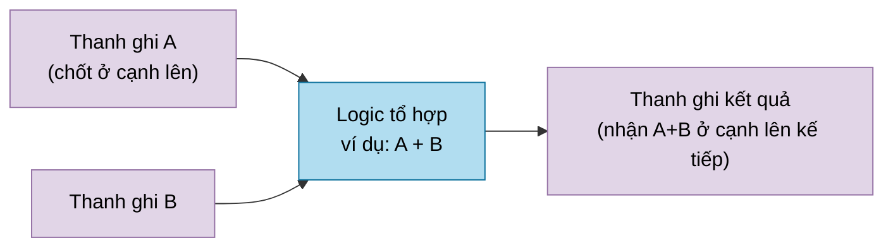
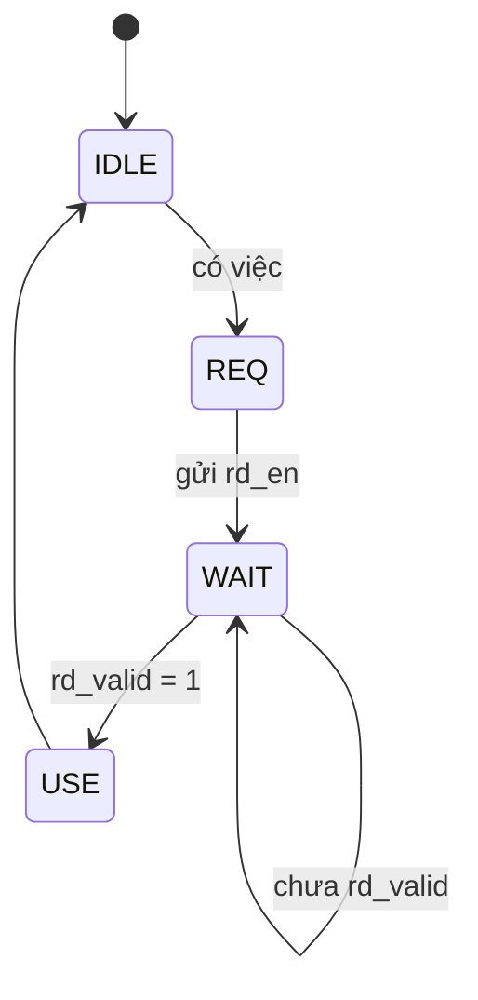
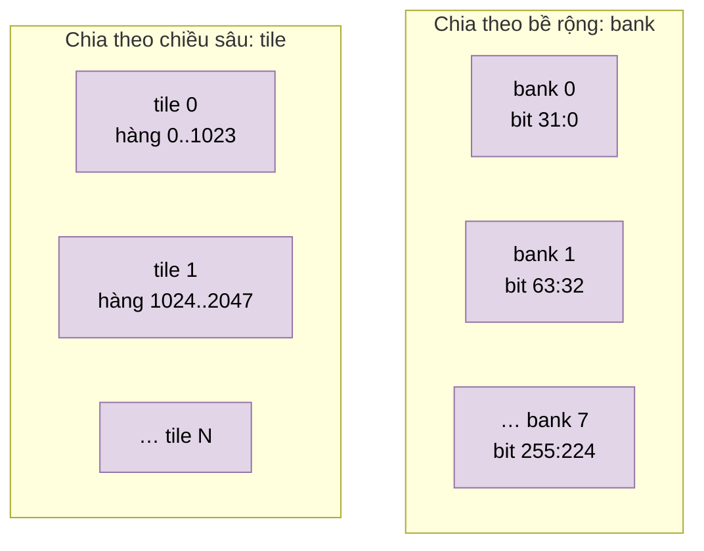
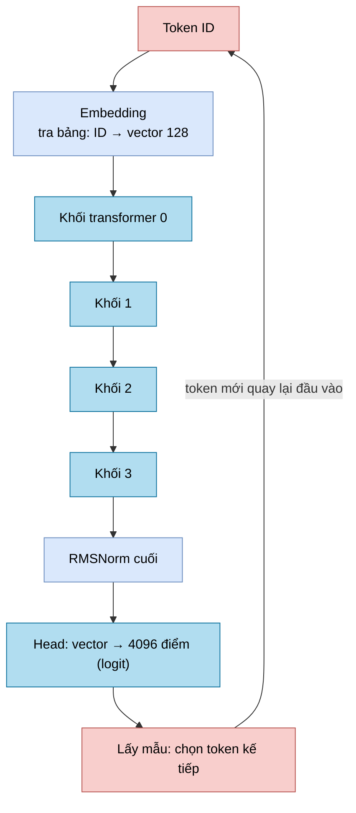
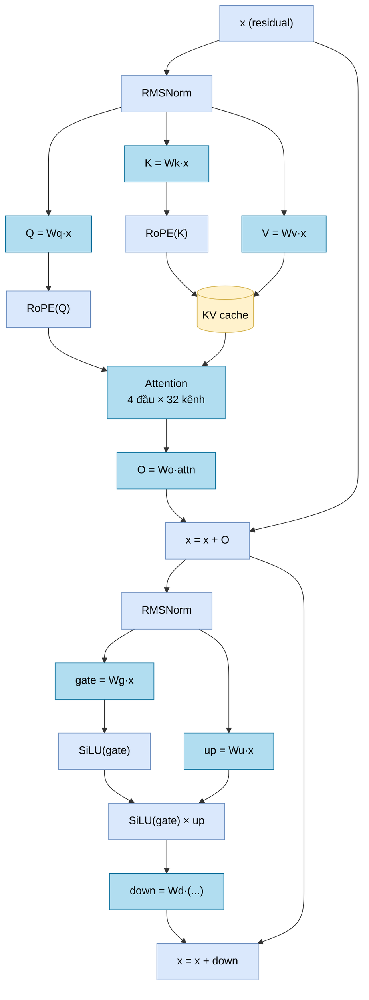

# 00 — Kiến thức nền: đọc file này trước

Bộ tài liệu này không giả định bạn đã quen với thiết kế phần cứng số, số học fixed-point hay mô hình ngôn ngữ lớn (LLM). Mọi khái niệm mà các tài liệu module dùng đến đều được giải thích ở đây, theo thứ tự từ cơ bản đến nâng cao, kèm ví dụ bằng số. Khi tài liệu module nhắc đến một thuật ngữ mà bạn chưa rõ, hãy quay lại mục tương ứng ở file này.

**Thứ tự đọc gợi ý:**

1. File này: kiến thức nền.
2. [01_tong_quan_kien_truc.md](01_tong_quan_kien_truc.md): NPU gồm những khối nào và chúng nối với nhau ra sao.
3. [02_hoat_dong_chi_tiet_llm_soc.md](02_hoat_dong_chi_tiet_llm_soc.md): `llm_soc` chạy một mô hình ngôn ngữ từng bước như thế nào.
4. [03_npu_legacy_matmulfree.md](03_npu_legacy_matmulfree.md): NPU thế hệ trước, chạy theo lệnh.
5. Thư mục `modules/`: mỗi module một file, đọc khi cần đi sâu.
6. `diagrams/npu_architecture.drawio`: sơ đồ trực quan, mở bằng draw.io / diagrams.net.

---

## 1. Phần cứng số trong 10 phút

### 1.1 RTL, module, SystemVerilog

- **SystemVerilog** là ngôn ngữ mô tả phần cứng. Khác với C, nó không "chạy từng dòng": mỗi dòng mô tả một mạch điện, và mọi mạch hoạt động **song song cùng lúc**.
- **RTL** (Register-Transfer Level) là cách mô tả mạch bằng các **thanh ghi** (nơi lưu giá trị) và **logic** tính giá trị mới cho thanh ghi.
- **Module** là một khối mạch có cổng vào/ra, tương tự một linh kiện. Một module có thể chứa module khác (gọi là **instance**). Cây chứa nhau đó gọi là **hierarchy**. Module ngoài cùng là **top**.
- **Tổng hợp** (synthesis) là bước công cụ (Quartus cho FPGA, hoặc công cụ ASIC) biến RTL thành cổng logic thật.

### 1.2 Clock, cạnh lên và thanh ghi

- **Clock** (`clk`) là tín hiệu vuông, lặp đều. Ví dụ 100 MHz nghĩa là 100 triệu chu kỳ mỗi giây, mỗi chu kỳ 10 ns.
- **Cạnh lên** (rising edge, `posedge clk`) là thời điểm clock chuyển từ 0 lên 1.
- **Flip-flop / thanh ghi** (register): phần tử nhớ 1 bit (hoặc nhiều bit). Nó chỉ **chép giá trị đầu vào sang đầu ra tại cạnh lên**; giữa hai cạnh, đầu ra đứng yên. Trong RTL viết bằng `always_ff @(posedge clk)` và phép gán `<=`.
- **Logic tổ hợp** (combinational): mạch không có bộ nhớ, đầu ra thay đổi ngay khi đầu vào đổi (sau một độ trễ điện rất nhỏ). Ví dụ: cộng, AND, mux. Trong RTL viết bằng `assign` hoặc `always_comb`.

Hình dung: thanh ghi là các "trạm dừng", logic tổ hợp là "con đường" giữa các trạm. Mỗi cạnh clock, dữ liệu nhảy qua đúng một chặng đường.

### 1.3 "Độ trễ N cạnh" (latency)

Các tài liệu đo độ trễ bằng **số cạnh clock** từ lúc đặt yêu cầu đến lúc có kết quả. Ví dụ "đọc RAM mất 3 cạnh":

- ở chu kỳ 0 bạn đặt `rd_en = 1` và địa chỉ;
- sau cạnh 1, cạnh 2, cạnh 3, dữ liệu xuất hiện ở `rd_data` cùng `rd_valid = 1`.

**Throughput** (thông lượng) khác latency: một mạch có thể mất 4 cạnh cho mỗi kết quả nhưng vẫn nhận một yêu cầu mới **mỗi chu kỳ**. Lúc đó throughput là 1 kết quả/chu kỳ.

### 1.4 Pipeline

**Pipeline** là cách chia một phép tính dài thành nhiều tầng, mỗi tầng ngăn bởi thanh ghi, giống dây chuyền lắp ráp. Ví dụ cộng 32 số:

- **không pipeline:** một mạch cộng rất dài, clock phải chậm để kịp tính;
- **có pipeline 4 tầng:** mỗi tầng chỉ cộng một phần, clock chạy nhanh hơn, và mỗi chu kỳ nhận được một bộ 32 số mới.

Khi đọc các bảng "Cạnh | Việc xảy ra" trong tài liệu module, mỗi dòng là một tầng pipeline.

**Tại sao lại phải pipeline?** Tần số tối đa (**Fmax**) của mạch bị giới hạn bởi **đường găng** (critical path), tức con đường logic tổ hợp dài nhất giữa hai thanh ghi. Chèn thêm thanh ghi làm đường ngắn lại, nên Fmax tăng.

### 1.5 Tín hiệu `valid`, `start`, `done`, `busy`

Vì các khối có độ trễ khác nhau, mạch cần một cách nói "dữ liệu lúc này có ý nghĩa":

| Tín hiệu | Ý nghĩa |
|---|---|
| `valid` | Bằng 1 khi dữ liệu đi kèm là thật. Khi bằng 0, bỏ qua dữ liệu |
| `start` | Xung 1 chu kỳ để bắt đầu một phép tính nhiều chu kỳ |
| `done` | Xung (hoặc mức) báo phép tính đã xong, kết quả đọc được |
| `busy` | Khối đang bận, chưa nhận việc mới |
| `ready` | Khối sẵn sàng nhận yêu cầu |

Pipeline thường mang theo một **chuỗi bit valid** đi song song với dữ liệu: bit valid dịch qua từng tầng cùng lúc với dữ liệu, nên cuối pipeline biết ngay dữ liệu nào hợp lệ.

### 1.6 Reset

- **Reset** (`rst_n`; chữ `_n` nghĩa là tích cực mức thấp, tức `rst_n = 0` là đang reset) đưa mạch về trạng thái ban đầu.
- **Reset bất đồng bộ:** có hiệu lực ngay, không chờ clock (`always_ff @(posedge clk or negedge rst_n)`).
- **Reset đồng bộ:** chỉ có hiệu lực tại cạnh clock.
- Thiết kế này **không reset nội dung RAM** và nhiều thanh ghi dữ liệu ("payload"). Nó chỉ reset các bit điều khiển như valid, enable và trạng thái FSM. Lý do: reset hàng nghìn bit dữ liệu tốn diện tích và dây nối, trong khi dữ liệu đó vô nghĩa cho đến khi bit valid tương ứng bật.

### 1.7 FSM (máy trạng thái)

**FSM** (Finite State Machine) là bộ điều khiển: một thanh ghi `state` cùng các luật "đang ở trạng thái X, nếu điều kiện Y thì sang trạng thái Z". Ví dụ FSM pha "đọc RAM":

- **One-hot**: mã hóa trạng thái sao cho mỗi trạng thái là một bit riêng. Ví dụ 87 trạng thái thì dùng 87 bit, và đúng một bit bằng 1. Kiểm tra "đang ở trạng thái X" chỉ cần đọc 1 bit, nên rất nhanh. `llm_soc` dùng one-hot cho FSM `op`.
- **Trạng thái không reachable**: trạng thái có trong mã nhưng không đường chuyển nào dẫn tới. [modules/llm_soc.md](modules/llm_soc.md) §5 liệt kê 25 trạng thái như vậy đã được gỡ khỏi `llm_soc`.
- **Return address**: một số "chương trình con" của FSM (ví dụ "đọc một hàng tham số") được gọi từ nhiều nơi. Trước khi gọi, FSM lưu "trạng thái quay về" vào một thanh ghi `return_*`, giống lệnh `call/ret` trong CPU.

### 1.8 SIMD và làn (lane)

**SIMD** (Single Instruction, Multiple Data) là làm cùng một phép tính trên nhiều số cùng lúc. `llm_soc` có **32 làn**: một vector 32 phần tử được cộng, nhân, làm tròn đồng thời bởi 32 mạch giống hệt nhau. Mỗi mạch là một **làn**.

---

## 2. Bộ nhớ

### 2.1 SRAM đồng bộ

- **SRAM** là bộ nhớ trên chip, lưu nhiều **word** (từ). Ví dụ "1024 × 32" nghĩa là 1024 word, mỗi word 32 bit.
- **Hàng** (row) là một địa chỉ. Với RAM rộng (256 bit hoặc 768 bit), "hàng" chứa nhiều số nhỏ.
- **Đọc đồng bộ**: đặt địa chỉ ở chu kỳ n, dữ liệu ra ở chu kỳ n+1 (hoặc muộn hơn nếu có thêm tầng thanh ghi). Không thể đọc "ngay lập tức" như một biến trong C.
- **Port**: cổng truy cập. "1 port đọc + 1 port ghi" nghĩa là mỗi chu kỳ đọc được một địa chỉ và ghi được một địa chỉ khác.
- **Va chạm đọc-ghi**: đọc và ghi cùng địa chỉ trong cùng chu kỳ. Thiết kế này luôn trả **dữ liệu cũ** (giá trị trước khi ghi), gọi là `OLD_DATA`.

### 2.2 Bank, tile, mask

- **Bank**: chia RAM rộng thành nhiều RAM hẹp đặt cạnh nhau. Ví dụ RAM 256 bit = 8 bank × 32 bit. Muốn ghi chỉ 32 bit thì chỉ bật ghi ở 1 bank; đó là **mask ghi** (write mask).
- **Tile**: chia RAM sâu thành nhiều RAM nông xếp chồng. Ví dụ RAM 24576 hàng = 24 tile × 1024 hàng. Địa chỉ cao chọn tile, địa chỉ thấp chọn hàng trong tile. Tile giúp mỗi khối nhỏ dễ đặt, dễ đạt tần số.

### 2.3 Hazard đọc-sau-ghi (RAW)

Nếu ghi vào hàng X rồi đọc hàng X ngay sau đó, nhưng phép ghi vẫn đang nằm trong pipeline, phép đọc sẽ lấy được giá trị cũ. Đó là **RAW hazard** (Read After Write). Thiết kế tránh bằng tín hiệu `wr_busy`: còn phép ghi chưa xong thì chưa đọc.

### 2.4 FPGA và ASIC

- **FPGA** (ví dụ Intel Cyclone V) có sẵn khối RAM cứng (**M10K**, 10 kbit mỗi khối). Quartus dùng IP `altsyncram` để gọi chúng.
- **ASIC** (chip đặt làm) dùng **SRAM macro** của nhà máy (foundry).
- Thiết kế cô lập phần phụ thuộc công nghệ trong một module lá (`quartus_word_ram`). Mọi logic tính toán khác là **portable**: tổng hợp được cho cả FPGA lẫn ASIC.

---

## 3. Biểu diễn số

### 3.1 Số nguyên không dấu và có dấu

- **Không dấu** (unsigned) n bit: biểu diễn được 0 … 2ⁿ − 1.
- **Có dấu bù hai** (two's complement) n bit: biểu diễn được −2ⁿ⁻¹ … 2ⁿ⁻¹ − 1. Bit cao nhất là bit dấu. Ví dụ 8 bit: `0111_1111` = 127, `1000_0000` = −128, `1111_1111` = −1.
- **Mở rộng dấu** (sign extension): muốn đổi số có dấu 8 bit thành 24 bit thì chép bit dấu sang các bit mới. Ví dụ −1 (`FF`) thành `FFFFFF`.

**Ký hiệu trong tài liệu:** `S24` = có dấu 24 bit; `U25` = không dấu 25 bit; `S8` = có dấu 8 bit (int8).

### 3.2 Số fixed-point (dấu chấm tĩnh)

Phần cứng này **không dùng số thực dấu chấm động** (float). Thay vào đó, một số thực được lưu như một số nguyên đã nhân với 2ⁿ. Đó là **fixed-point** dạng Q:

> Giá trị thực = số nguyên lưu trong thanh ghi ÷ 2^(số bit phân số)

Ví dụ với **16 bit phân số** (chia cho 65536):

| Số nguyên lưu | Giá trị thực |
|---|---|
| 65536 | 1.0 |
| 32768 | 0.5 |
| −98304 | −1.5 |
| 1 | 0.0000153 (bước nhỏ nhất) |

Activation của `llm_soc` là **S24 với 16 bit phân số**: 1 bit dấu, 7 bit phần nguyên, 16 bit phần lẻ. Khoảng biểu diễn là −128 … +127.99998.

Các hằng khác dùng số bit phân số khác nhau. Ví dụ bảng cos/sin của RoPE có 15 bit phân số (1.0 = 32768), và hệ số scale của ma trận có 24 bit phân số. Mỗi tài liệu module ghi rõ định dạng của từng tín hiệu.

### 3.3 Nhân fixed-point cần dịch phải

Khi nhân hai số Q16, số bit phân số **cộng lại**: Q16 × Q16 = Q32. Muốn quay về Q16 phải **dịch phải 16 bit** (chia 2¹⁶).

Ví dụ: 1.5 × 2.0
- 1.5 → 98304, 2.0 → 131072
- 98304 × 131072 = 12 884 901 888 (Q32)
- dịch phải 16 → 196608 = 3.0 trong Q16 ✔

Đó là lý do trong RTL hay thấy `rne_shift64(x, 16)`, `rne_shift64(x, 24)`… sau mỗi phép nhân.

### 3.4 Làm tròn: cắt bỏ và RNE

Dịch phải bỏ đi các bit thấp, nên phải chọn cách làm tròn:

- **Cắt bỏ** (truncate, `>>>`): luôn làm tròn xuống (về phía −∞). Sai số tích lũy lệch về một phía.
- **RNE** (Round to Nearest, ties to Even): làm tròn tới giá trị gần nhất. Nếu đúng ở giữa hai giá trị thì chọn giá trị **chẵn**. Đây cũng là chuẩn của số thực IEEE-754, và sai số trung bình bằng 0.

Ví dụ chia cho 4 (dịch phải 2) với RNE:

| x | x / 4 chính xác | Cắt bỏ | RNE |
|---|---|---|---|
| 5 | 1.25 | 1 | 1 |
| 6 | 1.5 (ở giữa) | 1 | **2** (chẵn) |
| 10 | 2.5 (ở giữa) | 2 | **2** (chẵn) |
| 7 | 1.75 | 1 | 2 |
| −6 | −1.5 (ở giữa) | −2 | **−2** (chẵn) |

Cách phần cứng làm RNE được mô tả trong [modules/npu_pkg.md](modules/npu_pkg.md) §4.1.

### 3.5 Bão hòa (saturation)

Khi kết quả vượt khỏi khoảng biểu diễn, phép cộng thông thường sẽ **tràn vòng** (wrap): 127 + 1 thành −128 ở 8 bit, một sai số khổng lồ. **Bão hòa** thay vào đó kẹp kết quả về giá trị lớn nhất hoặc nhỏ nhất: 127 + 1 → 127. Các hàm `llm_sat24`, `sat_s16`, `sat_s32` làm việc này. Tên trạng thái `*_CLAMP` trong FSM cũng nghĩa là "bão hòa".

### 3.6 Scale dạng mantissa × 2^−shift

Muốn nhân với một hằng số thực như 0.0123 mà không có float, thiết kế lưu hằng đó dưới dạng **số nguyên m và số mũ r**: giá trị ≈ m / 2ʳ. Phép nhân trở thành "nhân nguyên rồi dịch phải r bit, làm tròn RNE". Descriptor ma trận của NPU legacy dùng `scale_m` (24 bit) và `scale_r` (6 bit). `llm_soc` dùng hệ số 24 bit với 24 bit phân số.

---

## 4. Mạch số học

### 4.1 Nhân không dùng DSP

FPGA có khối nhân cứng (DSP), nhưng thiết kế này cố ý viết phép nhân bằng logic thường (`logic_mul`) để mang sang ASIC giống hệt. Ý tưởng giống nhân tay:

1. Mỗi bit của B tạo ra một **tích riêng phần** (partial product): A dịch trái, nếu bit đó bằng 1, hoặc 0 nếu bit đó bằng 0.
2. Cộng tất cả tích riêng phần lại.

Cộng nhiều số liền nhau rất chậm. Thiết kế dùng **CSA** (Carry-Save Adder): bộ nén "3 số thành 2 số" không lan truyền nhớ, xếp thành cây. Chỉ ở bước cuối mới dùng một phép cộng thường. Xem [modules/logic_mul.md](modules/logic_mul.md).

### 4.2 Chia và căn bậc hai lặp

- **Chia restoring** (`div`): giống chia tay ở hệ nhị phân. Mỗi chu kỳ thử trừ số chia khỏi phần dư; nếu không âm thì bit thương bằng 1, ngược lại bằng 0. Chia 64 bit mất khoảng 64 chu kỳ.
- **Căn bậc hai nguyên** (`isqrt_u64`): tương tự, mỗi chu kỳ tìm ra một bit của kết quả.

Chúng chậm (nhiều chu kỳ) nhưng nhỏ. Vì chỉ dùng vài lần cho mỗi vector, chúng không phải nút thắt cổ chai.

### 4.3 Bảng tra (LUT) và nội suy

Hàm như sigmoid hay eˣ rất tốn để tính chính xác. Thiết kế lưu sẵn các **điểm mẫu** của hàm trong một bảng (LUT, Look-Up Table, các file `*_lut.svh`). Bảng sigmoid và bảng e⁻ˣ mỗi bảng có **257 điểm** (256 khoảng + 1 điểm cuối). Với x bất kỳ:

1. dùng bit cao của x để chọn hai điểm mẫu kề nhau;
2. dùng bit thấp để **nội suy tuyến tính** giữa hai điểm (một phép nhân nhỏ).

Ví dụ: nếu x nằm 25 % quãng đường từ điểm `y0 = 100` tới `y1 = 140`, kết quả là `100 + 0,25 × (140 − 100) = 110`.

Bảng Gumbel (dùng khi lấy mẫu token) có **256 điểm** và được tra trực tiếp bằng 8 bit ngẫu nhiên, không nội suy.

### 4.4 Trọng số ternary (ba giá trị)

Mạng nơ-ron thường có trọng số là số thực. Mô hình ở đây được huấn luyện để mỗi trọng số chỉ là **−1, 0 hoặc +1** (ternary), lưu bằng **2 bit**:

| Mã 2 bit | Trọng số |
|---|---|
| `00` | 0 |
| `01` | +1 |
| `11` | −1 |
| `10` | Không hợp lệ: phần cứng báo lỗi (`reserved`) |

Lợi ích: **phép nhân biến mất**. Nhân x với +1 là giữ nguyên x, với −1 là đổi dấu, với 0 là bỏ qua. Tích vô hướng 32 phần tử chỉ còn là một cây cộng (xem [modules/ternary_dot32.md](modules/ternary_dot32.md)). Đây là ý nghĩa của tên **"matmul-free"**: nhân ma trận không cần bộ nhân.

Độ lớn thật của trọng số được bù bằng **một hệ số scale chung cho cả ma trận**, nhân một lần sau khi cộng xong.

---

## 5. Mô hình ngôn ngữ lớn (LLM) cần biết đến đâu

### 5.1 Token và từ vựng

- Văn bản được cắt thành các mảnh gọi là **token**. Mỗi token có một số hiệu (ID). Mô hình này có **từ vựng** (vocabulary) 4096 token, nên ID dài 12 bit.
- Host gửi các ID của câu mở đầu (**prompt**). NPU sinh tiếp từng ID một.

### 5.2 Vector ẩn (hidden state)

Mỗi token được biểu diễn bằng **một vector 128 số** (128 kênh, channel). Trong `llm_soc`, vector đó được lưu thành **4 hàng × 32 làn** S24.

### 5.3 Một lượt suy luận

| Bước | Giải thích đơn giản |
|---|---|
| **Embedding** | Tra hàng thứ ID trong một bảng 4096 × 128 để lấy vector của token |
| **Khối transformer** (×4) | Trộn thông tin giữa các token (attention) rồi biến đổi từng token (MLP) |
| **RMSNorm** | Chuẩn hóa: chia vector cho căn của trung bình bình phương các phần tử, rồi nhân với hệ số học được (gain). Giữ độ lớn vector ổn định |
| **Head** | Nhân vector với ma trận 4096 × 128, được một điểm (logit) cho mỗi token trong từ vựng |
| **Lấy mẫu** (sampling) | Chọn token kế tiếp từ các logit |

### 5.4 Bên trong một khối transformer

- **Linear** (W·x): nhân ma trận trọng số với vector. Ở đây W là ternary.
- **Q, K, V** (Query, Key, Value): ba phép chiếu của cùng một vector. Q là "tôi đang tìm gì", K là "tôi chứa gì", V là "nội dung tôi đưa ra".
- **RoPE** (Rotary Position Embedding): xoay từng cặp phần tử của Q và K một góc phụ thuộc **vị trí** của token, để attention biết thứ tự. Phép xoay dùng cos/sin tra từ bảng: `(a, b) → (a·cos − b·sin, a·sin + b·cos)`.
- **Attention**: với token hiện tại, tính điểm tương đồng `score = Q·K` với **mọi token trước đó**, chuẩn hóa bằng **softmax** (`p_i = e^(score_i) / Σ e^(score_j)`, cho các trọng số dương có tổng 1), rồi lấy tổng có trọng số các V. **Multi-head**: làm 4 lần độc lập, mỗi lần trên 32 kênh.
- **KV cache**: K và V của các token cũ được lưu lại, khỏi phải tính lại ở mỗi bước. Kích thước: 4 khối × 128 vị trí × (K, V) × 4 đầu.
- **Residual add**: cộng đầu ra của nhánh vào chính đầu vào (`x = x + …`). Giúp mạng sâu ổn định.
- **MLP có cổng** (gated MLP): `down(SiLU(gate(x)) × up(x))`. **SiLU**(x) = x · sigmoid(x), một hàm kích hoạt mềm.

### 5.5 Prefill và decode

- **Prefill**: đưa lần lượt từng token của prompt qua mô hình để lấp KV cache. Logit ở giữa prompt không cần dùng.
- **Decode**: sau prompt, mỗi lượt sinh **một** token mới, đưa nó trở lại đầu vào. Lặp cho đến khi đủ số token yêu cầu. Kiểu "sinh từng token, đưa lại làm đầu vào" gọi là **tự hồi quy** (autoregressive).
- **CONTEXT = 128**: tổng số vị trí (prompt + token sinh ra) tối đa.

### 5.6 Lấy mẫu: greedy, temperature, Gumbel-max

- **Greedy** (temperature = 0): luôn chọn token có logit lớn nhất. Kết quả lặp lại y hệt mỗi lần chạy.
- **Temperature > 0**: chọn ngẫu nhiên, nhưng token có logit lớn có xác suất cao hơn. Temperature càng lớn thì càng "liều".
- **Gumbel-max**: một mẹo lấy mẫu không cần softmax. Cộng vào mỗi logit một nhiễu ngẫu nhiên có phân phối Gumbel (nhân với temperature), rồi chọn giá trị lớn nhất. Về toán học, kết quả tương đương lấy mẫu từ softmax. Nhiễu được tạo từ bộ sinh số giả ngẫu nhiên **xorshift32** (`llm_random_next` trong `llm_pkg`) và bảng `llm_gumbel_lut.svh`.

---

## 6. Bảng thuật ngữ

| Thuật ngữ | Nghĩa ngắn |
|---|---|
| NPU | Neural Processing Unit, bộ xử lý chuyên cho mạng nơ-ron |
| SoC | System on Chip; ở đây `llm_soc` là top chạy trọn mô hình |
| Host | Máy/CPU bên ngoài điều khiển NPU qua cổng 32 bit |
| Top | Module ngoài cùng của thiết kế |
| Instance | Một bản sao cụ thể của module bên trong module khác |
| Cạnh | Một cạnh lên clock, đơn vị đo độ trễ |
| Payload | Phần dữ liệu (khác với bit điều khiển như valid) |
| Fanout | Số đầu vào mà một tín hiệu phải kéo. Fanout lớn làm chậm mạch |
| Mux | Bộ chọn: chọn một trong nhiều đầu vào |
| AND-OR mux | Mux làm bằng cách AND mỗi đầu vào với bit chọn rồi OR lại |
| Descriptor | Bản ghi mô tả một tensor/ma trận (địa chỉ, độ dài, định dạng…) |
| Tensor | Mảng số nhiều chiều; ở đây chủ yếu là vector |
| Logit | Điểm thô của mỗi token trước khi chọn |
| Channel / kênh | Một phần tử của vector ẩn |
| Head / đầu | Một nhánh attention độc lập (32 kênh) |
| Fmax | Tần số clock tối đa mà mạch chạy đúng |
| Đường găng | Đường logic dài nhất giữa hai thanh ghi |
| LUT | Bảng tra giá trị hàm |
| RNE | Làm tròn gần nhất, hòa thì về số chẵn |
| Bão hòa / clamp | Kẹp kết quả vào khoảng biểu diễn được |
