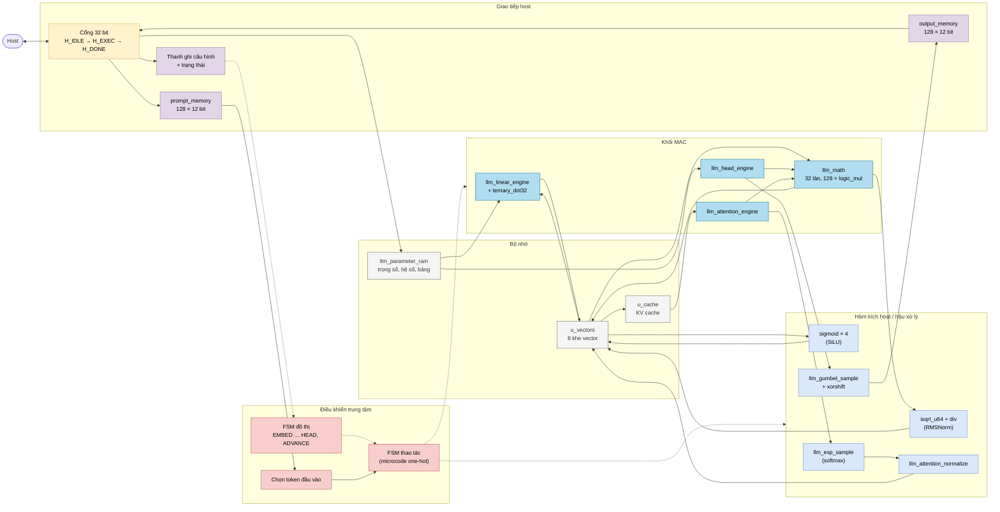
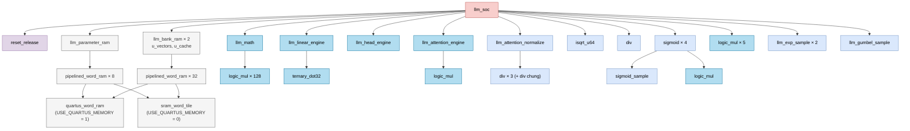
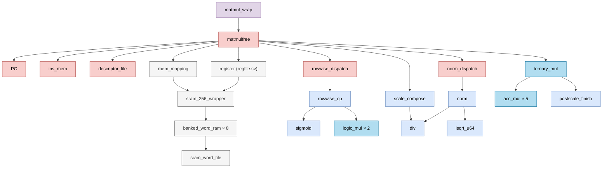

# 01: Tổng quan kiến trúc NPU

Tài liệu này là điểm bắt đầu. Nó giải thích repo chứa gì, các khối ghép với nhau thế nào và nên đọc file nào tiếp theo. Mọi nội dung được rút ra trực tiếp từ mã nguồn `.sv` / `.svh` trong thư mục `Verilog Source code/`.

| Tài liệu | Nội dung |
|---|---|
| [00_kien_thuc_nen.md](00_kien_thuc_nen.md) | Kiến thức nền: clock, FSM, SRAM, fixed-point, transformer |
| **01_tong_quan_kien_truc.md** (file này) | Bức tranh tổng thể, cây module, chỉ mục |
| [02_hoat_dong_chi_tiet_llm_soc.md](02_hoat_dong_chi_tiet_llm_soc.md) | NPU chính `llm_soc` hoạt động từng bước |
| [03_npu_legacy_matmulfree.md](03_npu_legacy_matmulfree.md) | NPU cũ `matmulfree` chạy chương trình lệnh |
| [modules/](modules/) | 42 tài liệu, mỗi module một file |
| [diagrams/npu_architecture.drawio](diagrams/npu_architecture.drawio) | Sơ đồ draw.io nhiều trang (mở bằng draw.io / diagrams.net) |

## 0. Kiến thức cần biết trước

**NPU là gì?** NPU (Neural Processing Unit) là mạch chuyên dụng chạy mạng nơ-ron. So với CPU, nó bỏ đi sự linh hoạt: không có bộ giải mã lệnh phức tạp hay cache. Đổi lại, nó có nhiều bộ nhân/cộng chạy song song và bộ nhớ được sắp sẵn theo đúng cách mạng nơ-ron truy cập dữ liệu.

**Host.** NPU không tự lấy dữ liệu từ ổ đĩa hay mạng. Một bộ điều khiển bên ngoài gọi là *host* (CPU, vi điều khiển hoặc máy tính qua JTAG) làm việc đó. Host ghi tham số và dữ liệu vào bộ nhớ của NPU qua một cổng 32 bit đơn giản (`host_en`, `host_we`, `host_addr`, `host_wdata` → `host_rdata`, `host_ready`). Sau đó host ra lệnh chạy và đọc kết quả. Ví dụ: ghi 1 vào địa chỉ 0x40000C nghĩa là "bắt đầu sinh văn bản".

**Hai cách điều khiển một NPU.**

| Cách | Ý tưởng | Ví dụ trong repo |
|---|---|---|
| Có tập lệnh (programmable) | Host nạp một chương trình gồm các lệnh như `NORM`, `TMATMUL`, `RELU`. NPU đọc và chạy từng lệnh | `matmulfree` (legacy) |
| Đồ thị cố định (fixed-function) | Trình tự tính toán của mô hình được "đúc" vào FSM phần cứng. Host chỉ nạp tham số và bấm chạy | `llm_soc` (chính) |

Cách thứ hai kém linh hoạt hơn nhưng không tốn thời gian giải mã lệnh. Nó cũng kiểm tra được mọi điều kiện ngay trong phần cứng.

**Cách đọc màu trong sơ đồ.** Mọi sơ đồ (Mermaid và draw.io) dùng cùng một bảng màu:

| Màu | Lớp | Nghĩa |
|---|---|---|
| Đỏ nhạt `#f8cecc` | ctrl | Điều khiển: FSM, bộ đếm, giải mã |
| Vàng `#fff2cc` | move | Di chuyển dữ liệu: giao tiếp host, đọc/ghi bộ nhớ |
| Xám `#f5f5f5` | param | Bộ nhớ lớn: tham số, vector, KV cache |
| Xanh đậm `#b1ddf0` | mac | Nhân-cộng (MAC), tích vô hướng |
| Xanh nhạt `#dae8fc` | act | Hàm kích hoạt, chuẩn hóa, làm tròn, bảng tra |
| Tím `#e1d5e7` | reg | Thanh ghi, bộ đệm nhỏ, hạ tầng |

Mũi tên liền là dữ liệu. Mũi tên đứt là tín hiệu điều khiển.

## 1. Hai NPU trong cùng một repo

| | `llm_soc` (chính) | `matmulfree` (legacy) |
|---|---|---|
| Mục đích | Sinh văn bản bằng mô hình NanoFable (4 lớp transformer) | Chạy các phép mạng nơ-ron không dùng phép nhân ma trận số thực ("MatMul-free") |
| Điều khiển | FSM đồ thị 24 pha + FSM thao tác 87 trạng thái | Chương trình 13 bit, tối đa 512 lệnh |
| Dữ liệu | S24 Q16, 32 làn / hàng 768 bit | S16 / int8, 16 hoặc 32 làn / từ 256 bit |
| Trọng số | Ternary 2 bit (ma trận), int8 (embedding) | Ternary 2 bit |
| Bộ nhớ tham số | 24 576 × 256 bit = 768 KiB | 1024 × 256 bit = 32 KiB |
| Bộ nhớ dữ liệu | Vector 96 × 768 bit + KV cache 4096 × 768 bit | Workspace 256 × 256 bit = 8 KiB |
| Top FPGA | `llm_soc` | `matmul_wrap` → `matmulfree` |

Hai thiết kế dùng chung một số khối số học như `logic_mul`, `div`, `isqrt_u64` và `sigmoid`, nhưng **không** nối với nhau. Mỗi thiết kế là một top riêng.

## 2. Kiến trúc tổng quát của `llm_soc`

Sơ đồ dưới chia NPU thành 5 khu vực theo kiểu sơ đồ khối của các NPU thương mại:

1. Giao tiếp host.
2. Điều khiển trung tâm.
3. Bộ nhớ.
4. Khối tính toán MAC.
5. Khối hàm kích hoạt / hậu xử lý.

**Ý tưởng chính:**

- **Một bộ nhân vector dùng chung.** `llm_math` (32 làn) phục vụ embedding, RMSNorm, RoPE, attention, SiLU, nhân phần tử và output head. FSM thao tác xếp lịch cho từng việc lần lượt. Riêng nhân ma trận ternary đi qua `ternary_dot32`, vì nó chỉ cần cộng/trừ, không cần nhân.
- **Dữ liệu ở trong chip.** Toàn bộ trạng thái của một bước suy luận nằm trong 8 khe của `u_vectors`. Host chỉ đọc kết quả cuối cùng, tức là các token.
- **Kiểm tra mọi thứ.** Mã trọng số `10`, metadata ma trận sai và cấu hình launch sai đều dừng NPU với `error = 1`, không âm thầm cho ra kết quả rác.

## 3. Cây module

### 3.1 `llm_soc`

`llm_pkg` (package) cung cấp hằng số và kéo theo hai bảng `llm_exp_sample`, `llm_gumbel_sample`.

### 3.2 `matmulfree` (legacy)

`npu_pkg` (package) cung cấp hằng số, kiểu descriptor và hàm kiểm tra cho nhánh này. Các hàm làm tròn/bão hòa của nó (`rne_shift64`, `sat_s16`, `sat_s32`) cũng được `llm_soc`, `llm_attention_engine` và `sigmoid` import.

### 3.3 Trường hợp đặc biệt

| Trường hợp | Chi tiết |
|---|---|
| Tên file ≠ tên module | `regfile.sv` chứa module `register` |
| Module trong file `.svh` | `llm_exp_sample` (`llm_exp_lut.svh`), `llm_gumbel_sample` (`llm_gumbel_lut.svh`), `sigmoid_sample` (`sigmoid_lut.svh`) |
| Một file hai module | `mul.sv` chứa `mul` và `addsub`; `postscale.sv` chứa `postscale` và `postscale_finish` |
| Không ai khởi tạo | `addsub`, `mul`, `postscale`: các mạch tham chiếu dùng cho kiểm thử số học. Chỉ `postscale_finish` được `ternary_mul` dùng lại |
| Lá công nghệ | `quartus_word_ram` là nơi **duy nhất** dùng IP của Intel/Altera (`altsyncram`). Mọi khối khác là SystemVerilog di động |

## 4. Nhóm chức năng

| Nhóm | `llm_soc` | `matmulfree` | Dùng chung |
|---|---|---|---|
| Điều khiển | `llm_soc` (FSM), `reset_release` | `matmulfree`, `PC`, `ins_mem`, `descriptor_file`, `rowwise_dispatch`, `norm_dispatch` | |
| Bộ nhớ | `llm_parameter_ram`, `llm_bank_ram`, `pipelined_word_ram`, `quartus_word_ram` | `mem_mapping`, `register`, `sram_256_wrapper`, `banked_word_ram` | `sram_word_tile` |
| MAC | `llm_math`, `llm_linear_engine`, `ternary_dot32`, `llm_head_engine`, `llm_attention_engine` | `ternary_mul`, `acc_mul` | `logic_mul` |
| Kích hoạt / hậu xử lý | `llm_attention_normalize`, `llm_exp_sample`, `llm_gumbel_sample` | `rowwise_op`, `norm`, `scale_compose`, `postscale_finish` | `sigmoid`, `sigmoid_sample`, `div`, `isqrt_u64` |
| Package | `llm_pkg` | | `npu_pkg` (kiểu descriptor chỉ legacy dùng; hàm RNE/bão hòa cả hai dùng) |
| Tham chiếu (không được khởi tạo trong cây RTL) | | `mul`, `addsub`, `postscale` | |

## 5. Chỉ mục tài liệu module

### 5.1 `llm_soc` (NPU chính)

| Module | Vai trò |
|---|---|
| [llm_soc](modules/llm_soc.md) | Top: giao tiếp host, FSM đồ thị và FSM thao tác |
| [llm_pkg](modules/llm_pkg.md) | Hằng số, bản đồ tham số, hàm tiện ích |
| [llm_parameter_ram](modules/llm_parameter_ram.md) | SRAM tham số 256 bit |
| [llm_bank_ram](modules/llm_bank_ram.md) | RAM vector 32 làn × S24, ghi có mask |
| [llm_math](modules/llm_math.md) | Bộ nhân SIMD 32 làn + cây cộng |
| [llm_linear_engine](modules/llm_linear_engine.md) | Nhân ma trận ternary × vector |
| [ternary_dot32](modules/ternary_dot32.md) | Tích vô hướng 32 làn với trọng số ternary |
| [llm_head_engine](modules/llm_head_engine.md) | Tích vô hướng cho một hàng từ điển |
| [llm_attention_engine](modules/llm_attention_engine.md) | Điểm attention q·k |
| [llm_attention_normalize](modules/llm_attention_normalize.md) | Chia cho tổng xác suất softmax |
| [llm_exp_sample](modules/llm_exp_sample.md) | Bảng e⁻ˣ 257 mẫu |
| [llm_gumbel_sample](modules/llm_gumbel_sample.md) | Bảng nhiễu Gumbel 256 mẫu |

### 5.2 `matmulfree` (NPU legacy)

| Module | Vai trò |
|---|---|
| [matmul_wrap](modules/matmul_wrap.md) | Vỏ bọc board FPGA |
| [matmulfree](modules/matmulfree.md) | Top: nạp lệnh, giải mã, lập lịch |
| [npu_pkg](modules/npu_pkg.md) | Hằng số, kiểu descriptor, hàm kiểm tra |
| [PC](modules/PC.md) | Bộ đếm chương trình |
| [ins_mem](modules/ins_mem.md) | Bộ nhớ lệnh 512 × 13 bit |
| [descriptor_file](modules/descriptor_file.md) | Bảng descriptor workspace / ma trận |
| [register](modules/register.md) | Workspace 8 KiB (file `regfile.sv`) |
| [mem_mapping](modules/mem_mapping.md) | SRAM tham số 32 KiB |
| [sram_256_wrapper](modules/sram_256_wrapper.md) | SRAM 256 bit có cổng host 32 bit |
| [banked_word_ram](modules/banked_word_ram.md) | RAM chia tile 1024 hàng |
| [rowwise_dispatch](modules/rowwise_dispatch.md) | Lặp phép theo phần tử qua cả vector |
| [rowwise_op](modules/rowwise_op.md) | ALU theo phần tử (ADD, SUB, MUL, SIG, REC, RELU) |
| [norm_dispatch](modules/norm_dispatch.md) | Kiểm tra descriptor cho NORM |
| [norm](modules/norm.md) | RMSNorm + lượng tử hóa int8 |
| [ternary_mul](modules/ternary_mul.md) | Nhân ma trận ternary × int8 |
| [acc_mul](modules/acc_mul.md) | Cây cộng có dấu |
| [scale_compose](modules/scale_compose.md) | Ghép hệ số scale |
| [postscale_finish](modules/postscale_finish.md) | Cộng bias, bão hòa |
| [postscale](modules/postscale.md) | Mạch tham chiếu scale + bias |
| [mul](modules/mul.md) | Tế bào tham chiếu nhân S16 |
| [addsub](modules/addsub.md) | Tế bào tham chiếu cộng/trừ S16 |

### 5.3 Dùng chung

| Module | Vai trò |
|---|---|
| [logic_mul](modules/logic_mul.md) | Bộ nhân tổ hợp không dùng DSP |
| [div](modules/div.md) | Bộ chia tuần tự |
| [isqrt_u64](modules/isqrt_u64.md) | Căn bậc hai nguyên 64 bit |
| [sigmoid](modules/sigmoid.md) | Sigmoid bằng bảng + nội suy |
| [sigmoid_sample](modules/sigmoid_sample.md) | Bảng σ(x) 257 mẫu |
| [reset_release](modules/reset_release.md) | Đồng bộ nhả reset |
| [pipelined_word_ram](modules/pipelined_word_ram.md) | Bộ chuyển SRAM có pipeline |
| [sram_word_tile](modules/sram_word_tile.md) | Tile SRAM mô hình hóa |
| [quartus_word_ram](modules/quartus_word_ram.md) | Lá bộ nhớ FPGA (M10K) |

## 6. Lộ trình đọc gợi ý

1. [00_kien_thuc_nen.md](00_kien_thuc_nen.md): đọc mục 1 (phần cứng số), mục 3 (fixed-point) và mục 5 (transformer).
2. File này, mục 2: nắm 5 khu vực của `llm_soc`.
3. [02_hoat_dong_chi_tiet_llm_soc.md](02_hoat_dong_chi_tiet_llm_soc.md): đi theo một token qua toàn bộ NPU.
4. [modules/llm_soc.md](modules/llm_soc.md), sau đó các engine theo thứ tự `llm_math` → `ternary_dot32` → `llm_linear_engine` → `llm_attention_engine` → `llm_head_engine`.
5. Các khối nhỏ (`logic_mul`, `div`, `sigmoid`, …) khi cần hiểu sâu số học.
6. Nhánh legacy: [03_npu_legacy_matmulfree.md](03_npu_legacy_matmulfree.md).
