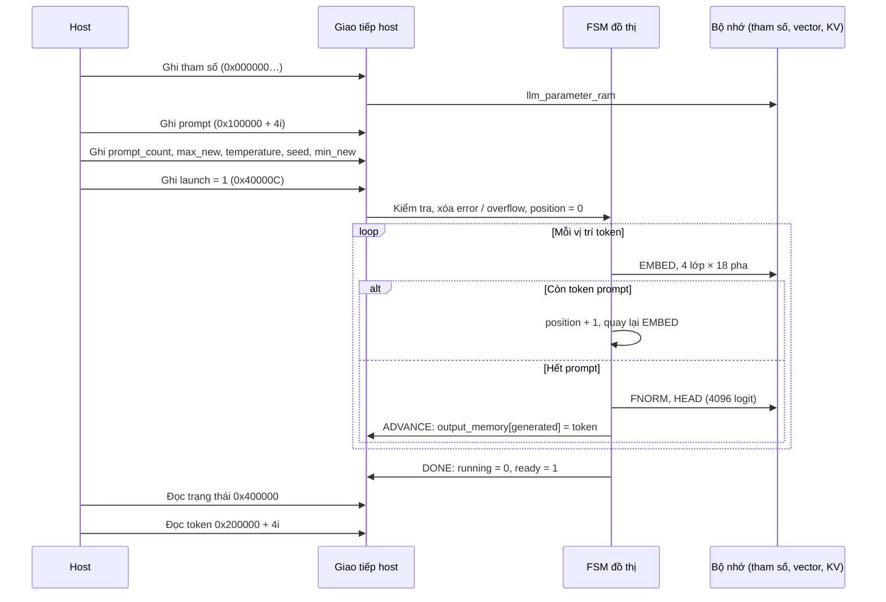
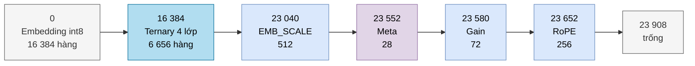
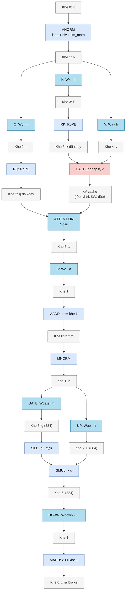
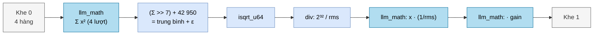
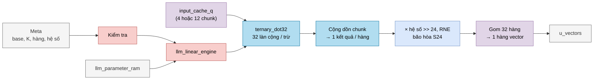
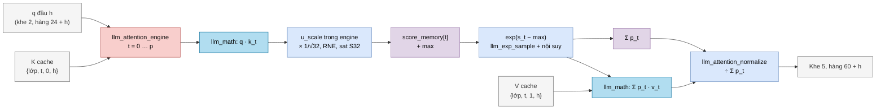
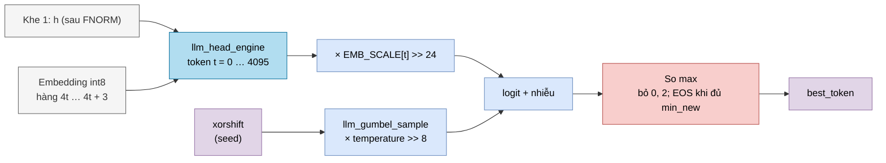

# 02: `llm_soc` hoạt động chi tiết, theo chân một token

Tài liệu này đi theo **một token** từ lúc host ghi prompt cho đến lúc token mới xuất hiện trong bộ nhớ kết quả. Ở mỗi bước, nó chỉ rõ dữ liệu nằm ở đâu, module nào làm việc và kết quả được ghi vào đâu. Phần chi tiết từng cổng và từng trạng thái nằm ở [modules/llm_soc.md](modules/llm_soc.md). Bản vẽ draw.io của FSM đồ thị, FSM thao tác và bản đồ bộ nhớ nằm ở các trang 03–05 của [diagrams/npu_architecture.drawio](diagrams/npu_architecture.drawio).

## 0. Kiến thức cần biết trước

Nếu chưa quen các khái niệm dưới đây, hãy đọc [00_kien_thuc_nen.md](00_kien_thuc_nen.md) mục 3 (fixed-point) và mục 5 (transformer) trước.

**Một vector = 4 hàng bộ nhớ.** Mỗi token được biểu diễn bằng 128 số. Bộ nhớ vector của `llm_soc` có hàng rộng 768 bit = 32 số × 24 bit. Vì vậy một vector 128 số nằm trong **4 hàng liên tiếp**, gọi là 4 *chunk*. Vector 384 số (lớp ẩn FFN) chiếm 12 hàng.

**S24 Q16.** Mỗi số là số có dấu 24 bit với 16 bit phân số. Giá trị thật = số nguyên / 65 536. Ví dụ 1,5 → 98 304; −0,25 → −16 384. Khoảng biểu diễn là −128 … +127,99998.

**"Khe" (slot).** `u_vectors` chia thành 8 khe, mỗi khe 12 hàng. Mỗi khe có vai trò cố định, ví dụ khe 0 luôn chứa vector dư x. Nhờ vậy FSM không cần cấp phát bộ nhớ động: địa chỉ của mọi thứ đã biết trước.

**Pha (phase).** FSM đồ thị chia một lớp transformer thành các pha. Mỗi pha làm một việc, như "tính q" hay "cộng dư". Trong một pha, FSM thao tác chạy một chuỗi trạng thái nhỏ: đọc, tính, ghi.

**Lượt 32 làn.** Đơn vị công việc trong tài liệu này là **một lượt**: một lần đưa 32 cặp số vào `llm_math` hoặc `ternary_dot32`. Nếu pipeline luôn đầy thì mỗi lượt tốn khoảng một chu kỳ clock. Thực tế còn có thêm chu kỳ chờ đọc bộ nhớ.

## 1. Vòng đời một lần suy luận



## 2. Bộ nhớ tham số: 24 576 hàng × 256 bit

Mọi con số dưới đây suy ra từ các hằng số trong `llm_pkg.sv` và từ cách `llm_soc` tính địa chỉ:

| Hàng | Số hàng | Nội dung | Cách tính |
|---|---|---|---|
| 0 – 16 383 | 16 384 | Embedding int8 | 4096 token × 4 hàng (mỗi hàng 32 int8, ứng với một chunk) |
| 16 384 – 23 039 | 6 656 | Ma trận ternary của 4 lớp | Mỗi lớp 1664 hàng (bảng dưới). Vị trí cụ thể do metadata chỉ ra |
| 23 040 – 23 551 | 512 | `EMB_SCALE`: hệ số giải lượng tử embedding | 4096 token / 8 hệ số mỗi hàng |
| 23 552 – 23 579 | 28 | Metadata ma trận | 4 lớp × 7 ma trận |
| 23 580 – 23 651 | 72 | Gain RMSNorm | 4 lớp × (8 hàng ANORM + 8 hàng MNORM) + 8 hàng FNORM |
| 23 652 – 23 907 | 256 | Bảng RoPE (cos, sin) | 128 vị trí × 2 hàng |
| 23 908 – 24 575 | 668 | Không dùng | |

Ma trận ternary của một lớp. Mỗi trọng số dùng 2 bit, nên một hàng 256 bit chứa 128 trọng số, tức là 4 chunk:

| Ma trận | Hàng ra | Cột vào | Hàng bộ nhớ |
|---|---|---|---|
| Wq, Wk, Wv, Wo | 128 mỗi ma trận | 128 | 4 × 128 = 512 |
| Wgate, Wup | 384 mỗi ma trận | 128 | 2 × 384 = 768 |
| Wdown | 128 | 384 (12 chunk, 3 hàng bộ nhớ / hàng ra) | 128 × 3 = 384 |
| **Tổng** | | | **1664** |

Kiểm tra: 16 384 + 4 × 1664 = 23 040 = `EMB_SCALE_BASE` ✓. Tiếp theo 23 040 + 512 = 23 552 = `MATRIX_META_BASE`, + 28 = 23 580 = `GAIN_BASE`, + 72 = 23 652 = `ROPE_BASE` ✓.



Embedding được dùng **hai lần**: ở `G_EMBED` để biến token thành vector, và ở `G_HEAD` để tính logit (kỹ thuật "tied embedding").

## 3. Một token đi qua một lớp



FSM chạy các nhánh **lần lượt** (Q rồi K rồi V), không song song. Hình vẽ tách nhánh chỉ để thấy rõ dữ liệu đi đâu.

## 4. Chi tiết từng loại pha

### 4.1 EMBED: từ số token thành vector

```
với r = 0..3:
    w   = tham_số[token · 4 + r]              // 32 int8
    s   = EMB_SCALE[token >> 3], đoạn 24 bit thứ (token & 7)
    x_r = kẹp_S24( RNE( w · s ) )             // qua llm_math, 32 làn
    ghi x_r vào khe 0, hàng r
```

Ví dụ: token 17 → đọc hàng 68, 69, 70, 71. Hệ số nằm ở hàng `23 040 + 2`, đoạn thứ 1.

### 4.2 RMSNorm (ANORM, MNORM, FNORM)



- `>> 7` là chia cho 128 (số kênh), không cần bộ chia.
- 42 950 ≈ 10⁻⁵ · 2³². Đây là ε, giúp tránh chia cho 0 khi vector toàn 0.
- `div` chỉ chạy **một lần** cho mỗi vector. 128 phần tử sau đó chỉ cần nhân.

### 4.3 Nhân ma trận ternary (Q, K, V, O, GATE, UP, DOWN)



**Vì sao trọng số ternary giúp tiết kiệm?** Mỗi trọng số chỉ là −1, 0 hoặc +1, nên "nhân" chỉ là chọn giữa −x, 0 và +x. `ternary_dot32` không có bộ nhân nào, chỉ có cây cộng. Độ lớn thật của ma trận được gom vào **một hệ số duy nhất** (24 bit trong metadata). Hệ số này được nhân một lần cho mỗi hàng kết quả, bằng 3 `logic_mul` nhỏ (`u_scalar_lo/mid/hi`).

Ví dụ một hàng của Wq có 128 trọng số và x có 128 số: 4 lượt `ternary_dot32` → cộng 4 tổng → × hệ số → >> 24 → một số S24.

### 4.4 RoPE (RQ, RK)

Mỗi cặp kênh (a, b) được xoay một góc phụ thuộc vào vị trí:

```
a' = a · cos θ − b · sin θ
b' = a · sin θ + b · cos θ
```

Bảng cos và sin của vị trí p nằm ở hàng `ROPE_BASE + 2p` và `ROPE_BASE + 2p + 1`. FSM đọc bảng một lần ở `G_RQ` rồi dùng lại cho `G_RK`. Kết quả được ghi đè tại chỗ vào khe 2 và khe 3.

### 4.5 CACHE và ATTENTION



- **Nhân quả (causal).** Ở vị trí p, token chỉ "nhìn" các vị trí 0 … p, không nhìn vị trí tương lai. Vị trí 0 có 1 khóa; vị trí 99 có 100 khóa.
- **Trừ max trước khi lấy mũ.** e^(s − max) luôn nằm trong (0; 1], nên không bị tràn. Nếu s − max ≤ −16 thì kết quả coi như 0.
- **Chia một lần ở cuối.** Thay vì chia từng p_t cho Σp, phần cứng cộng dồn p_t · v_t rồi mới chia 32 tổng cho Σp, chia 4 làn song song.

### 4.6 AADD, MADD, SILU, GMUL

| Pha | Phép | Số hàng |
|---|---|---|
| AADD, MADD | `khe0[i] = kẹp(khe0[i] + khe1[i])` | 4 |
| SILU | `khe6[i] = g · σ(g)` với 4 khối `sigmoid` song song | 12 |
| GMUL | `khe6[i] = khe6[i] · khe7[i]` (qua `llm_math`) | 12 |

### 4.7 HEAD và chọn token



Đây là pha đơn lẻ **nặng nhất**: 4096 token × 4 lượt = 16 384 lượt `llm_math`. Con số này bằng khoảng 60 % khối lượng ma trận của cả 4 lớp cộng lại (26 624 lượt, bảng mục 5).

`llm_head_engine` stream các hàng liên tục, nên một lượt HEAD bị giới hạn bởi số lần đọc bộ nhớ tham số (16 896 = 16 384 từ trọng số + 512 từ scale). Đo trên `tb_llm_operators`, một lượt mất 16 948 chu kỳ thay vì 121 886 khi xử lý từng hàng (T = 166).

## 5. Khối lượng công việc cho một vị trí token

| Phần | Số lượt 32 làn | Ghi chú |
|---|---|---|
| Ma trận một lớp | 4 · 128 · 4 + 2 · 384 · 4 + 128 · 12 = 6 656 | Q, K, V, O + GATE, UP + DOWN |
| Ma trận 4 lớp | 26 624 | |
| Attention một lớp ở vị trí p | 4 đầu × (p + 1) × 2 | q·k và p·v |
| HEAD | 16 384 | Chỉ chạy sau token prompt cuối và ở mỗi bước sinh |

Mỗi lượt có thể chiếm một chu kỳ clock, nếu pipeline luôn đầy. Số chu kỳ thực tế lớn hơn vì còn chờ bộ nhớ và các bước tuần tự (`div`, `isqrt`). Khi bật `PERF_COUNTERS = 1`, phần cứng tự đếm số chu kỳ của từng pha.

## 6. Số học và định dạng

| Đại lượng | Định dạng | Ghi chú |
|---|---|---|
| Vector (khe, KV cache) | S24 Q16 | Kẹp về [−2²³; 2²³ − 1]. Chỉ kết quả nhân ma trận ternary bị kẹp mới bật `overflow` |
| Tích của `llm_math` | S56 | S24 × S32 |
| Tổng 32 tích | S61 | Sau cây cộng |
| Hệ số ma trận, EMB_SCALE | 24 bit | Sau khi nhân: `>> 24` với RNE |
| Điểm attention | S32 Q16 | Đã nhân 1/√32 |
| Logit HEAD | S32 (`sat_s32`) | |

**RNE** (Round to Nearest, ties to Even): làm tròn tới số gần nhất; nếu đúng giữa hai số thì chọn số chẵn. Ví dụ 2,5 → 2 và 3,5 → 4. Cách này tránh lệch về một phía khi làm tròn hàng triệu lần.

## 7. Lỗi và cờ trạng thái

| Cờ | Bật khi | Hậu quả |
|---|---|---|
| `error` | Launch sai: `prompt_count = 0`, `max_new = 0` hoặc tổng > 128 | Không chạy |
| `error` | Metadata ma trận sai, mã trọng số `10`, … (`op_fault`) | Dừng, vào `G_DONE`; chỉ về idle (`running = 0`) sau khi việc đang dở drain xong |
| `overflow` | Một kết quả của Q, K, V, O, GATE, UP hoặc DOWN bị kẹp về S24 (các phép kẹp khác không bật cờ này) | Vẫn chạy tiếp, chỉ ghi nhận |

## 8. Ví dụ: prompt 3 token, sinh tối đa 5 token

| Vị trí | Token vào | Pha chạy | Token ra |
|---|---|---|---|
| 0 | prompt[0] | EMBED + 4 lớp | |
| 1 | prompt[1] | EMBED + 4 lớp | |
| 2 | prompt[2] | EMBED + 4 lớp + FNORM + HEAD + ADVANCE | output[0] |
| 3 | output[0] | EMBED + 4 lớp + FNORM + HEAD + ADVANCE | output[1] |
| 4 | output[1] | như trên | output[2] |
| 5 | output[2] | như trên | output[3] |
| 6 | output[3] | như trên | output[4], dừng (đủ 5) |

Tổng cộng có 7 vị trí, 28 lần chạy một lớp và 5 lần HEAD. Nếu ở bước nào đó token được chọn là 1 (EOS) và `generated ≥ min_new`, NPU dừng sớm hơn.
