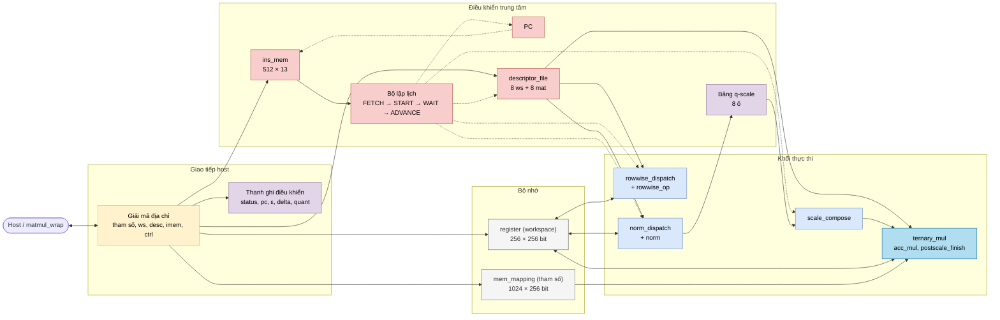
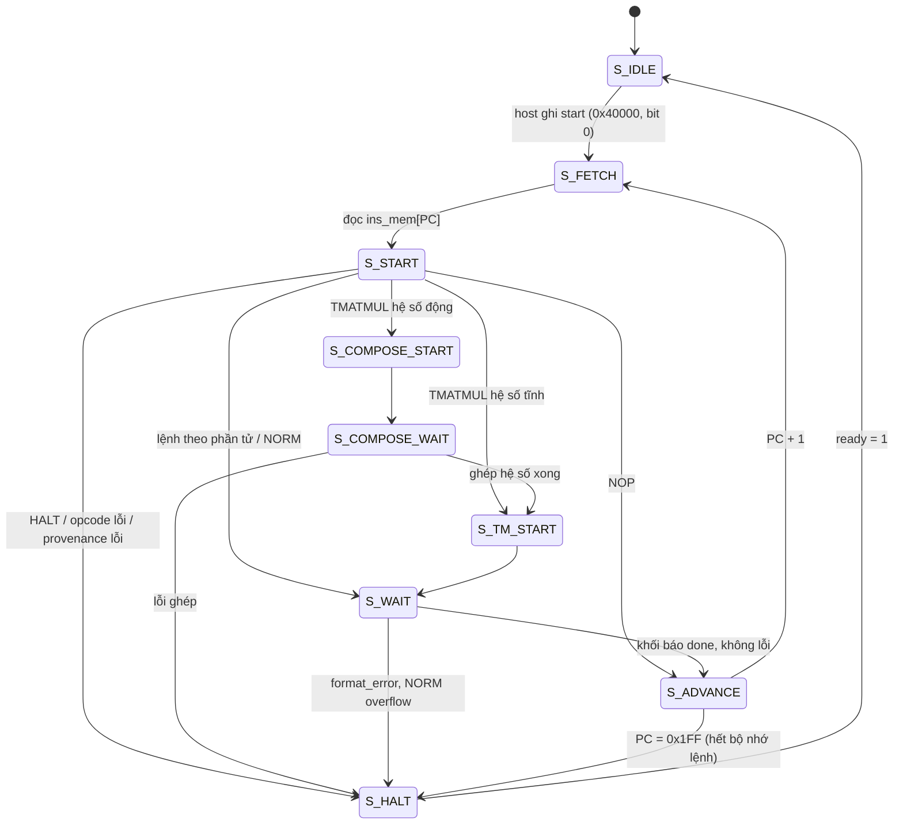
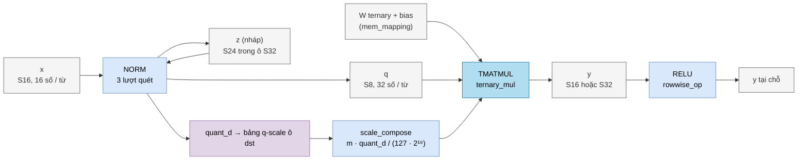

# 03: NPU legacy `matmulfree`, một NPU chạy chương trình

`matmulfree` là NPU thế hệ trước trong repo. Khác với `llm_soc`, trình tự tính toán của nó **không** được đúc cứng vào phần cứng. Host viết một chương trình ngắn bằng lệnh 13 bit, và NPU chạy chương trình đó. Thiết kế này vẫn được tổng hợp được, với top FPGA là `matmul_wrap`, nhưng nó không còn là đích chính. Chi tiết từng cổng và từng trạng thái nằm ở [modules/matmulfree.md](modules/matmulfree.md). Bản vẽ draw.io (sơ đồ khối + bộ lập lịch) là trang 06 của [diagrams/npu_architecture.drawio](diagrams/npu_architecture.drawio).

## 0. Kiến thức cần biết trước

**Chương trình, PC, lệnh.** Chương trình là một dãy lệnh nằm trong bộ nhớ lệnh `ins_mem`. Thanh ghi PC (program counter) giữ số thứ tự lệnh đang chạy. Mỗi vòng, NPU *nạp* lệnh `ins_mem[PC]`, *giải mã* xem đó là lệnh gì, *thực thi*, rồi tăng PC. Đây là chu trình nạp → giải mã → thực thi của mọi bộ xử lý.

**Descriptor: "con trỏ" có kiểu.** Lệnh chỉ dài 13 bit, không đủ chỗ ghi địa chỉ hay độ dài vector. Vì vậy lệnh chỉ mang **số hiệu 3 bit** (0…7) của một *descriptor*. Descriptor là một bản ghi do host ghi sẵn, cho biết vector nằm ở đâu, dài bao nhiêu và có định dạng gì. Ví dụ: ws descriptor 0 có `base_word = 0`, `length = 128`, `fmt = S16`, `frac_bits = 8`, nghĩa là "vector x có 128 số S16 Q8, bắt đầu ở từ 0 của workspace".

**Workspace.** Workspace là SRAM 256 từ × 256 bit (module `register`) chứa mọi vector đầu vào, kết quả trung gian và đầu ra. Một từ chứa 32 số S8, hoặc 16 số S16 / U16, hoặc 8 số S32.

**Lượng tử hóa động.** Phép nhân ma trận ternary nhận vector int8. Trước đó, lệnh `NORM` biến vector S16 thành int8 và trả về hệ số `quant_d` cho biết "127 trong int8 ứng với bao nhiêu". Lệnh `TMATMUL` sau đó phải nhân lại hệ số này. Nếu quên, kết quả sai theo một tỉ lệ ngẫu nhiên. `matmulfree` có cơ chế phần cứng chặn lỗi này (mục 4).

Xem thêm [00_kien_thuc_nen.md](00_kien_thuc_nen.md), mục 1.7 (FSM), mục 3 (fixed-point) và mục 4.4 (ternary).

## 1. Kiến trúc tổng quát



Chỉ **một** khối thực thi chạy tại một thời điểm. Ba khối dùng chung một cổng workspace qua bộ chọn `active_unit`.

## 2. Tập lệnh

```
 12      9 8     6 5     3 2     0
+---------+-------+-------+-------+
|  opcode |  dst  | src1  | src0  |
+---------+-------+-------+-------+
mã = opcode·512 + dst·64 + src1·8 + src0
```

| Nhóm | Lệnh (opcode) | Khối | Ý nghĩa |
|---|---|---|---|
| Theo phần tử | ADD (1), SUB (2), MUL (3), SIG (6), REC (0xB), RELU (0xC) | `rowwise_dispatch` | Phép trên từng phần tử của vector |
| Chuẩn hóa | NORM (7) | `norm_dispatch` | RMSNorm + lượng tử hóa int8 |
| Ma trận | TMATMUL (8) | `scale_compose` + `ternary_mul` | y = W · q · hệ số + bias. `src1` là số hiệu **mat** descriptor |
| Điều khiển | NOP (0), HALT (0xF) | — | Bỏ qua / dừng |
| Chưa có | DIV (4), EXP (5), LDV (9), STV (0xA) | — | Có tên nhưng gặp là báo lỗi và dừng |

## 3. Một vòng lệnh



Ở `S_START`, `descriptor_file` đã tra sẵn ba ws descriptor (`src0`, `src1`, `dst`) và một mat descriptor (`src1`) **cùng lúc**, hoàn toàn bằng mạch tổ hợp. Vì vậy khối thực thi nhận đủ thông tin ngay khi `start`. Khối thực thi tự kiểm tra định dạng và báo `format_error` nếu sai, ví dụ ADD hai vector khác độ dài.

## 4. Đường đi của dữ liệu trong một khối "Linear"

Một lớp tuyến tính điển hình `y = ReLU(W · RMSNorm(x))` cần 3 lệnh:



| Bước | Lệnh | Vào | Ra | Module chi tiết |
|---|---|---|---|---|
| 1 | NORM src0 = 0, dst = 1 | x (S16) | q (S8) + `quant_d` | [norm.md](modules/norm.md) |
| 2 | TMATMUL src0 = 1, mat = 3, dst = 2 | q, W, bias, hệ số đã ghép | y (S16) | [ternary_mul.md](modules/ternary_mul.md), [scale_compose.md](modules/scale_compose.md) |
| 3 | RELU src0 = 2, dst = 2 | y | y | [rowwise_op.md](modules/rowwise_op.md) |
| 4 | HALT | | | |

Mã máy: 0x0E40, 0x1099, 0x1882, 0x1E00. Ví dụ dòng 2: 8 · 512 + 2 · 64 + 3 · 8 + 1 = 4249 = 0x1099.

### 4.1 Bảng q-scale chặn lỗi quên hệ số

- `NORM` thành công (không lỗi, không tràn) → ô số `dst` lưu `quant_d`, vị trí và độ dài của q.
- Bất kỳ lần ghi nào đè lên vùng q → ô đó mất hiệu lực. Host ghi descriptor → mọi ô mất hiệu lực.
- `TMATMUL` với ma trận đánh dấu "hệ số động" chỉ chạy khi ô `src0` còn hiệu lực và khớp vị trí. Ngược lại, ma trận "hệ số tĩnh" không được phép đọc một vùng q động.

Hệ quả cho người viết chương trình: `NORM` và `TMATMUL` theo sau nó phải dùng **cùng số hiệu** ws descriptor (ô `dst` của NORM = `src0` của TMATMUL), như ví dụ trên dùng số 1.

## 5. Bản đồ địa chỉ host

| Vùng | Địa chỉ byte | Nội dung |
|---|---|---|
| Tham số | 0x00000 – 0x07FFC | `mem_mapping`: trọng số ternary, bias, gain |
| Bộ nhớ lệnh | 0x0C000 – 0x0C7FC | 512 lệnh |
| Workspace | 0x10000 – 0x11FFC | `addr[12:5]` = từ, `addr[4:2]` = mảnh 32 bit |
| ws descriptor i | 0x20000 + 16i | 32 bit: `base_word 8 · length 10 · fmt 2 · frac_bits 5 · reserved 7` |
| mat descriptor i | 0x20100 + 16i + 4w | 96 bit (3 word): `weight_base, bias_base, k_len, n_rows, scale_m, scale_r, output_s32, reserved` |
| Điều khiển | 0x40000 + 4k | k = 0 status / start, 1 pc, 4 scratch_z_base, 5–6 ε, 7 delta, 8–10 kết quả NORM |

Trình tự host: ghi tham số → ghi x vào workspace → ghi descriptor → ghi chương trình → ghi 1 vào 0x40000 → đọc 0x40000 đến khi `ready = 1` → kiểm tra `error` → đọc y.

## 6. So sánh với `llm_soc`

| Khía cạnh | `matmulfree` | `llm_soc` |
|---|---|---|
| Ai quyết định trình tự | Chương trình của host | FSM phần cứng |
| Kích thước dữ liệu | Linh hoạt (K ≤ 512) theo descriptor | Cố định (128 / 384 kênh) |
| Activation vào ma trận | int8, lượng tử hóa động bởi NORM | S24 trực tiếp, không lượng tử hóa |
| Song song | 1 khối chạy một lúc; ALU theo phần tử xử lý 2 phần tử / lượt | 32 làn cho mọi phép vector |
| Hàm phi tuyến | Sigmoid, ReLU, cổng hồi quy | RMSNorm, RoPE, softmax, SiLU, Gumbel |
| Phát hiện lỗi | Kiểm tra descriptor, bảng q-scale | Kiểm tra metadata ma trận, cấu hình launch |

Hai thiết kế dùng chung các khối số học `logic_mul`, `div`, `isqrt_u64`, `sigmoid` và lá bộ nhớ `sram_word_tile` / `quartus_word_ram`.
