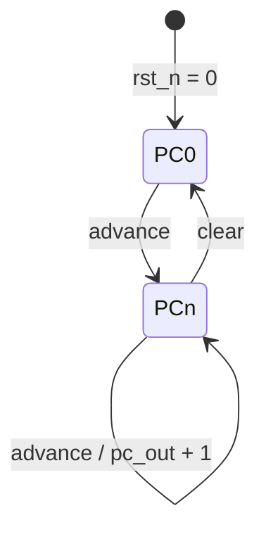

# `PC` — Bộ đếm chương trình 9-bit

| Mục | Giá trị |
|---|---|
| File | `PC.sv` |
| Loại | Tuần tự |
| Nhóm | Điều khiển (NPU legacy) |
| Được dùng bởi | `matmulfree.u_pc` |

## 0. Kiến thức cần biết trước

**Program counter (PC)** là thanh ghi chứa địa chỉ của lệnh đang thực hiện, như ngón tay chỉ vào dòng hiện tại của một danh sách việc. Làm xong một lệnh thì PC tăng 1 để trỏ sang lệnh kế tiếp. Muốn chạy lại từ đầu thì đưa PC về 0.

NPU legacy (`matmulfree`) chạy theo **chương trình** do host nạp vào `ins_mem`. Đây là kiểu điều khiển giống CPU. Ngược lại, `llm_soc` không có chương trình mà có FSM cố định, biết sẵn thứ tự các bước của mô hình.

Các khái niệm chung (thanh ghi, cạnh clock, pipeline, valid, fixed-point, RNE…) được giải thích trong [../00_kien_thuc_nen.md](../00_kien_thuc_nen.md).

## 1. Tổng quan

Program counter của bộ lập lịch lệnh trong `matmulfree`. Nó trỏ vào `ins_mem` (512 lệnh × 13 bit), nên có 9 bit.

## 2. Cổng

| Cổng | Hướng | Độ rộng | Ý nghĩa |
|---|---|---|---|
| `clear` | in | 1 | Đưa PC về 0 (khi host khởi động chương trình) |
| `advance` | in | 1 | PC + 1 (sau khi lệnh hiện tại hoàn tất) |
| `pc_out` | out | 9 | Địa chỉ lệnh hiện tại |

## 3. Sơ đồ hoạt động

Thứ tự ưu tiên: reset bất đồng bộ > `clear` > `advance`. Nếu cả hai tín hiệu đều 0 thì PC giữ nguyên.

## 4. Ghi chú

`matmulfree` báo lỗi nếu chương trình chạy đến `pc == 0x1FF` mà chưa gặp `HALT` (xem [matmulfree.md](matmulfree.md)), nên PC không bao giờ quấn vòng về 0 trong lúc chạy.
