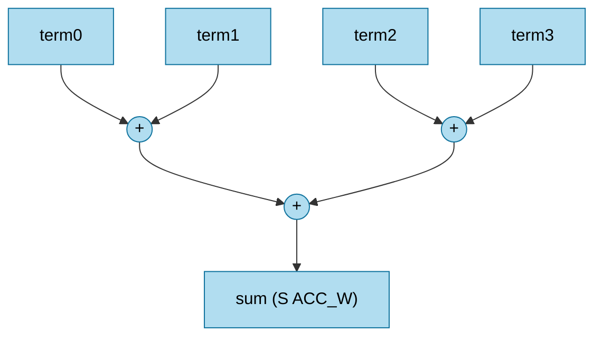

# `acc_mul` — Cây cộng có dấu tham số hóa

| Mục | Giá trị |
|---|---|
| File | `acc_mul.sv` |
| Loại | Tổ hợp thuần |
| Nhóm | Số học dùng chung (MAC reduce) |
| Được dùng bởi | `ternary_mul.u_group[0..3]` (8 số hạng S9 → S12), `ternary_mul.u_total` (4 số hạng S12 → S14) |

## 0. Kiến thức cần biết trước

**Cây cộng (adder tree).** Muốn cộng 32 số, có thể cộng nối tiếp (31 bộ cộng nối đuôi nhau, rất chậm), hoặc cộng theo **cây**: cộng từng cặp (16 tổng), rồi từng cặp của chúng (8 tổng)… Sau log₂(32) = 5 tầng còn 1 tổng. Số bộ cộng vẫn là 31, nhưng đường dài nhất chỉ còn 5 bộ cộng.

**Độ rộng tăng dần.** Cộng hai số n bit có thể cần n+1 bit, nên mỗi tầng của cây rộng thêm 1 bit. Ví dụ 8 số S9 cần tối đa S12 (9 + log₂8). Module giới hạn độ rộng ở `ACC_W` vì người thiết kế biết trước tổng không vượt quá khoảng đó.

**Liên hệ ternary.** Khi trọng số chỉ là −1/0/+1, "nhân rồi cộng" (MAC) chỉ còn là **cộng các số ±x hoặc 0**. Vì vậy cây cộng này đóng vai trò cả bộ MAC.

Các khái niệm chung (thanh ghi, cạnh clock, pipeline, valid, fixed-point, RNE…) được giải thích trong [../00_kien_thuc_nen.md](../00_kien_thuc_nen.md).

## 1. Tổng quan

Dù tên là `acc_mul`, module **không nhân**. Nó là cây cộng nhị phân, rút gọn `NUM_INPUTS` số hạng có dấu thành một tổng. Trong NPU legacy, nó cộng các tích "ternary × int8" (chỉ là ±q hoặc 0) của một lát tích vô hướng.

## 2. Tham số và cổng

| Tên | Mặc định | Ý nghĩa |
|---|---|---|
| `TERM_W` | 9 | Độ rộng mỗi số hạng (có dấu) |
| `NUM_INPUTS` | 32 | Số số hạng |
| `ACC_W` | 18 | Độ rộng tối đa của tổng |
| `term[NUM_INPUTS]` | in | Mảng số hạng S`TERM_W` |
| `sum` | out | Tổng S`ACC_W` |

## 3. Sơ đồ khối

## 4. Hoạt động chi tiết

- `LEVELS = clog2(NUM_INPUTS)` và `LEAVES = 2^LEVELS`. Các lá dư (khi `NUM_INPUTS` không phải lũy thừa 2) được gán 0.
- Tầng `level` có `LEAVES >> level` nút, mỗi nút là tổng của 2 nút tầng trước.
- Độ rộng tầng `level` là `min(TERM_W + level, ACC_W)`. Mỗi tầng chỉ cần thêm 1 bit dấu. Khi chạm `ACC_W`, phép cộng bị cắt theo modulo `2^ACC_W`, tức là hành vi tràn được giữ đúng như yêu cầu của nơi gọi.

Ví dụ trong `ternary_mul`:

| Instance | Số hạng | Độ rộng | Số tầng | Đầu ra |
|---|---|---|---|---|
| `u_group[g]` | 8 × S9 | 9→10→11→12 | 3 | S12 |
| `u_total` | 4 × S12 | 12→13→14 | 2 | S14 |
