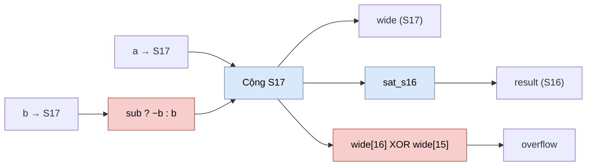

# `addsub` — Bộ cộng/trừ S16 có bão hòa (tế bào tham chiếu)

| Mục | Giá trị |
|---|---|
| File | `mul.sv` (cùng file với `mul`) |
| Loại | Tổ hợp thuần |
| Nhóm | Số học dùng chung — tế bào tham chiếu |
| Con | — |
| Được dùng bởi | Không module RTL nào khởi tạo; dành cho kiểm thử số học |

## 0. Kiến thức cần biết trước

**Cộng hai số n bit cần n + 1 bit.** Ví dụ với số 4 bit có dấu (−8…7): 7 + 7 = 14, không vừa 4 bit. Vì vậy tổng được tính ở 17 bit (`wide`) rồi mới quyết định có tràn hay không.

**Nhận biết tràn bằng 2 bit cao.** Với số bù hai, nếu kết quả 17 bit vẫn vừa 16 bit thì bit 16 và bit 15 phải **giống nhau** (đều là bit dấu). Nếu chúng khác nhau thì kết quả không vừa S16: `overflow = wide[16] XOR wide[15]`.

**Trừ = cộng số đối.** `a − b` được tính là `a + (−b)`. Trong bù hai, `−b` là đảo bit rồi cộng 1.

Các khái niệm chung được giải thích trong [../00_kien_thuc_nen.md](../00_kien_thuc_nen.md).

## 1. Tổng quan

`addsub` tính `a + b` hoặc `a − b` (chọn bằng `sub`), xuất cả kết quả đầy đủ 17 bit và kết quả đã bão hòa về S16. Giống `mul`, module này không được khởi tạo trong cây RTL; nó là tế bào tham chiếu cho hồi quy số học.

## 2. Cổng

| Cổng | Hướng | Rộng | Ý nghĩa |
|---|---|---|---|
| `a`, `b` | in | S16 | Hai toán hạng |
| `sub` | in | 1 | 0: cộng; 1: trừ |
| `wide` | out | S17 | Kết quả chính xác |
| `result` | out | S16 | Kết quả bão hòa |
| `overflow` | out | 1 | Kết quả chính xác không vừa S16 |

## 3. Sơ đồ khối

## 4. Hoạt động chi tiết

1. `b_ext = {b[15], b}` (mở rộng dấu lên 17 bit).
2. `wide = {a[15], a} + (sub ? −b_ext : b_ext)`. Phép đối của số 17 bit luôn vừa 17 bit, kể cả khi `b = −32768`.
3. `overflow = wide[16] ^ wide[15]`.
4. `result = sat_s16(wide mở rộng lên 64 bit)`.

Ví dụ: `a = 30000`, `b = 5000`, `sub = 0` → `wide = 35000`, `overflow = 1`, `result = 32767`.
