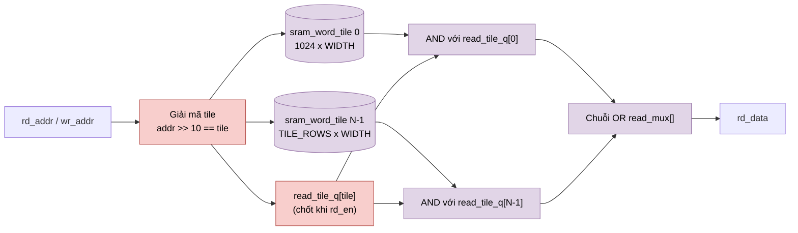

# `banked_word_ram` — RAM word chia tile 1024 hàng (NPU legacy)

| Mục | Giá trị |
|---|---|
| File | `banked_word_ram.sv` |
| Loại | Tuần tự, 1 port đọc đồng bộ + 1 port ghi |
| Nhóm | Hạ tầng / bộ nhớ |
| Con | `TILES = ceil(ROWS/1024)` × `sram_word_tile` |
| Được dùng bởi | `sram_256_wrapper` (8 instance, mỗi làn 32 bit một instance) |

## 0. Kiến thức cần biết trước

**Ghép RAM lớn từ RAM nhỏ.** Một RAM 4096 hàng có thể ghép từ 4 tile 1024 hàng. 2 bit cao của địa chỉ (`addr >> 10`) chọn tile, 10 bit thấp chọn hàng trong tile. Khi ghi thì chỉ bật tile được chọn. Khi đọc thì tile được chọn xuất dữ liệu, còn các tile khác bị **che** (AND với 0) trước khi OR lại.

Đây là bản rút gọn của `pipelined_word_ram` (không có thêm tầng thanh ghi), dùng cho NPU legacy vốn có RAM nhỏ (≤ 1024 hàng, tức chỉ 1 tile).

Các khái niệm chung (thanh ghi, cạnh clock, pipeline, valid, fixed-point, RNE…) được giải thích trong [../00_kien_thuc_nen.md](../00_kien_thuc_nen.md).

## 1. Tổng quan

`banked_word_ram` là phiên bản đơn giản của `pipelined_word_ram`, dùng cho NPU legacy `matmulfree`. Bộ nhớ được cắt thành các tile 1024 hàng. Tile cuối có thể ngắn hơn khi `ROWS` không chia hết cho 1024. Mỗi tile chỉ được bật khi địa chỉ rơi vào nó, và dữ liệu đọc được gom lại bằng một chuỗi AND-OR.

Module **không có tầng thanh ghi phụ**. Độ trễ đọc chỉ là 1 cạnh của tile.

## 2. Tham số và cổng

| Tên | Mặc định | Ý nghĩa |
|---|---|---|
| `WIDTH` | 32 | Độ rộng word |
| `ROWS` | 4096 | Số word |
| `ADDR_W` | `clog2(ROWS)` | Độ rộng địa chỉ |
| `rd_en, rd_addr` | in | Đọc |
| `wr_en, wr_addr, wr_data` | in | Ghi |
| `rd_data` | out | Dữ liệu đọc |

Trong NPU legacy: `mem_mapping` dùng `ROWS = 1024` (1 tile), `register` dùng `ROWS = 256` (1 tile, 256 hàng).

## 3. Sơ đồ khối

## 4. Hoạt động chi tiết

- **Chọn tile.** `rd_en` và `wr_en` của tile `t` được AND với `(addr >> 10) == t`. Địa chỉ đưa xuống tile là 10 bit thấp (`10'(addr)`).
- **Ghi nhớ tile được đọc.** `read_tile_q[t]` chỉ cập nhật khi `rd_en = 1`. Như vậy, khi không có đọc mới, mux vẫn trỏ đúng tile đã đọc gần nhất. Điều này khớp với việc `rd_data` của `sram_word_tile` được giữ nguyên.
- **Gom dữ liệu.** `read_mux[0] = 0` và `read_mux[t+1] = read_mux[t] | (tile_data[t] & {WIDTH{read_tile_q[t]}})`. Vì đúng một bit `read_tile_q` bật, kết quả bằng dữ liệu của tile được chọn.

| Cạnh | Việc xảy ra |
|---|---|
| 0 | `rd_en` và `rd_addr` đi thẳng vào tile; `wr_en` ghi vào tile ở cùng cạnh |
| 1 | Tile xuất `rd_data`; `read_tile_q` đã chốt; `rd_data` hợp lệ (logic OR thuần tổ hợp) |

Đọc và ghi cùng địa chỉ trong cùng chu kỳ trả **dữ liệu cũ**, theo hành vi của `sram_word_tile`.
