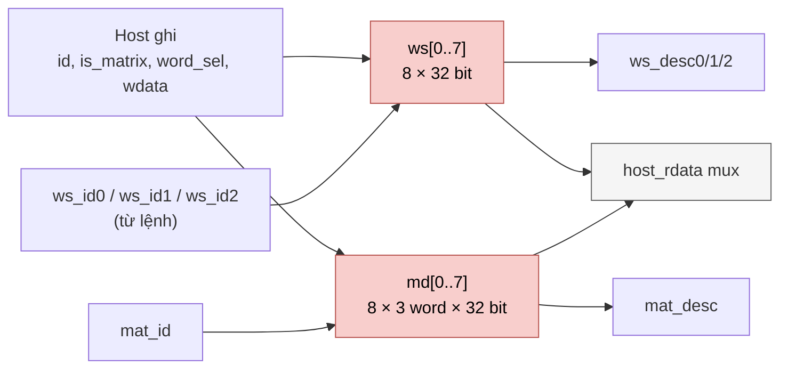

# `descriptor_file` — Bảng descriptor workspace và ma trận (NPU legacy)

| Mục | Giá trị |
|---|---|
| File | `descriptor_file.sv` |
| Loại | Thanh ghi flip-flop, đọc tổ hợp |
| Nhóm | Điều khiển trung tâm (Central Control) |
| Được dùng bởi | `matmulfree` |

## 0. Kiến thức cần biết trước

**Descriptor.** Một lệnh 13 bit không đủ chỗ để ghi "vector bắt đầu ở hàng 37, dài 384 phần tử, định dạng S16, 8 bit phân số". Thay vào đó, các thông tin này được ghi sẵn vào một **bảng descriptor**. Lệnh chỉ cần mang **số thứ tự** (ID, 3 bit) của dòng trong bảng. Giống như dùng "mã khách hàng" thay vì viết lại đầy đủ địa chỉ mỗi lần.

**Hai loại descriptor:**
- **Workspace descriptor**: mô tả một vector trong workspace.
- **Matrix descriptor**: mô tả một ma trận trọng số trong bộ nhớ tham số (vị trí, kích thước, hệ số scale).

**Đọc tổ hợp.** Bảng làm bằng flip-flop (chỉ 8 + 8 dòng), nên đọc ra ngay trong cùng chu kỳ, không có độ trễ như SRAM.

Các khái niệm chung (thanh ghi, cạnh clock, pipeline, valid, fixed-point, RNE…) được giải thích trong [../00_kien_thuc_nen.md](../00_kien_thuc_nen.md).

## 1. Tổng quan

Lệnh 13 bit của NPU legacy quá ngắn để chứa địa chỉ, độ dài hay hệ số scale. Vì vậy lệnh chỉ mang **ID 3 bit** trỏ tới descriptor; mọi thông tin chi tiết nằm trong `descriptor_file`:

- **8 workspace descriptor** (`ws_desc_t`, 32 bit). Mỗi cái mô tả một tensor trong `register`: hàng gốc, độ dài, định dạng, số bit phân số.
- **8 matrix descriptor** (`mat_desc_t`, 96 bit = 3 word). Mỗi cái mô tả một ma trận ternary trong `mem_mapping`: base trọng số, base bias, K, N, hệ số scale, cờ.

Host ghi và đọc lại descriptor qua cổng 32 bit. Datapath đọc **3 workspace descriptor + 1 matrix descriptor song song**, hoàn toàn tổ hợp.

## 2. Cổng

| Cổng | Hướng | Ý nghĩa |
|---|---|---|
| `host_we, host_id[2:0], host_is_matrix, host_word_sel[1:0], host_wdata` | in | Ghi một word descriptor |
| `host_rdata[31:0]` | out | Đọc lại (tổ hợp) |
| `ws_id0/1/2` → `ws_desc0/1/2` | in → out | 3 port đọc workspace |
| `mat_id` → `mat_desc` | in → out | 1 port đọc ma trận |

## 3. Sơ đồ khối

## 4. Hoạt động chi tiết

### 4.1 Ghi

Mỗi entry và mỗi word là một khối `always_ff` riêng, được sinh bằng `generate`:

- **Workspace.** `host_we && !host_is_matrix && host_id == entry` thì `ws[entry] <= host_wdata`.
- **Ma trận.** `host_we && host_is_matrix && host_id == entry && host_word_sel == w` thì `word_q` thứ `w` (w = 0..2) nhận `host_wdata`. `md[entry]` là ghép `{word2, word1, word0}`.

Chỉ số hằng và ghi nguyên word được dùng có chủ ý: Quartus 18.1 sẽ suy ra latch nếu ghi một phần vào packed struct có chỉ số động. Reset bất đồng bộ đưa mọi descriptor về 0.

### 4.2 Đọc lại

- `host_is_matrix = 0`: `host_rdata = ws[host_id]`.
- `host_is_matrix = 1`: `host_rdata` là word `host_word_sel` của `md[host_id]` (0: bit [31:0], 1: bit [63:32], 2: bit [95:64]). `word_sel = 3` trả 0.

### 4.3 Bố cục trường

`ws_desc_t` (32 bit, MSB trước):

| Bit | Trường | Ý nghĩa |
|---|---|---|
| 31:24 | `base_word` | Hàng bắt đầu trong workspace |
| 23:14 | `length` | Số phần tử logic (1..512) |
| 13:12 | `fmt` | S8 / S16 / U16 / S32 |
| 11:7 | `frac_bits` | Số bit phân số (≤ 24) |
| 6:0 | `reserved` | — |

`mat_desc_t` (96 bit, MSB trước):

| Bit | Trường | Ý nghĩa |
|---|---|---|
| 95:86 | `weight_base` | Hàng trọng số đầu tiên trong `mem_mapping` |
| 85:76 | `bias_base` | Hàng bias đầu tiên |
| 75:66 | `k_len` | Chiều vào K |
| 65:56 | `n_rows` | Số hàng ra N |
| 55:32 | `scale_m` | Mantissa scale 24 bit |
| 31:26 | `scale_r` | Số bit dịch phải |
| 25 | `output_s32` | 0: bão hòa S16; 1: bão hòa S32 |
| 24:0 | `reserved` | bit 0: scale q động; bit 1: không bias |

Kiểm tra hợp lệ (`ws_valid`, chồng lấn vùng nhớ) **không** nằm ở đây; các dispatcher của `matmulfree` làm việc đó (xem [npu_pkg.md](npu_pkg.md)).
