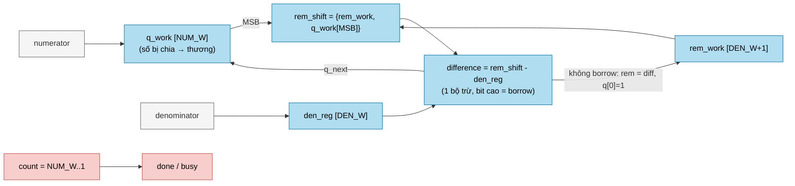
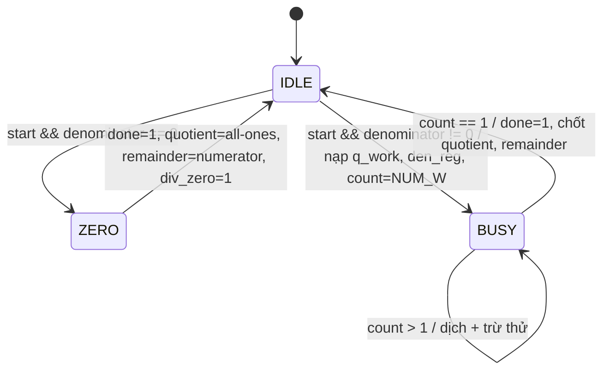

# `div` — Bộ chia không dấu tuần tự (restoring divider)

| Mục | Giá trị |
|---|---|
| File | `div.sv` |
| Loại | Tuần tự, 1 bit thương / chu kỳ |
| Nhóm | Số học dùng chung (scalar unit) |
| Được dùng bởi | `llm_soc.u_div` (64/32), `llm_attention_normalize.g_divider[*].u_div` (64/32), `norm.u_div` (55/32), `scale_compose.u_div` (48/25) |

## 0. Kiến thức cần biết trước

**Chia nhị phân bằng tay (restoring division).** Giống chia dài ở trường, nhưng mỗi bước chỉ cần hỏi "phần dư hiện tại có ≥ số chia không?". Ví dụ 13 ÷ 3 (`1101 ÷ 11`):

| Bước | Hạ bit | Phần dư thử | ≥ 3? | Bit thương | Phần dư mới |
|---|---|---|---|---|---|
| 1 | 1 | 1 | không | 0 | 1 |
| 2 | 1 | 11 (3) | có | 1 | 0 |
| 3 | 0 | 0 | không | 0 | 0 |
| 4 | 1 | 1 | không | 0 | 1 |

Thương = `0100` = 4, dư = 1. Mỗi bước tìm được **một bit thương**, nên chia số 64 bit mất cỡ 64 chu kỳ. "Restoring" (phục hồi) nghĩa là: nếu phép trừ thử ra âm thì giữ lại (phục hồi) phần dư cũ.

**Tại sao chấp nhận chậm?** Bộ chia một-chu-kỳ cho số 64 bit cực lớn và cực chậm. Trong NPU, phép chia chỉ dùng vài lần mỗi vector (ví dụ chia cho tổng trong softmax, chia cho căn trong RMSNorm), nên bộ chia tuần tự nhỏ gọn là lựa chọn hợp lý.

**Làm tròn từ phần dư.** Muốn làm tròn thương tới gần nhất, chỉ cần so `2 × phần dư` với số chia: lớn hơn thì cộng 1, bằng nhau là trường hợp hòa.

Các khái niệm chung (thanh ghi, cạnh clock, pipeline, valid, fixed-point, RNE…) được giải thích trong [../00_kien_thuc_nen.md](../00_kien_thuc_nen.md).

## 1. Tổng quan

`div` tính `quotient = numerator / denominator` và `remainder = numerator mod denominator` cho số **không dấu**. Thuật toán là chia có phục hồi (restoring division): mỗi chu kỳ dịch một bit của số bị chia vào phần dư, thử trừ số chia, rồi quyết định bit thương là 1 hay 0.

Phép chia có dấu và phép làm tròn RNE được xử lý **ngoài** module, bằng cách tách độ lớn/dấu và dùng `remainder` để quyết định làm tròn.

## 2. Tham số và cổng

| Tên | Hướng | Độ rộng | Ý nghĩa |
|---|---|---|---|
| `NUM_W` | param | 64 | Độ rộng số bị chia và thương |
| `DEN_W` | param | 32 | Độ rộng số chia và phần dư |
| `start` | in | 1 | Bắt đầu (chỉ nhận khi `!busy`) |
| `numerator` | in | NUM_W | Số bị chia |
| `denominator` | in | DEN_W | Số chia |
| `busy` | out | 1 | Đang lặp |
| `done` | out | 1 | Xung 1 chu kỳ khi có kết quả |
| `div_zero` | out | 1 | Số chia bằng 0 |
| `quotient` | out | NUM_W | Thương |
| `remainder` | out | DEN_W | Phần dư |

## 3. Sơ đồ khối

## 4. Hoạt động chi tiết

Mỗi chu kỳ khi `busy`:

1. `rem_shift = {rem_work[DEN_W-1:0], q_work[NUM_W-1]}`: đưa bit cao nhất của số bị chia vào phần dư.
2. `difference = rem_shift - den_reg`, tính với thêm 1 bit để lấy cờ mượn.
3. Nếu không mượn, phần dư mới là `difference` và bit thương `q_next[0] = 1`. Nếu mượn, giữ phần dư và bit thương là 0.
4. `q_work` dịch trái và giảm `count`. Khi `count == 1`, chốt `quotient`/`remainder` và phát `done`.

**Độ trễ:** `NUM_W` chu kỳ sau khi nhận `start`, cộng 1 cạnh để `done` được ghi. Các instance có độ trễ:

| Instance | NUM_W | Chu kỳ lặp |
|---|---|---|
| `llm_soc.u_div` | 64 | 64 |
| `llm_attention_normalize` (các làn riêng) | 64 | 64 |
| `norm.u_div` | 55 | 55 |
| `scale_compose.u_div` | 48 | 48 |

Trường hợp chia cho 0 hoàn tất **ngay** chu kỳ kế: `quotient = '1` (tất cả bit 1) và `remainder` là số bị chia cắt về `DEN_W` bit.

## 5. Chia sẻ bộ chia trong `llm_soc`

`llm_soc.u_div` được **dùng chung** bởi hai nơi:

- Bước `N_DIV` của RMSNorm (tính `2^32 / root`).
- Làn 0 của `llm_attention_normalize` khi tham số `ATTN_DIV_LANES` cho phép chia sẻ (`USE_SHARED`).

Bộ mux đầu vào ưu tiên `attention_div_start`: nếu khối attention đang phát lệnh chia thì dùng numerator/denominator của attention, ngược lại dùng `div_numerator_q`/`div_denominator_q` của bước norm. Hai bước này không bao giờ chạy đồng thời vì thuộc hai phase khác nhau của graph FSM. Bit làm tròn `divide_round_up` được tính từ `2·remainder` so với số chia (RNE: lớn hơn nửa, hoặc đúng nửa và thương lẻ).
