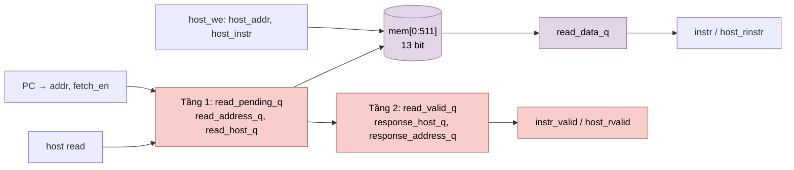

# `ins_mem` — Bộ nhớ lệnh 512 × 13 bit (NPU legacy)

| Mục | Giá trị |
|---|---|
| File | `ins_mem.sv` |
| Loại | Tuần tự, 1 port ghi (host) + 1 port đọc dùng chung (fetch/host) |
| Nhóm | Điều khiển trung tâm (Central Control) |
| Được dùng bởi | `matmulfree` (fetch theo `PC`) |

## 0. Kiến thức cần biết trước

**Bộ nhớ lệnh.** NPU legacy làm việc như một CPU đơn giản: host nạp một danh sách **lệnh** (chương trình), rồi NPU lần lượt lấy (**fetch**) từng lệnh, giải mã và thực hiện. Mỗi lệnh dài 13 bit, gồm mã phép toán và các ID descriptor.

**Fetch có độ trễ.** Vì là SRAM đồng bộ, lệnh ở địa chỉ PC chỉ có sau 2 cạnh. Bộ điều khiển phải chờ `instr_valid` mới giải mã.

Các khái niệm chung (thanh ghi, cạnh clock, pipeline, valid, fixed-point, RNE…) được giải thích trong [../00_kien_thuc_nen.md](../00_kien_thuc_nen.md).

## 1. Tổng quan

`ins_mem` lưu chương trình của NPU legacy: tối đa **512 lệnh 13 bit**. Host nạp chương trình qua cổng ghi. Bộ fetch của `matmulfree` đọc lệnh theo địa chỉ từ `PC`. Hợp đồng đọc giống `sram_256_wrapper`: dữ liệu hợp lệ sau 2 cạnh, và người yêu cầu phải giữ nguyên địa chỉ trong suốt thời gian đó.

## 2. Cổng

| Cổng | Hướng | Độ rộng | Ý nghĩa |
|---|---|---|---|
| `fetch_en, addr` | in | 1, 9 | Yêu cầu fetch |
| `instr, instr_valid` | out | 13, 1 | Lệnh và cờ hợp lệ |
| `host_en, host_we` | in | 1 | Giao dịch host / ghi |
| `host_addr, host_instr` | in | 9, 13 | Địa chỉ, lệnh ghi |
| `host_rinstr, host_rvalid` | out | 13, 1 | Đọc lại lệnh |

## 3. Sơ đồ khối

## 4. Hoạt động chi tiết

- **Ghi.** Ở cạnh clock, nếu `rst_n && host_en && host_we` thì `mem[host_addr] <= host_instr`.
- **Tầng 1.** `read_pending_q <= fetch_en || host_read`. Host được ưu tiên khi chọn `read_address_q`; `read_host_q` ghi lại ai là chủ yêu cầu.
- **Tầng 2.** Khi `read_pending_q = 1`, `read_data_q <= mem[read_address_q]`. Các bit valid, chủ sở hữu và địa chỉ dịch sang tầng phản hồi.
- **Hợp lệ.** `instr_valid` yêu cầu `fetch_en` còn bật, cả hai tầng đều là fetch, và cả hai địa chỉ bằng `addr` hiện tại. `host_rvalid` có điều kiện tương tự cho phía host.

Khi `PC` đổi địa chỉ (tập lệnh không có lệnh nhảy; PC chỉ tăng 1 hoặc về 0 khi start), phản hồi cũ tự động bị bỏ, vì địa chỉ đã lưu không còn khớp `addr`. Bộ fetch chỉ cần chờ `instr_valid`.

Không có reset cho mảng `mem` hay `read_data_q`. Chỉ các bit điều khiển pipeline được reset bất đồng bộ.
