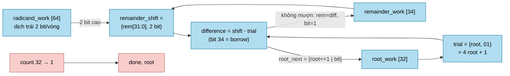

# `isqrt_u64` — Căn bậc hai nguyên 64-bit tuần tự

| Mục | Giá trị |
|---|---|
| File | `isqrt_u64.sv` |
| Loại | Tuần tự, 32 vòng lặp (mỗi vòng 1 bit căn) |
| Nhóm | Số học dùng chung (scalar unit) |
| Được dùng bởi | `llm_soc.u_root` (RMSNorm), `norm.u_sqrt` (NPU legacy) |

## 0. Kiến thức cần biết trước

**Căn bậc hai nguyên** của N là số nguyên r lớn nhất sao cho r² ≤ N. Ví dụ isqrt(30) = 5, vì 5² = 25 ≤ 30 < 36 = 6².

**Cách tìm từng bit.** Kết quả có 32 bit. Ta dò từ bit cao nhất xuống: thử bật bit đó lên 1; nếu bình phương của kết quả tạm vẫn ≤ N thì giữ bit, ngược lại xóa. Thuật toán trong RTL tránh phép nhân bằng cách mỗi vòng lấy **2 bit** của N vào một "phần dư" và thử trừ (giống chia dài), vì (2r+1)² − (2r)² = 4r + 1.

**Dùng ở đâu?** RMSNorm cần chia vector cho `sqrt(mean(x²))`. `llm_soc` tính căn một lần cho cả vector 128 phần tử, rồi tính nghịch đảo và nhân. Như vậy chỉ cần 1 phép căn + 1 phép chia cho mỗi vector, không phải 128 phép chia.

Các khái niệm chung (thanh ghi, cạnh clock, pipeline, valid, fixed-point, RNE…) được giải thích trong [../00_kien_thuc_nen.md](../00_kien_thuc_nen.md).

## 1. Tổng quan

Tính `root = floor(sqrt(radicand))` với `radicand` là U64 và `root` là U32. Thuật toán "digit-by-digit" kiểu chia tay: mỗi vòng lấy thêm **2 bit** của số cần khai căn, thử đặt bit căn kế tiếp bằng 1, rồi giữ nếu phép trừ thử không mượn.

## 2. Cổng

| Cổng | Hướng | Độ rộng | Ý nghĩa |
|---|---|---|---|
| `start` | in | 1 | Bắt đầu (nhận khi `!busy`) |
| `radicand` | in | 64 | Số cần khai căn |
| `busy` | out | 1 | Đang tính |
| `done` | out | 1 | Xung khi có kết quả |
| `root` | out | 32 | `floor(sqrt(radicand))` |

## 3. Sơ đồ khối

## 4. Hoạt động chi tiết

Mỗi chu kỳ khi `busy`:

1. `remainder_shift = {remainder_work[31:0], radicand_work[63:62]}`. Comment trong RTL chứng minh trước vòng 32 phần dư ≤ 2·root, nên vừa trong U34.
2. `trial = {root_work, 2'b01}`, tức `4·root + 1`.
3. `difference = remainder_shift - trial`. Bit 34 là cờ mượn, nên một bộ trừ dùng cho cả so sánh lẫn cập nhật phần dư.
4. Nếu không mượn: `root_next = (root << 1) | 1` và phần dư lấy `difference`. Nếu mượn: `root_next = root << 1` và giữ `remainder_shift`.
5. `radicand_work <<= 2`, `count--`. Khi `count == 1`, chốt `root` và phát `done`.

**Độ trễ:** 32 chu kỳ lặp sau chu kỳ nhận `start`.

## 5. Vai trò trong NPU

- Trong `llm_soc` (RMSNorm): `root_input = (Σx² >> 7) + 42950`. Dịch `>>7` chia cho 128 kênh, còn 42950 là epsilon. `isqrt` cho căn RMS; bước sau dùng `div` để lấy nghịch đảo `2^32 / root`. Chi tiết ở [llm_soc.md](llm_soc.md).
- Trong `norm` (legacy): khai căn phương sai đã cộng epsilon, ở dạng fixed-point 32 bit phân số.
