# `llm_attention_engine` — Tính điểm attention q · k cho mọi vị trí trước đó

| Mục | Giá trị |
|---|---|
| File | `llm_attention_engine.sv` |
| Loại | Tuần tự, bộ đếm + pipeline 3 tầng cho điểm + mảng 128 điểm |
| Nhóm | Attention |
| Con | `logic_mul` (`u_scale`, 39 × 14 → 55) |
| Được dùng bởi | `llm_soc` (instance `u_attention_engine`) |

## 0. Kiến thức cần biết trước

**Attention là gì?** Khi xử lý token ở vị trí `p`, mô hình "nhìn lại" mọi token `t = 0…p` đã thấy. Mỗi token t có một vector **khóa** kₜ và một vector **giá trị** vₜ (lưu trong **KV cache**). Token hiện tại có **truy vấn** q.

1. **Điểm**: `sₜ = (q · kₜ) / √d` — q giống kₜ bao nhiêu (d = 32 là số phần tử của một head).
2. **Softmax**: đổi điểm thành xác suất pₜ.
3. **Kết quả**: `Σ pₜ · vₜ`.

Module này làm **bước 1** cho một head. Bước 2 và 3 do `llm_soc` và [llm_attention_normalize](llm_attention_normalize.md) làm.

**Chia cho √32 bằng phép nhân.** 1/√32 ≈ 0,17678. Ở Q16: 0,17678 × 65536 ≈ **11585**. Nhân với 11585 rồi dịch phải 16 bit tương đương chia cho √32 — không cần bộ chia.

**Causal (nhân quả).** Token chỉ được nhìn các vị trí ≤ chính nó, nên engine duyệt `t = 0 … position`.

Xem thêm [../00_kien_thuc_nen.md](../00_kien_thuc_nen.md) (mục 5 attention, softmax; mục 3 RNE và bão hòa).

## 1. Tổng quan

Khi `start_i` (trạng thái `A_QUERY` của `llm_soc`), với lớp `layer_i`, head `head_i` và vị trí hiện tại `position_i`:

1. Đọc lần lượt khóa K của vị trí 0…position từ KV cache.
2. Mỗi khóa về: `llm_soc` đưa `query_q` và khóa vào `llm_math` → tổng 32 tích (S61).
3. Mỗi tổng được làm tròn, nhân 1/√32, làm tròn và bão hòa thành điểm S32 (Q16), lưu vào `score_memory[t]`, đồng thời cập nhật `max_score_o`.
4. Khi đủ `position + 1` điểm → `done_o`.

`llm_soc` sau đó đọc từng điểm qua `score_address_i` để tính e^(s − max) (xem [llm_exp_sample.md](llm_exp_sample.md)).

## 2. Cổng

| Cổng | Hướng | Rộng | Ý nghĩa |
|---|---|---|---|
| `start_i`, `cancel_i` | in | 1 | Bắt đầu / hủy |
| `layer_i`, `head_i` | in | 2, 2 | Lớp 0…3, head 0…3 |
| `position_i` | in | 7 | Vị trí hiện tại 0…127 |
| `kv_req_o`, `kv_address_o` | out | 1, 12 | Yêu cầu đọc khóa |
| `kv_valid_i` | in | 1 | Khóa đã về |
| `operand_capture_o`, `math_issue_o` | out | 1 | Chốt toán hạng / start `llm_math` |
| `sum_valid_i`, `sum_i` | in | 1, S61 | q · k từ `llm_math` |
| `score_address_i` | in | 7 | Chỉ số điểm muốn đọc |
| `score_o` | out | S32 | `score_memory[score_address_i]` |
| `max_score_o` | out | S32 | Điểm lớn nhất |
| `done_o` | out | 1 | Xung xong |

## 3. Sơ đồ khối

```mermaid
flowchart LR
    classDef ctrl fill:#f8cecc,stroke:#b85450,color:#000
    classDef mac fill:#b1ddf0,stroke:#10739e,color:#000
    classDef act fill:#dae8fc,stroke:#6c8ebf,color:#000
    classDef reg fill:#e1d5e7,stroke:#9673a6,color:#000
    classDef param fill:#f5f5f5,stroke:#666666,color:#333
    CNT["request_q / response_q / score_q"]:::ctrl -->|"{layer, t, 0, head}"| KV["KV cache<br/>(u_cache)"]:::param
    KV -->|"k_data"| CAP["math_a_q ← query_q<br/>math_b_q ← k"]:::reg
    CNT -->|"operand_capture"| CAP
    CAP -->|"math_issue"| M["llm_math<br/>Σ q·k (S61)"]:::mac
    M --> R1["rounded_dot_q<br/>rne(sum, 16) → S39"]:::act
    R1 --> SC["u_scale<br/>× 11585 (1/√32)"]:::mac
    SC --> R2["scaled_dot_q S55"]:::reg
    R2 --> R3["score_result_q<br/>sat_s32(rne(·, 16))"]:::act
    R3 --> MEM["score_memory[128]<br/>S32"]:::reg
    R3 --> MAX["max_score_o"]:::reg
    MEM -->|"score_o"| SOC["llm_soc: A_EXP_*"]
```



## 4. Hoạt động chi tiết

### 4.1 Địa chỉ KV cache

`kv_address_o = {layer[1:0], t[6:0], 1'b0, head[1:0]}` (12 bit), tức

```
địa chỉ = layer·1024 + t·8 + 0·4 + head
```

Bit `0` chọn **K** (bit `1` là V). Mỗi ô là 768 bit = 32 phần tử S24 của một head. Ví dụ layer 1, t = 5, head 2 → 1024 + 40 + 2 = 1066.

### 4.2 Ba bộ đếm

- `request_q`: số yêu cầu đã gửi. `kv_req_o = active && request_q ≤ position`.
- `response_q`: số khóa đã về. `operand_capture_o = active && kv_valid_i && response_q ≤ position`.
- `score_q`: số điểm đã lưu. Khi `score_q == position` và có điểm mới → `done_o`.

Các yêu cầu đi liên tiếp, không chờ phản hồi; `llm_math` ở chế độ streaming nhận mỗi chu kỳ một phép. Nhờ vậy cả dãy 0…p đi qua như một băng chuyền.

### 4.3 Pipeline tính điểm

`score_valid_q` là thanh ghi dịch 3 bit theo `sum_valid_i`:

| Cạnh | Thanh ghi | Phép |
|---|---|---|
| 1 | `rounded_dot_q` (S39) | `rne_shift64(sum, 16)`: q và k đều Q16 → tích Q32 → về Q16 |
| 2 | `scaled_dot_q` (S55) | `rounded × 11585` |
| 3 | `score_result_q` (S32) | `sat_s32(rne_shift64(scaled, 16))` |

Khi `score_valid_q[2] = 1`: ghi `score_memory[score_q] ← score_result_q` và cập nhật max (so sánh có dấu `>`).

Ví dụ: q · k thật = 8,0 → `sum = 8 · 2³²` → `rounded = 8 · 2¹⁶ = 524288` → × 11585 = 6 073 876 480 → >> 16 = 92 680 → điểm ≈ 1,41418 (= 8/√32 ✓).

### 4.4 Giá trị ban đầu của max

Khi bắt đầu, `max_score_o = 0x80000000` (số S32 nhỏ nhất), nên điểm đầu tiên luôn thay thế nó.

### 4.5 Đọc điểm

`score_o` là đọc tổ hợp `score_memory[score_address_i]`; `llm_soc` nối `score_address_i` với `time_q` (vị trí đang xét trong vòng softmax).
