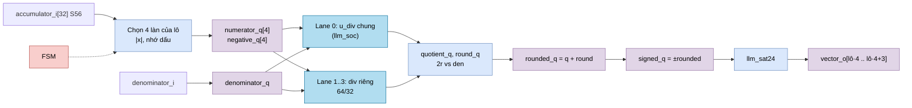
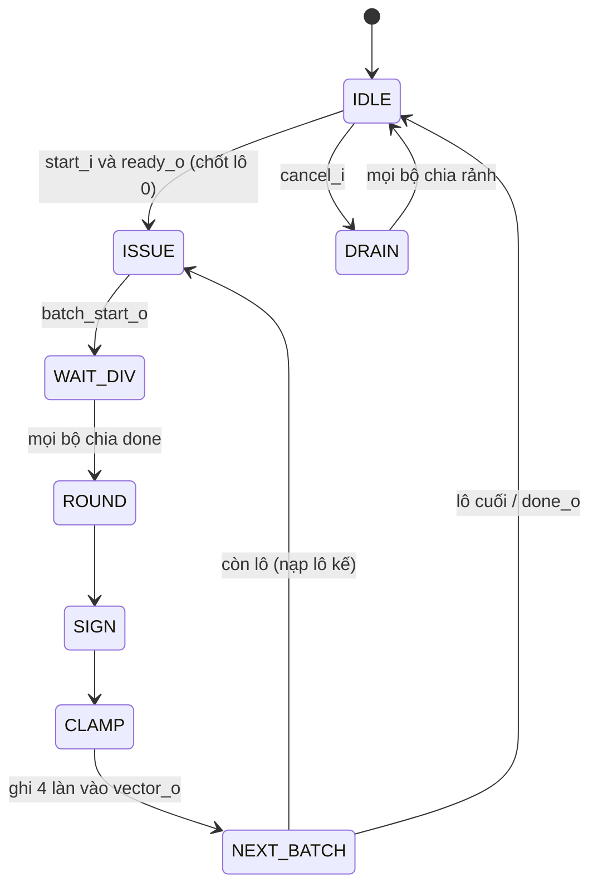

# `llm_attention_normalize` — Chia kết quả attention cho tổng xác suất

| Mục | Giá trị |
|---|---|
| File | `llm_attention_normalize.sv` |
| Loại | Tuần tự, FSM 8 trạng thái, `DIV_LANES` bộ chia chạy song song |
| Nhóm | Attention — chuẩn hóa softmax |
| Con | `div` (64/32 bit) × `DIV_LANES` (lane 0 dùng bộ chia chung khi `USE_SHARED = 1`) |
| Được dùng bởi | `llm_soc` (`u_attention_normalize`, `DIV_LANES = ATTN_DIV_LANES = 4`, `USE_SHARED = 1`) |

## 0. Kiến thức cần biết trước

**Vì sao phải chia?** Softmax là `pₜ = eₜ / Σ e`. Thay vì chia **từng** eₜ (tối đa 128 lần), `llm_soc` cộng dồn trực tiếp `acc = Σ eₜ · vₜ` với eₜ chưa chuẩn hóa, và cộng dồn `S = Σ eₜ`. Cuối cùng chỉ cần chia **32 phần tử** của acc cho S một lần:

```
kết quả[i] = acc[i] / S
```

**Chia có dấu bằng bộ chia không dấu.** Bộ chia `div` làm việc với số không dấu. Cách làm: lấy giá trị tuyệt đối, chia, làm tròn, rồi gắn lại dấu. Ví dụ −7 / 2: |−7| = 7 → 7/2 = 3 dư 1 → làm tròn → 4 → gắn dấu → −4 (−3,5 làm tròn RNE về số chẵn −4).

**Làm tròn RNE với phép chia.** Có thương q và số dư r. Phần lẻ là r/den. So `2r` với `den`:
- `2r > den` → phần lẻ > 0,5 → làm tròn lên.
- `2r = den` → đúng 0,5 → lên chỉ khi q lẻ (để kết quả chẵn).
- `2r < den` → giữ q.

**Chia theo lô (batch).** Bộ chia tuần tự tốn nhiều chu kỳ. Có 4 bộ chạy song song → 32 phần tử chia thành 32/4 = **8 lô**.

Xem thêm [../00_kien_thuc_nen.md](../00_kien_thuc_nen.md) (mục 3 RNE, bão hòa; mục 5 softmax) và [div.md](div.md).

## 1. Tổng quan

Khi `start_i` (trạng thái `A_LANE` của `llm_soc`), module nhận 32 accumulator S56 và mẫu số 32 bit (`probability_sum_q`). Với mỗi lô 4 làn: chia → làm tròn → gắn dấu → bão hòa S24 → ghi vào `vector_o`. Sau 8 lô, `done_o`.

## 2. Cổng

| Cổng | Hướng | Rộng | Ý nghĩa |
|---|---|---|---|
| `start_i`, `cancel_i` | in | 1 | Bắt đầu / hủy |
| `accumulator_i[0:31]` | in | 32 × S56 | Σ eₜ · vₜ |
| `denominator_i` | in | 32 | Σ eₜ |
| `shared_*` | in/out | — | Giao tiếp bộ chia chung của `llm_soc` (lane 0) |
| `ready_o` | out | 1 | IDLE và mọi bộ chia rảnh |
| `batch_start_o` | out | 1 | Xung bắt đầu chia một lô (`state == ISSUE`) |
| `done_o` | out | 1 | Xung xong |
| `vector_o` | out | 768 | 32 × S24 kết quả |

| Tham số | `llm_soc` | Ý nghĩa |
|---|---|---|
| `DIV_LANES` | 4 | Số bộ chia song song; `BATCHES = 32 / DIV_LANES` |
| `USE_SHARED` | 1 | Lane 0 dùng `u_div` chung của `llm_soc` thay vì bộ chia riêng |

## 3. Sơ đồ khối



### FSM



## 4. Hoạt động chi tiết

### 4.1 Nạp tử số

- Khi bắt đầu: lô 0, làn `lane` lấy `accumulator_i[lane]`.
- Ở `NEXT_BATCH` (nếu chưa phải lô cuối): nạp sẵn lô kế, `accumulator_i[(batch+1)·4 + lane]`.

`numerator_q = |x|` mở rộng lên 64 bit; `negative_q` nhớ bit dấu (bit 55).

### 4.2 Chia và làm tròn

`ISSUE` phát `batch_start_o` cho cả 4 bộ chia (lane 0 qua `u_div` của `llm_soc`). `WAIT_DIV` chờ cả 4 `done` (cùng lúc, vì các bộ chia có cùng độ trễ). Khi xong, chốt `quotient_q` và `round_q` theo quy tắc ở mục 0.

- `ROUND`: `rounded_q = quotient_q + round_q`.
- `SIGN`: `signed_q = negative ? −rounded : rounded`.
- `CLAMP`: `vector_o[24·lane +: 24] = llm_sat24(signed_q)` cho 4 làn của lô hiện tại.

Mỗi bước một cạnh riêng để đường tổ hợp ngắn.

### 4.3 Định dạng số

`acc` = Σ (V ở Q16) × (e ở U25/F24) → F40; `S` = Σ e (F24). Thương `acc / S` có F16, đúng định dạng S24 Q16 của activation. Ví dụ: hai vị trí có e = 1,0 và 0,5 (S = 1,5), V = 2,0 và 4,0 → acc = 2 + 2 = 4 → 4 / 1,5 ≈ 2,6667 → Q16 = 174763.

### 4.4 Bộ chia chung

Với `USE_SHARED = 1`, lane 0 không có bộ chia riêng. `shared_numerator_o = numerator_q[0]`, `shared_denominator_o = denominator_q`. Trong `llm_soc`, `u_div.start = op[N_DIV] || attention_div_start`, và toán hạng được chọn theo `attention_div_start`. Bộ chia của RMSNorm được dùng lại, tiết kiệm một bộ chia 64/32.
