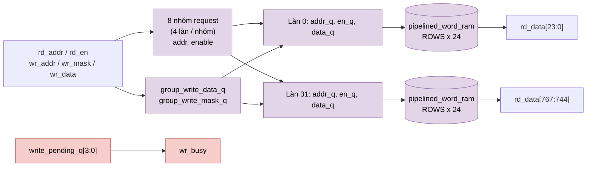

# `llm_bank_ram` — RAM vector 32 làn × 24 bit, ghi có mask theo làn

| Mục | Giá trị |
|---|---|
| File | `llm_bank_ram.sv` |
| Loại | Tuần tự, 1 port đọc + 1 port ghi |
| Nhóm | Bộ nhớ dữ liệu (activation, KV cache) |
| Con | 32 × `pipelined_word_ram` (mỗi làn một instance WIDTH = 24) |
| Được dùng bởi | `llm_soc.u_vectors` (96 hàng) và `llm_soc.u_cache` (4096 hàng, KV cache) |

## 0. Kiến thức cần biết trước

**Một hàng = một vector 32 phần tử.** Ở `llm_soc`, vector ẩn 128 kênh được chia thành 4 nhóm 32. Mỗi phần tử là số S24 (24 bit có dấu, 16 bit phân số). Một hàng RAM rộng 32 × 24 = 768 bit chứa đúng 32 phần tử, nên 32 làn SIMD đọc/ghi được cùng một lúc.

**Ghi theo mask.** Đôi khi chỉ một vài phần tử của hàng được cập nhật. Ví dụ phép linear tính xong từng phần tử một. Nếu RAM là một khối 768 bit, muốn ghi 1 phần tử phải đọc cả hàng, sửa, rồi ghi lại (read-modify-write, tốn 2 lần truy cập). Chia thành **32 bank riêng** (mỗi bank 24 bit) thì chỉ cần bật ghi ở đúng bank đó.

**KV cache là gì?** Khi sinh văn bản, attention của token mới cần K và V của mọi token trước. Thay vì tính lại, chúng được lưu trong `u_cache`; xem tài liệu kiến thức nền, mục 5.4.

Các khái niệm chung (thanh ghi, cạnh clock, pipeline, valid, fixed-point, RNE…) được giải thích trong [../00_kien_thuc_nen.md](../00_kien_thuc_nen.md).

## 1. Tổng quan

Mỗi hàng của `llm_bank_ram` là **một vector 32 phần tử S24** (768 bit). Đây là đơn vị dữ liệu cơ bản của `llm_soc`: 128 kênh = 4 hàng × 32 làn. Bộ nhớ được cắt dọc thành **32 bank độc lập** (một bank/làn), nên phép ghi có thể bật/tắt từng làn bằng `wr_mask` mà không cần đọc-sửa-ghi.

| Instance | ROWS | ADDR_W | Nội dung |
|---|---|---|---|
| `u_vectors` | 96 | 7 | 8 slot × 12 hàng: residual, norm, Q, K, V, attention, gate, up |
| `u_cache` | 4096 | 12 | KV cache: `{layer[2], position[7], row[3]}` |

## 2. Tham số và cổng

| Tên | Mặc định | Ý nghĩa |
|---|---|---|
| `LANES` | 32 | Số làn |
| `WIDTH` | 24 | Bit/làn |
| `ROWS`, `ADDR_W` | 4096, 12 | Độ sâu |
| `USE_QUARTUS_MEMORY` | 0 | Truyền xuống `pipelined_word_ram` |
| `rd_en, rd_addr` | in | Đọc cả hàng |
| `rd_data[LANES*WIDTH]` | out | 768 bit |
| `rd_valid` | out | Lấy từ làn 0 |
| `wr_addr, wr_mask[32], wr_data[768]` | in | Ghi; `wr_mask ≠ 0` là có yêu cầu ghi |
| `wr_busy` | out | Còn phép ghi đang trong pipeline (4 cạnh) |

## 3. Sơ đồ khối

## 4. Hoạt động chi tiết

### 4.1 Đọc: 5 cạnh

| Cạnh | Tầng |
|---|---|
| 1 | 8 thanh ghi request nhóm (`dont_merge`, mỗi nhóm 4 làn) chốt `rd_addr`, `rd_en` |
| 2 | Thanh ghi request riêng của từng làn |
| 3–5 | `pipelined_word_ram` (≤ 4096 hàng: 3 cạnh) |

Cả `u_vectors` (96 hàng) và `u_cache` (4096 hàng) đều có `GROUPS = 1` bên trong `pipelined_word_ram`, nên độ trễ đọc là **5 cạnh**. `rd_valid` lấy từ làn 0; mọi làn chạy đồng bộ nên dùng một làn là đủ.

### 4.2 Ghi: tới lá ở cạnh 4

| Cạnh | Tầng |
|---|---|
| 1 | Chốt `wr_addr` (nhóm), `wr_data`, `wr_mask` |
| 2 | Làn chốt địa chỉ, dữ liệu 24 bit của mình, `write_enable_q = mask[lane]` |
| 3 | `pipelined_word_ram` chốt yêu cầu |
| 4 | Ghi vào lá SRAM |

`wr_busy = |write_pending_q`, trong đó `write_pending_q` là thanh ghi dịch 4 bit của `|wr_mask`. `llm_soc` dùng `wr_busy` để chặn đọc một hàng vừa ghi (tránh RAW hazard) và để chờ trước khi kết thúc một op (`O_FINISH`).

### 4.3 Va chạm và reset

- Đọc và ghi cùng địa chỉ được chấp nhận cùng chu kỳ: trả dữ liệu cũ.
- Reset hủy request và valid đang chờ. Nội dung SRAM và payload không bị reset.
- Thuộc tính `dont_merge` giữ các bản sao địa chỉ cục bộ, tránh công cụ tổng hợp gộp lại thành một driver fanout lớn ra cả 32 bank.
