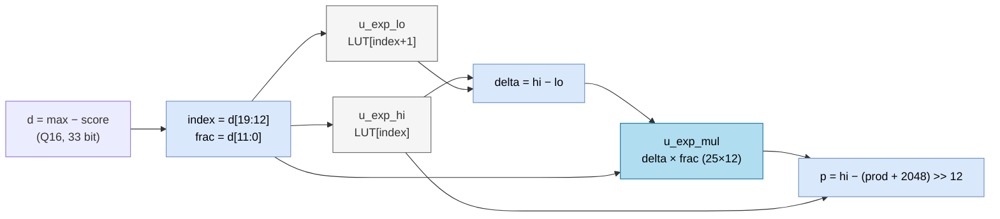

# `llm_exp_sample` — Bảng hằng 257 mẫu của e⁻ˣ cho softmax

| Mục | Giá trị |
|---|---|
| File | `llm_exp_lut.svh` (được `llm_pkg.sv` `include`) |
| Loại | Tổ hợp thuần — bảng `case` hằng (ROM) |
| Nhóm | Attention — softmax |
| Con | — |
| Được dùng bởi | `llm_soc` (2 instance: `u_exp_hi`, `u_exp_lo`) |

## 0. Kiến thức cần biết trước

**Softmax.** Attention tính một "điểm" (score) sᵢ cho mỗi token trước đó, rồi đổi điểm thành **xác suất** pᵢ = e^(sᵢ) / Σⱼ e^(sⱼ). Điểm càng cao → xác suất càng lớn, và tổng các xác suất bằng 1.

**Mẹo trừ giá trị lớn nhất.** e^(sᵢ) có thể rất lớn. Vì e^(sᵢ − m) / Σ e^(sⱼ − m) cho cùng kết quả với mọi hằng m, phần cứng chọn m = max(s). Khi đó mọi số mũ `sᵢ − m ≤ 0`, nên mọi e^(sᵢ − m) nằm trong (0, 1]. Chỉ cần bảng của **e⁻ˣ với x ≥ 0**.

**U25/F24.** Số không dấu 25 bit với 24 bit phân số: 1,0 = 2²⁴ = 16 777 216.

Xem thêm [../00_kien_thuc_nen.md](../00_kien_thuc_nen.md), mục 4.3 (LUT) và mục 5 (attention).

## 1. Tổng quan

Bảng lưu `e^(−i/16)` tại `i = 0…256`, tức x từ 0 đến 16, bước 1/16, ở U25/F24. Một chú thích trong file ghi bảng được sinh bởi một script Python của dự án.

| `index` | x | e⁻ˣ | Giá trị |
|---|---|---|---|
| 0 | 0 | 1 | 16 777 216 |
| 1 | 0,0625 | 0,9394 | 15 760 736 |
| 255, 256 | ≈ 16 | ≈ 1,1 × 10⁻⁷ | 2 |

## 2. Cổng

| Cổng | Hướng | Rộng | Ý nghĩa |
|---|---|---|---|
| `index` | in | 9 | Chỉ số mẫu 0…256 |
| `value` | out | U25 | e^(−index/16) ở F24; `default` trả 0 |

## 3. Sơ đồ khối (cách `llm_soc` dùng bảng)

## 4. Hoạt động chi tiết

Trong `llm_soc`, mỗi score được đổi thành xác suất chưa chuẩn hóa qua các trạng thái `A_EXP_*`:

1. **`A_EXP_READ`**: `d = max_score − score`. Score là số Q16, nên `d / 65536` là x thực.
2. **`A_EXP_PREP`**: nếu `d ≥ 2²⁰` (x ≥ 16) thì `hi = lo = 0`, vì e⁻¹⁶ coi như bằng 0. Ngược lại, `index = d[19:12]` (bước 2¹²/2¹⁶ = 1/16), lấy `hi = LUT[index]` và `lo = LUT[index + 1]`. Hai bảng được đọc song song, nên không cần 2 chu kỳ như `sigmoid`.
3. **`A_EXP_DELTA`**: `delta = hi − lo` (luôn ≥ 0 vì e⁻ˣ giảm).
4. **`A_EXP_MUL`**: `delta × d[11:0]`, với 12 bit thấp của d là phần lẻ trong khoảng.
5. **`A_EXP_STORE`**: `p = hi − round(delta × frac / 4096)`, làm tròn nửa-lên (+2048 rồi dịch 12). `p` cũng được cộng dồn vào `probability_sum_q` để chia ở bước chuẩn hóa.

Vì index chỉ dùng 8 bit (`{1'b0, d[19:12]}`), `u_exp_hi` dùng chỉ số 0…255 và `u_exp_lo` dùng 1…256. Như vậy cần đủ 257 mẫu.
