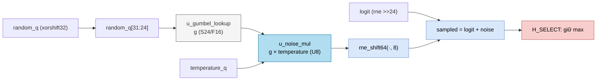

# `llm_gumbel_sample` — Bảng 256 mẫu nhiễu Gumbel để lấy mẫu token

| Mục | Giá trị |
|---|---|
| File | `llm_gumbel_lut.svh` (được `llm_pkg.sv` `include`) |
| Loại | Tổ hợp thuần — bảng `case` hằng (ROM) |
| Nhóm | Head — lấy mẫu token |
| Con | — |
| Được dùng bởi | `llm_soc` (instance `u_gumbel_lookup`) |

## 0. Kiến thức cần biết trước

**Chọn token tiếp theo.** Sau khi tính xong, mô hình cho mỗi token trong từ điển một **logit** (điểm). Có hai cách chọn:
- **Greedy**: luôn chọn logit lớn nhất. Kết quả lặp lại y hệt mỗi lần chạy.
- **Lấy mẫu (sampling)**: chọn ngẫu nhiên, token có logit cao có xác suất cao hơn. **Nhiệt độ** T điều chỉnh mức ngẫu nhiên: T nhỏ → gần greedy; T lớn → ngẫu nhiên hơn.

**Mẹo Gumbel-max.** Lấy mẫu theo softmax(logit / T) thông thường cần tính e^x cho 4096 token, cộng dồn, rồi so với một số ngẫu nhiên. Có một cách tương đương nhưng rẻ hơn nhiều: cộng vào mỗi logit một nhiễu `T · g`, với g theo **phân phối Gumbel**, rồi chọn **giá trị lớn nhất**. Phần cứng chỉ cần cộng và so sánh, giống hệt greedy.

**Tạo nhiễu Gumbel.** Nếu U là số ngẫu nhiên đều trong (0, 1) thì `g = −log(−log(U))` có phân phối Gumbel. Bảng lưu sẵn g cho 256 giá trị U.

Xem thêm [../00_kien_thuc_nen.md](../00_kien_thuc_nen.md), mục 5 (sampling, xorshift32).

## 1. Tổng quan

Bảng lưu `g(i) = −log(−log(Uᵢ))` với `Uᵢ = (i + 0,5) / 256`, `i = 0…255`, ở **S24/F16** (24 bit có dấu, 16 bit phân số, giống activation).

| `index` | Uᵢ | g ≈ | Giá trị hex |
|---|---|---|---|
| 0 | 0,00195 | −1,83 | `0xfe2b56` |
| 128 | 0,502 | 0,37 | `0x005f45` |
| 255 | 0,998 | 6,24 | `0x063cc3` |

Lấy điểm giữa mỗi khoảng (`+ 0,5`) để tránh U = 0 hoặc 1, nơi log không xác định. Bảng không nội suy: 8 bit ngẫu nhiên chọn trực tiếp một mẫu.

## 2. Cổng

| Cổng | Hướng | Rộng | Ý nghĩa |
|---|---|---|---|
| `index` | in | 8 | Chỉ số mẫu 0…255 |
| `value` | out | S24 | g ở F16 |

## 3. Sơ đồ khối (cách `llm_soc` dùng bảng)

## 4. Hoạt động chi tiết

Với mỗi token (hàng từ điển) trong `llm_soc`:

1. **`H_ROUND`**: `logit = rne_shift64(scalar_product, 24)` (F16).
   - Nếu `temperature = 0`: `sampled = logit` (greedy). Bộ ngẫu nhiên vẫn được bước một lần cho mỗi hàng, để chuỗi ngẫu nhiên không phụ thuộc chế độ.
   - Ngược lại sang `H_NOISE`.
2. **`H_NOISE`**: `noise_product = g × temperature`, với `g = LUT[random_q[31:24]]`; sau đó bước `random_q` bằng xorshift32.
3. **`H_SAMPLE`**: `sampled = logit + rne_shift64(noise_product, 8)`. `temperature` là U8 có 8 bit phân số, nên giá trị mặc định 166 nghĩa là T ≈ 0,65.
4. **`H_SELECT`**: nếu `sampled` lớn hơn giá trị tốt nhất hiện tại (và token được phép chọn), lưu token này.

Như vậy toàn bộ việc lấy mẫu nằm trong RTL: không cần exp, không cần chia, không cần host can thiệp.
