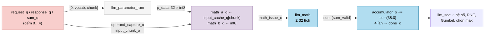
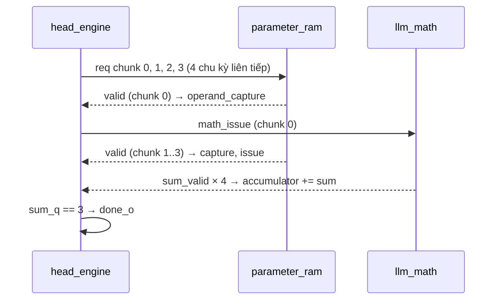

# `llm_head_engine` — Engine tích vô hướng cho một hàng từ điển (output head)

| Mục | Giá trị |
|---|---|
| File | `llm_head_engine.sv` |
| Loại | Tuần tự, bộ đếm yêu cầu / phản hồi / tổng |
| Nhóm | Head — tính logit |
| Con | — (dùng `llm_math` chung qua cổng) |
| Được dùng bởi | `llm_soc` (instance `u_head_engine`) |

## 0. Kiến thức cần biết trước

**Output head.** Sau 4 lớp transformer, mô hình có vector ẩn h (128 phần tử). Để đoán token tiếp theo, nó tính **logit** cho từng token trong từ điển 4096 từ: `logit[v] = E[v] · h`, với E là ma trận 4096 × 128 (mỗi token một hàng). Token có logit cao là ứng viên tốt.

**Int8 + hệ số tỉ lệ.** Ma trận head lưu dạng **int8** (−128…127) để tiết kiệm bộ nhớ, kèm một hệ số tỉ lệ cho mỗi hàng. Giá trị thật ≈ int8 × hệ số. Engine này chỉ tính phần nguyên `Σ int8 · h`; `llm_soc` nhân hệ số sau.

**Bố trí bộ nhớ.** Một hàng 128 int8 = 1024 bit = **4 từ** 256 bit. Mỗi từ chứa 32 trọng số, đúng 32 làn của `llm_math`. Địa chỉ: `{0, vocab[11:0], chunk[1:0]}` → hàng v nằm ở `4v … 4v+3`.

Xem thêm [../00_kien_thuc_nen.md](../00_kien_thuc_nen.md) (mục 5 LLM, 5.6 sampling) và [llm_math.md](llm_math.md).

## 1. Tổng quan

Mỗi lần `start_i`, engine tính `Σ_{chunk=0..3} Σ_{lane} w_int8 · x` cho **một** hàng từ điển:

1. Phát 4 yêu cầu đọc liên tiếp (chunk 0..3) tới `llm_parameter_ram`.
2. Khi mỗi từ về, báo `operand_capture_o`; `llm_soc` chốt 32 int8 + chunk x tương ứng vào `llm_math`, một chu kỳ sau là `math_issue_o`.
3. Cộng 4 giá trị `sum` của `llm_math` (lấy 39 bit thấp) → `accumulator_o`, rồi `done_o`.

Việc nhân hệ số, làm tròn, cộng nhiễu Gumbel và chọn token do `llm_soc` đảm nhiệm.

## 2. Cổng

| Cổng | Hướng | Rộng | Ý nghĩa |
|---|---|---|---|
| `start_i`, `cancel_i` | in | 1 | Bắt đầu một hàng / hủy |
| `vocabulary_i` | in | 12 | Chỉ số token (hàng) 0…4095 |
| `parameter_req_o`, `parameter_address_o` | out | 1, 15 | Yêu cầu đọc trọng số |
| `parameter_valid_i` | in | 1 | Từ trọng số đã về |
| `operand_capture_o` | out | 1 | Cha chốt toán hạng cho `llm_math` |
| `math_issue_o` | out | 1 | `start` cho `llm_math` (trễ 1 chu kỳ) |
| `input_chunk_o` | out | 2 | Chunk x cần dùng (= số phản hồi đã nhận) |
| `sum_valid_i`, `sum_i` | in | 1, S61 | Kết quả từ `llm_math` |
| `done_o` | out | 1 | Xung xong |
| `accumulator_o` | out | S39 | Tổng của hàng |

## 3. Sơ đồ khối

## 4. Hoạt động chi tiết

- **Bắt đầu** (`start_i` khi không bận): `active_q = 1`, xóa các bộ đếm và `accumulator_o`, chốt `vocabulary_q`.
- **Yêu cầu**: `parameter_req_o = active && request_q < 4`. Vì bộ nhớ tham số có pipeline, 4 yêu cầu đi liên tiếp mà không chờ.
- **Phản hồi**: `operand_capture_o = active && parameter_valid_i && response_q < 4`. `input_chunk_o = response_q[1:0]` cho biết chunk x nào khớp với từ vừa về — đảm bảo trọng số chunk k nhân với x chunk k.
- **Phát**: `math_issue_o` là bản trễ 1 chu kỳ của `operand_capture_o`, đúng lúc `math_a_q/math_b_q` vừa được chốt.
- **Cộng**: mỗi `sum_valid_i`: `accumulator_o += sum_i[38:0]`, `sum_q++`. Khi `sum_q == 3` (tổng thứ 4) → `done_o = 1`, `active_q = 0`.
- **Hủy**: `cancel_i` tắt `active_q` và `math_issue_o`.

Ví dụ: 4 tổng chunk lần lượt 1200, −300, 45, 55 → `accumulator_o = 1000`. `llm_soc` tiếp tục với `H_COEFF` (nhân hệ số), `H_ROUND`, `H_NOISE`, `H_SAMPLE`, `H_SELECT` (xem [llm_gumbel_sample.md](llm_gumbel_sample.md)).

**Vì sao S39 là đủ?** Mỗi tích int8 × S24 ≤ 2³¹; 128 tích ≤ 2³⁸ → vừa S39.
