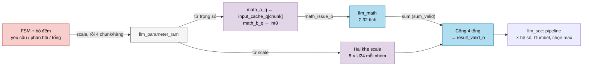
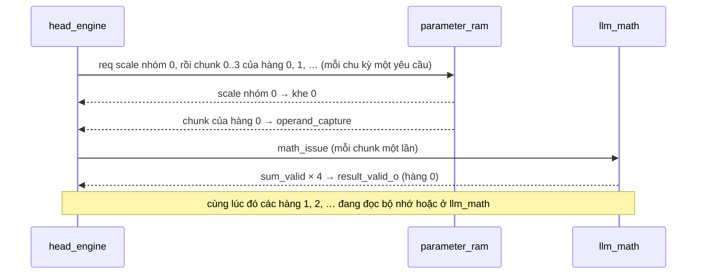

# `llm_head_engine` — Engine stream toàn bộ 4096 hàng từ điển (output head)

| Mục | Giá trị |
|---|---|
| File | `llm_head_engine.sv` |
| Loại | Tuần tự: FSM `IDLE/RUN/DRAIN`, bộ đếm yêu cầu / phản hồi / tổng, hai khe scale |
| Nhóm | Head — tính logit |
| Con | — (dùng `llm_math` chung qua cổng) |
| Được dùng bởi | `llm_soc` (instance `u_head_engine`) |

## 0. Kiến thức cần biết trước

**Output head.** Sau 4 lớp transformer, mô hình có vector ẩn h (128 phần tử). Để đoán token tiếp theo, nó tính **logit** cho từng token trong từ điển 4096 từ: `logit[v] = E[v] · h`, với E là ma trận 4096 × 128 (mỗi token một hàng). Token có logit cao là ứng viên tốt.

**Int8 + hệ số tỉ lệ.** Ma trận head lưu dạng **int8** (−128…127) để tiết kiệm bộ nhớ, kèm một hệ số tỉ lệ cho mỗi hàng. Giá trị thật ≈ int8 × hệ số. Engine này chỉ tính phần nguyên `Σ int8 · h`; `llm_soc` nhân hệ số sau.

**Bố trí bộ nhớ.** Một hàng 128 int8 = 1024 bit = **4 từ** 256 bit. Mỗi từ chứa 32 trọng số, đúng 32 làn của `llm_math`. Địa chỉ: `{0, vocab[11:0], chunk[1:0]}` → hàng v nằm ở `4v … 4v+3`.

**Bố trí hệ số tỉ lệ.** Hệ số của hàng v là số U24 nằm ở bit [23:0] của khe 32 bit thứ `v mod 8` trong từ 256 bit tại `EMB_SCALE_BASE + v/8`. Một từ scale phục vụ một **nhóm** 8 hàng; bit [31:24] của mỗi khe không dùng.

**Stream nhiều hàng.** Bộ nhớ tham số nhận một yêu cầu mỗi chu kỳ và trả dữ liệu sau 5 chu kỳ, `llm_math` cũng nhận một phép mỗi chu kỳ và trả tổng sau 9 chu kỳ. Nếu chờ xong một hàng mới bắt đầu hàng sau, phần lớn thời gian là chờ. Engine này phát yêu cầu liên tục, nên tại một thời điểm có vài hàng đang "bay" (in flight): hàng này đang đọc bộ nhớ, hàng trước đang ở `llm_math`, hàng trước nữa đang ở pipeline epilogue của `llm_soc`. Thứ tự vẫn giữ nguyên vì bộ nhớ và `llm_math` đều trả kết quả đúng thứ tự phát.

Xem thêm [../00_kien_thuc_nen.md](../00_kien_thuc_nen.md) (mục 5 LLM, 5.6 sampling) và [llm_math.md](llm_math.md).

## 1. Tổng quan

Một xung `start_i` chạy trọn một lượt head: engine tính `Σ_{chunk=0..3} Σ_{lane} w_int8 · x` cho **cả 4096** hàng, theo thứ tự ID:

1. Phát một dòng yêu cầu đọc liên tục tới `llm_parameter_ram`: với mỗi nhóm 8 hàng, trước tiên là từ scale của nhóm, sau đó 4 từ trọng số (chunk 0..3) cho từng hàng. Tổng cộng 512 + 16.384 = 16.896 lần đọc, tối đa 8 lần đọc đang chờ phản hồi (read credit).
2. Từ scale về thì được tách thành 8 hệ số U24 và ghi vào một trong hai khe scale. Từ trọng số về thì báo `operand_capture_o`; `llm_soc` chốt 32 int8 + chunk x tương ứng vào `llm_math`, một chu kỳ sau là `math_issue_o`.
3. Cộng 4 giá trị `sum` của `llm_math` (lấy 39 bit thấp) của một hàng → xung `result_valid_o` kèm `accumulator_o` và `coefficient_o` (hệ số của chính hàng đó).

Nhân hệ số, làm tròn, cộng nhiễu Gumbel, bước PRNG và chọn token do pipeline epilogue của `llm_soc` đảm nhiệm. Đo trên `tb_llm_operators` (bộ nhớ thật, trễ 5): một lượt head mất 16.948 chu kỳ thay vì 121.886 (T = 166) hay 113.694 (T = 0) của thiết kế cũ xử lý từng hàng.

## 2. Cổng

| Cổng | Hướng | Rộng | Ý nghĩa |
|---|---|---|---|
| `SCALE_BASE` | tham số | int | Địa chỉ từ scale đầu tiên (`EMB_SCALE_BASE`) |
| `start_i`, `cancel_i` | in | 1 | Bắt đầu một lượt 4096 hàng / hủy |
| `busy_o` | out | 1 | Engine chưa về `IDLE` (kể cả lúc drain) |
| `parameter_req_o`, `parameter_address_o` | out | 1, 15 | Yêu cầu đọc từ scale hoặc từ trọng số |
| `parameter_valid_i`, `parameter_data_i` | in | 1, 256 | Phản hồi của bộ nhớ tham số, đúng thứ tự |
| `operand_capture_o` | out | 1 | Cha chốt toán hạng cho `llm_math` (chỉ với từ trọng số) |
| `math_issue_o` | out | 1 | `start` cho `llm_math` (trễ 1 chu kỳ) |
| `input_chunk_o` | out | 2 | Chunk x khớp với từ trọng số vừa về |
| `sum_valid_i`, `sum_i` | in | 1, S61 | Kết quả từ `llm_math` |
| `result_valid_o` | out | 1 | Xung: một hàng đã xong |
| `accumulator_o` | out | S39 | Tổng của hàng |
| `coefficient_o` | out | U24 | Hệ số tỉ lệ của hàng |

## 3. Sơ đồ khối

## 4. Hoạt động chi tiết

- **Bắt đầu** (`start_i` ở `IDLE`, không có `cancel_i`): sang `RUN`, xóa bộ đếm; yêu cầu đầu tiên là từ scale của nhóm 0.
- **Yêu cầu**: `parameter_req_o = RUN && !cancel_i && còn hàng && reads_pending_q < 8`. `request_scale_q` cho biết yêu cầu tới là từ scale (địa chỉ `SCALE_BASE + hàng/8`) hay từ trọng số (`{0, hàng, chunk}`). Sau chunk 3 của hàng 8k+7, yêu cầu kế tiếp lại là từ scale.
- **Phản hồi**: bên phản hồi đi đúng chuỗi đó (`response_scale_q`, `response_row_q`, `response_chunk_q`). Từ scale ghi vào khe `hàng[3]`; từ trọng số bật `operand_capture_o` với `input_chunk_o = response_chunk_q`, bảo đảm trọng số chunk k nhân với x chunk k.
- **Phát**: `math_issue_o` là bản trễ 1 chu kỳ của `operand_capture_o`, đúng lúc `math_a_q/math_b_q` vừa được chốt.
- **Cộng và trả hàng**: mỗi `sum_valid_i` cộng `sum_i[38:0]` vào bộ tích lũy. Tổng thứ 4 của một hàng tạo `result_valid_o` cùng `accumulator_o` và `coefficient_o = khe[hàng[3]][hàng[2:0]]`. Mỗi hàng cần 4 tổng, nên hai hàng liên tiếp cách nhau ít nhất 4 chu kỳ; epilogue của `llm_soc` không bao giờ phải chặn engine.
- **Vì sao hai khe scale là đủ**: từ scale của nhóm G về sau 32 từ trọng số của nhóm G-1 (bộ nhớ trả đúng thứ tự). Hàng cuối của nhóm G-2 đã nhận từ trọng số cuối của nó trước đó ít nhất 33 chu kỳ và xong 10 chu kỳ sau từ đó (chốt, phát, 9 chu kỳ `llm_math`). Vì vậy khe bị ghi đè không còn ai đọc.
- **Kết thúc**: hàng 4095 xong → `DRAIN`; khi không còn lần đọc hay tổng nào đang chờ → `IDLE`.
- **Hủy**: `cancel_i` dừng yêu cầu, chốt toán hạng và trả hàng ngay, chuyển sang `DRAIN`. Engine vẫn đếm các phản hồi bộ nhớ và các tổng của `llm_math` còn đang bay, rồi mới về `IDLE`. Nhờ vậy một lượt mới không bao giờ nhận nhầm dữ liệu cũ.

Ví dụ: 4 tổng chunk của một hàng lần lượt 1200, −300, 45, 55 → `accumulator_o = 1000`. Pipeline epilogue của `llm_soc` nhân với `coefficient_o`, làm tròn, cộng nhiễu và chọn token (xem [llm_soc.md](llm_soc.md) và [llm_gumbel_sample.md](llm_gumbel_sample.md)).

**Vì sao S39 là đủ?** |int8| ≤ 2⁷ và |S24| ≤ 2²³, nên mỗi tích có độ lớn ≤ 2³⁰. Tổng 128 = 2⁷ tích có độ lớn ≤ 2³⁷, nằm gọn trong S39 (−2³⁸ … 2³⁸ − 1).
