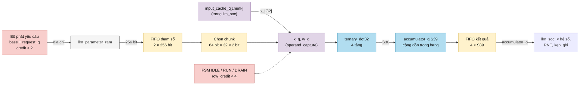
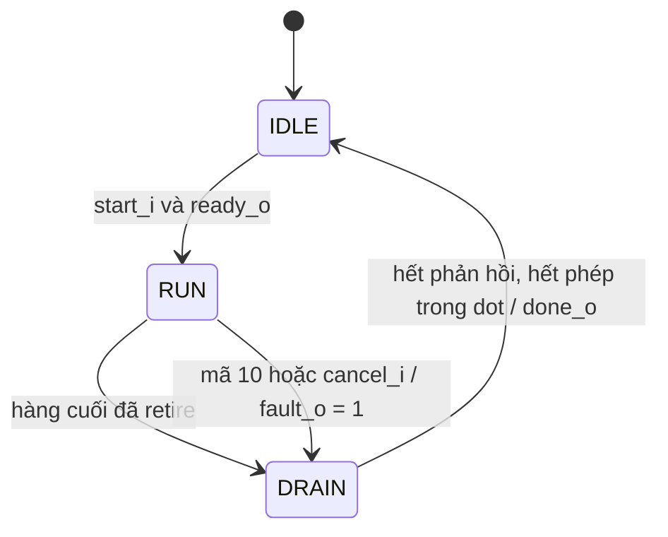

# `llm_linear_engine` — Engine nhân ma trận ternary × vector theo dòng hàng

| Mục | Giá trị |
|---|---|
| File | `llm_linear_engine.sv` |
| Loại | Tuần tự, FSM 3 trạng thái + FIFO tham số 2 từ + FIFO kết quả 4 phần tử |
| Nhóm | MAC — lớp tuyến tính (`llm_soc`) |
| Con | `ternary_dot32` (`u_dot`) |
| Được dùng bởi | `llm_soc` (instance `u_linear_engine`) |

## 0. Kiến thức cần biết trước

**Lớp tuyến tính (linear layer).** `y = W · x`: mỗi phần tử `y[r]` là tích vô hướng của **hàng r** của ma trận W với vector x. Ma trận có `rows` hàng, mỗi hàng dài bằng x.

**Chia vector thành "chunk".** Phần cứng chỉ cộng 32 phần tử một lần (`ternary_dot32`). Vector dài 128 = **4 chunk** × 32; vector dài 384 (lớp bên trong MLP) = **12 chunk** × 32. Mỗi hàng cần `chunks` lần tích 32 phần tử, rồi cộng các kết quả lại:

```
y[r] = dot(W[r, 0..31], x[0..31]) + dot(W[r, 32..63], x[32..63]) + …
```

**Trọng số nén 2 bit.** Mỗi trọng số ternary chiếm 2 bit, nên một chunk 32 trọng số = 64 bit, và một từ bộ nhớ tham số 256 bit chứa **4 chunk**. Hàng 4 chunk = 1 từ; hàng 12 chunk = 3 từ.

**Credit (tín dụng) và FIFO.** Bộ nhớ trả dữ liệu sau vài chu kỳ. Để không chờ, engine gửi yêu cầu trước, nhưng chỉ được có tối đa N yêu cầu "chưa dùng" — mỗi yêu cầu tiêu một credit, dùng xong trả lại. Nhờ vậy FIFO nhận dữ liệu không bao giờ tràn. Ví dụ: FIFO 2 chỗ → tối đa 2 từ đã yêu cầu mà chưa tiêu thụ.

Xem thêm [../00_kien_thuc_nen.md](../00_kien_thuc_nen.md) (mục 2 bộ nhớ, 4.4 ternary) và [ternary_dot32.md](ternary_dot32.md).

## 1. Tổng quan

Khi `start_i`, engine nhận vị trí ma trận (`weight_base_i`), số chunk mỗi hàng (4 hoặc 12) và số hàng. Sau đó nó tự:

1. Gửi yêu cầu đọc từ trọng số liên tiếp từ `llm_parameter_ram`, giữ tối đa 2 từ chưa dùng.
2. Mỗi chu kỳ có thể, chọn một chunk trọng số + chunk x tương ứng và phát vào `ternary_dot32`.
3. Cộng dồn các tổng chunk của cùng một hàng (S39).
4. Khi hàng xong, đẩy kết quả vào FIFO 4 phần tử. `llm_soc` lấy kết quả ra theo thứ tự để nhân hệ số, làm tròn, kẹp và ghi.
5. Khi mọi hàng xong (hoặc gặp mã trọng số lỗi / bị hủy), sang `DRAIN`, chờ mọi phản hồi về rồi `done_o`.

## 2. Cổng

| Cổng | Hướng | Rộng | Ý nghĩa |
|---|---|---|---|
| `start_i`, `cancel_i` | in | 1 | Bắt đầu / hủy |
| `weight_base_i` | in | 15 | Địa chỉ từ đầu tiên của ma trận |
| `chunks_i` | in | 4 | Số chunk mỗi hàng (4 hoặc 12) |
| `rows_i` | in | 10 | Số hàng |
| `ready_o` / `busy_o` | out | 1 | Rảnh (IDLE, FIFO kết quả rỗng) / đang làm |
| `done_o`, `fault_o` | out | 1 | Xung xong / có lỗi |
| `parameter_req_o`, `parameter_address_o` | out | 1, 15 | Yêu cầu đọc trọng số |
| `parameter_valid_i`, `parameter_data_i` | in | 1, 256 | Từ trọng số trả về |
| `input_chunk_o` | out | 4 | Chunk x mà cha cần cấp ngay bây giờ |
| `x_i[0:31]` | in | 32 × S24 | Chunk x tương ứng |
| `dot_issue_o` | out | 1 | Một phép tích vừa được phát |
| `result_valid_o`, `result_fault_o`, `accumulator_o` | out | 1, 1, S39 | Đầu FIFO kết quả |
| `result_ready_i` | in | 1 | Cha lấy kết quả |

## 3. Sơ đồ khối



### FSM



## 4. Hoạt động chi tiết

### 4.1 Số từ cần đọc

Khi bắt đầu: `words_required = rows` nếu 4 chunk, `= 3 · rows` nếu 12 chunk (RTL tính `(rows << 1) + rows`, không dùng bộ nhân). Ví dụ ma trận Q 128 × 128 → 128 hàng × 1 từ = 128 từ. Ma trận 128 hàng có đầu vào 384 phần tử (12 chunk) → 3 · 128 = 384 từ.

### 4.2 Yêu cầu tham số (credit 2 từ)

`parameter_req_o = 1` khi đang `RUN`, chưa đọc đủ, và `request_q − words_consumed < 2`. Địa chỉ = `base + request_q`. Dữ liệu về được ghi vào `fifo_q[response_q[0]]` (2 ô, xoay vòng). Một ô được giải phóng khi chunk thứ 4 trong từ (`input_chunk_q[1:0] == 3`) đã được phát.

### 4.3 Phát một phép tích (`operand_capture`)

Điều kiện: đang `RUN`, ô FIFO hiện tại có dữ liệu, còn hàng chưa phát, và **row credit**: khi bắt đầu một hàng mới (`input_chunk_q == 0`), số hàng đã bắt đầu trừ số hàng cha đã lấy phải `< 4` (vì FIFO kết quả chỉ có 4 chỗ).

Khi phát:
- `x_q ← x_i` (cha cấp chunk `input_chunk_o`), `w_q[lane] ← fifo[…][64·(chunk mod 4) + 2·lane +: 2]`.
- Một chu kỳ sau, `launch_q` = `valid_i` của `ternary_dot32` (và `dot_issue_o`).
- `input_chunk_q` tăng; khi bằng `chunks` thì quay về 0 và sang hàng kế.

### 4.4 Cộng dồn và FIFO kết quả

Khi `ternary_dot32` trả `dot_valid`:
- Nếu chưa phải chunk cuối của hàng: `accumulator_q += dot_sum`.
- Nếu là chunk cuối (`row_last`): đẩy `accumulator_q + dot_sum` vào `result_q[result_write_q]` rồi xóa accumulator.

Ví dụ hàng 4 chunk với tổng chunk 100, −40, 7, 3 → kết quả 70.

`result_count_q` đếm số phần tử trong FIFO; cha lấy khi `result_valid_o && result_ready_i`. Kết quả ra **theo đúng thứ tự hàng**.

### 4.5 Lỗi và hủy

- Mã trọng số `10` → `ternary_dot32` bật `reserved_o`. Engine đẩy một kết quả có `result_fault = 1`, đặt `fault_o`, và sang `DRAIN`. Trong lúc đó không phát thêm phép nào (`!(dot_valid && dot_reserved)`).
- `cancel_i` ở `RUN` → `DRAIN` với `fault_o = 1`, FIFO kết quả bị xóa.
- `DRAIN → IDLE` khi `response_q == request_q` (mọi từ đã yêu cầu đã về), `retired_q == issue_q` (mọi phép đã ra khỏi `ternary_dot32`) và `launch_q = 0`. Như vậy không còn dữ liệu "lạc" nào khi phép kế tiếp bắt đầu.
- **Reset** xóa FSM, các bộ đếm, `launch_q`, FIFO tham số và hàng đợi kết quả (`result_count_q`), nên mọi việc đang dở bị bỏ. Payload (`accumulator_q`, `result_q`, `fifo_q`, `x_q`, `w_q`) không reset; chúng chỉ có nghĩa khi cờ valid/bộ đếm tương ứng nói vậy.

### 4.6 Cách `llm_soc` dùng

- `start_i = op[L_ROW_START] && !linear_active_q && !op_fault_q`; tham số lấy từ metadata ma trận (`weight_row_q`, `matrix_chunks_q`, `matrix_rows_q`).
- `x_i[lane] = input_cache_q[linear_input_chunk][24·lane +: 24]`: đầu vào đã được nạp sẵn vào bộ đệm 12 chunk.
- `result_ready_i` bật trong `L_ROW_WAIT`. Mỗi kết quả lấy ra đi qua 9 tầng (nhân hệ số, RNE, kẹp, gom làn) với số hàng đi kèm trong `linear_pipe_row_q[0..8]`.
- Cứ đủ 32 hàng (hoặc hàng cuối), một vector 32 phần tử được ghi vào `u_vectors` tại `destination · 12 + hàng / 32`.
