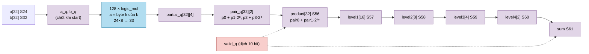
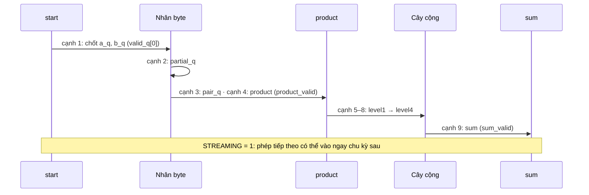

# `llm_math` — Bộ tính SIMD 32 làn: nhân từng phần tử và tổng 32 tích

| Mục | Giá trị |
|---|---|
| File | `llm_math.sv` |
| Loại | Tuần tự, pipeline 9 tầng, nhận 1 phép/chu kỳ khi `STREAMING = 1` |
| Nhóm | MAC — phép toán vector dùng chung (`llm_soc`) |
| Con | `logic_mul` × 128 (32 làn × 4 byte, 24 × 8 → 33 bit) |
| Được dùng bởi | `llm_soc` (instance `u_math`, `STREAMING = 1`) |

## 0. Kiến thức cần biết trước

**SIMD (Single Instruction, Multiple Data).** Một lệnh làm cùng một việc trên nhiều phần tử cùng lúc. Ở đây có 32 "làn" (lane): làn i nhân `a[i] × b[i]`. Vì một vector 128 kênh của mô hình được chia thành 4 nhóm × 32 phần tử, 32 làn xử lý trọn một nhóm trong một lượt.

**Hai kết quả từ một phép.** Module trả cùng lúc:
- `product[i] = a[i] × b[i]`: 32 tích riêng (dùng cho phép nhân từng phần tử, ví dụ `x · γ` trong RMSNorm hay `x · σ(x)` trong SiLU).
- `sum = Σ product[i]`: tích vô hướng 32 phần tử (dùng cho attention `q · k` và đầu ra từ điển).

**Nhân bằng cách chia nhỏ thừa số.** Nhân 24 × 32 bit trong một chu kỳ tạo đường tín hiệu rất dài. Mẹo: tách `b` (32 bit) thành 4 byte:

```
b = b0 + b1·2⁸ + b2·2¹⁶ + b3·2²⁴      (b3 là byte có dấu)
a × b = a·b0 + (a·b1)·2⁸ + (a·b2)·2¹⁶ + (a·b3)·2²⁴
```

Mỗi `a·bk` chỉ là nhân 24 × 8 bit (nhỏ, nhanh). Nhân với 2⁸, 2¹⁶ chỉ là dịch bit — không tốn phần cứng.

Ví dụ nhỏ: a = 3, b = 0x0102 (= 258) → b0 = 2, b1 = 1 → 3·2 + (3·1)·256 = 6 + 768 = 774 = 3 × 258 ✓.

**Cây cộng.** Cộng 32 số theo cặp: 32 → 16 → 8 → 4 → 2 → 1, tức 5 tầng. Mỗi tầng tăng 1 bit để không tràn: tích S56 → tổng S61.

Xem thêm [../00_kien_thuc_nen.md](../00_kien_thuc_nen.md) (mục 1.4 pipeline, 1.8 SIMD, 3 số fixed-point) và [logic_mul.md](logic_mul.md).

## 1. Tổng quan

`llm_math` là "máy nhân" duy nhất cho mọi phép vector cần nhân thật trong `llm_soc` (phép nhân ma trận ternary đi qua `ternary_dot32` riêng, không qua đây).

- Mỗi phép nhận 32 cặp `a[i]` (S24) × `b[i]` (32 bit có dấu).
- Sau **4 cạnh**: 32 tích S56 (`product_valid`).
- Sau **9 cạnh**: tổng S61 (`sum_valid`).
- Với `STREAMING = 1` (cấu hình của `llm_soc`), một phép mới có thể vào **mỗi chu kỳ**; các phép đi nối đuôi nhau trong pipeline.

## 2. Cổng

| Cổng | Hướng | Rộng | Ý nghĩa |
|---|---|---|---|
| `clk`, `rst_n` | in | 1 | Clock, reset bất đồng bộ mức thấp |
| `start` | in | 1 | Đưa một phép vào (chấp nhận khi `in_ready = 1`) |
| `a[0:31]` | in | 32 × S24 | Thừa số thứ nhất |
| `b[0:31]` | in | 32 × S32 | Thừa số thứ hai |
| `in_ready` | out | 1 | `STREAMING` hoặc không bận |
| `busy` | out | 1 | Còn phép nào trong pipeline |
| `product[0:31]` | out | 32 × S56 | Tích từng làn |
| `product_valid` | out | 1 | `product` ứng với một phép vừa xong (trễ 4) |
| `sum` | out | S61 | Tổng 32 tích |
| `sum_valid` | out | 1 | `sum` hợp lệ (trễ 9) |
| `done` | out | 1 | Xung kết thúc kiểu cũ (trễ 10) |

| Tham số | Mặc định | `llm_soc` | Ý nghĩa |
|---|---|---|---|
| `STREAMING` | 0 | 1 | 1: nhận phép mới mỗi chu kỳ; 0: chờ phép trước xong |

## 3. Sơ đồ khối



### Thời gian



## 4. Hoạt động chi tiết

### 4.1 Thanh ghi hợp lệ

`valid_q` là thanh ghi dịch 10 bit: mỗi cạnh `valid_q ← {valid_q[8:0], start && in_ready}`. Một bit 1 "đi theo" dữ liệu của phép tương ứng qua pipeline:

- `product_valid = valid_q[3]`
- `sum_valid = valid_q[8]`
- `done = valid_q[9]`
- `busy = |valid_q` (còn ít nhất một phép đang chạy)

Các tầng dữ liệu (`partial_q`, `pair_q`, `product`, `level*`, `sum`) **luôn cập nhật mỗi chu kỳ**, không có clock enable. Chú thích trong RTL giải thích: bỏ tín hiệu enable có fan-out lớn khỏi các thanh ghi rộng giúp timing tốt hơn, còn ý nghĩa dữ liệu chỉ do `valid_q` quyết định. Chỉ `a_q`, `b_q` có enable (`start && in_ready`), nên toán hạng được giữ nguyên cho đến phép kế tiếp.

### 4.2 Nhân theo byte

Với mỗi làn và mỗi byte `k = 0..3`: `partial[k] = a_q × b_q[8k+7 : 8k]`. Byte 0, 1, 2 được coi là **không dấu**; byte 3 là **có dấu** (`SIGNED_B = (k == 3)`), vì nó chứa bit dấu của `b`.

- `pair0 = partial[0] + (partial[1] <<< 8)` (S41)
- `pair1 = partial[2] + (partial[3] <<< 8)` (S41)
- `product = pair0 + (pair1 <<< 16)` (S56)

Ví dụ với số Q16: a = 1,5 (98304), b = −2,0 (−131072 = 0xFFFE0000):
- b0 = 0x00, b1 = 0x00, b2 = 0xFE (254), b3 = 0xFF (−1).
- pair0 = 0; pair1 = 98304·254 + (98304·(−1))·256 = 24 969 216 − 25 165 824 = −196 608.
- product = −196 608 · 65536 = −12 884 901 888 = −3,0 · 2³² ✓ (kết quả có 32 bit phân số; nơi dùng tự dịch về).

### 4.3 Cây cộng

`level1[j] = product[2j] + product[2j+1]`, rồi lần lượt `level2`, `level3`, `level4`, `sum`. Mỗi tầng một thanh ghi, mỗi tầng tăng 1 bit. Tổng 32 tích S56 luôn vừa S61.

### 4.4 `llm_soc` đưa gì vào `llm_math`?

Bộ chọn toán hạng nằm trong `llm_soc` (khối `always_ff` cho `math_a_q`, `math_b_q`). Ưu tiên: `head_capture` > `attention_capture` > trạng thái `op`.

| Khi | `a` | `b` | Dùng kết quả |
|---|---|---|---|
| `head_capture` | đoạn đầu vào (`input_cache_q`) | trọng số int8 của từ điển | `sum` |
| `attention_capture` | `query_q` | khóa K từ cache | `sum` |
| `E_DATA` | byte embedding int8 | `coefficient_q` | `product` |
| `N_SQUARE` | `vector_q` | `vector_q` | `sum` (tổng bình phương) |
| `N_INPUT` | `vector_q` | `reciprocal_q` (1/rms) | `product` |
| `NR_CLAMP` | kết quả đã chuẩn hóa | gain (`table_q`) | `product` |
| `R_INPUT` | `vector_q` | cos của RoPE | `product` (x · cos) |
| `R_COS` | `vector_q` xoay nửa (làn i lấy làn (i + 16) mod 32) | −sin (làn 0–15) / +sin (làn 16–31) | `product`, cộng với x · cos ở `R_SIN` |
| `A_WEIGHT` | giá trị V (`cache_operand_q`) | xác suất `probability_q` | `product` |
| `B_INPUT1` (nhân phần tử) | `second_q` | `vector_q` | `product` |
| `S_MUL` | `vector_q` | σ(x) Q15 | `product` (SiLU) |

`start` = `op[O_M_START]` hoặc `head_math_issue` hoặc `attention_math_issue`.
