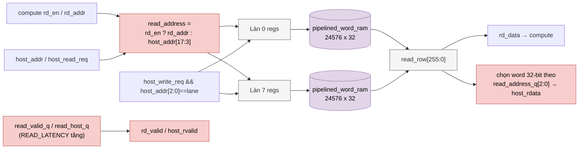

# `llm_parameter_ram` — SRAM tham số 256-bit (trọng số, hệ số, bảng)

| Mục | Giá trị |
|---|---|
| File | `llm_parameter_ram.sv` |
| Loại | Tuần tự. Compute đọc 256 bit/hàng; host đọc/ghi 32 bit |
| Nhóm | Bộ nhớ trọng số (Weights) |
| Con | 8 × `pipelined_word_ram` (WIDTH 32, ROWS = DEPTH) |
| Được dùng bởi | `llm_soc.u_parameters` (`ADDR_W = 15`, `DEPTH = PARAM_ROWS = 24576`) |

## 0. Kiến thức cần biết trước

**Tham số mô hình.** Mạng nơ-ron "học" được nhờ các con số gọi là **tham số**: trọng số ma trận, hệ số chuẩn hóa, bảng embedding… Chúng không đổi trong lúc chạy suy luận. Host nạp chúng một lần qua cổng 32 bit trước khi chạy.

**Cổng rộng và cổng hẹp.** Lõi tính toán muốn đọc nhiều dữ liệu một lần (256 bit = 128 trọng số ternary 2 bit), trong khi host chỉ có bus 32 bit. RAM được làm từ **8 làn × 32 bit**: lõi đọc cả 8 làn cùng lúc, còn host chọn 1 làn bằng 3 bit thấp của địa chỉ.

**Phân xử (arbitration).** Hai bên dùng chung một RAM, nên cần quy tắc ai được truy cập lúc nào. Ở đây quy tắc đơn giản: host chỉ truy cập khi lõi **không chạy**.

Các khái niệm chung (thanh ghi, cạnh clock, pipeline, valid, fixed-point, RNE…) được giải thích trong [../00_kien_thuc_nen.md](../00_kien_thuc_nen.md).

## 1. Tổng quan

Toàn bộ tham số của mô hình nằm ở đây: embedding int8, ma trận ternary 2-bit, metadata ma trận, gain RMSNorm, bảng RoPE, hệ số scale. Một **hàng = 256 bit = 8 làn × 32 bit**.

- Phía **compute** (graph FSM, `llm_linear_engine`, `llm_head_engine`) đọc nguyên hàng 256 bit.
- Phía **host** nhìn RAM như các word 32 bit: `host_addr = {row[14:0], lane[2:0]}`, ghi đúng một làn.

## 2. Cổng

| Cổng | Hướng | Độ rộng | Ý nghĩa |
|---|---|---|---|
| `rd_en, rd_addr` | in | 1, 15 | Đọc compute |
| `rd_data, rd_valid` | out | 256, 1 | Hàng tham số |
| `host_active` | in | 1 | Giao dịch host đang mở |
| `host_we` | in | 1 | Giao dịch host là ghi |
| `host_read_req`, `host_write_req` | in | 1 | Xung yêu cầu host |
| `host_addr` | in | 18 | `{row, lane}` |
| `host_wdata` | in | 32 | Dữ liệu ghi |
| `host_rdata`, `host_rvalid` | out | 32, 1 | Phản hồi host |

## 3. Sơ đồ khối



## 4. Hoạt động chi tiết

### 4.1 Độ trễ

`READ_LATENCY = (DEPTH ≤ 4096) ? 4 : 5`. Với `DEPTH = 24576`, compute đọc mất **5 cạnh**: 1 cạnh thanh ghi làn cộng 4 cạnh `pipelined_word_ram` (24 tile, 6 nhóm). Host đọc thêm **1 cạnh** để chọn word 32 bit và kiểm tra địa chỉ.

### 4.2 Phân xử compute/host

- Hai phía không đọc cùng lúc. Bộ phân xử ở `llm_soc` chỉ cho host truy cập khi lõi **không chạy** (`!core_running`).
- `read_request = rd_en || host_read_req`; bit `read_host_q` theo dọc pipeline để biết phản hồi thuộc về ai.
- `rd_valid` chỉ bật cho phản hồi compute (`!read_host_q`).

### 4.3 Hủy phản hồi host

Ở mỗi tầng, valid của một yêu cầu host bị **hủy** nếu `host_active` tắt, giao dịch chuyển thành ghi, hoặc `host_addr` đổi so với địa chỉ đang bay. Như vậy host không bao giờ nhận dữ liệu của một địa chỉ cũ:

```
read_valid_q[s] <= read_valid_q[s-1] &&
    (!read_host_q[s-1] || (host_active && !host_we && host_addr == read_address_q[s-1]))
```

Cuối pipeline, `host_rdata = read_row[addr[2:0]*32 +: 32]` và `host_rvalid` chỉ bật khi địa chỉ phản hồi vẫn khớp `host_addr`.

### 4.4 Ghi host

`write_enable_q` của làn `lane` bật khi `host_write_req && host_addr[2:0] == lane`, với hàng `host_addr[17:3]`. Xác nhận ghi (`host_rvalid` khi `host_we`) đến **sau khi lá đã commit** (`wr_valid` của làn).

### 4.5 Bản đồ hàng tham số

Các base address nằm trong `llm_pkg` (xem [llm_pkg.md](llm_pkg.md) và [../02_hoat_dong_chi_tiet_llm_soc.md](../02_hoat_dong_chi_tiet_llm_soc.md)).
