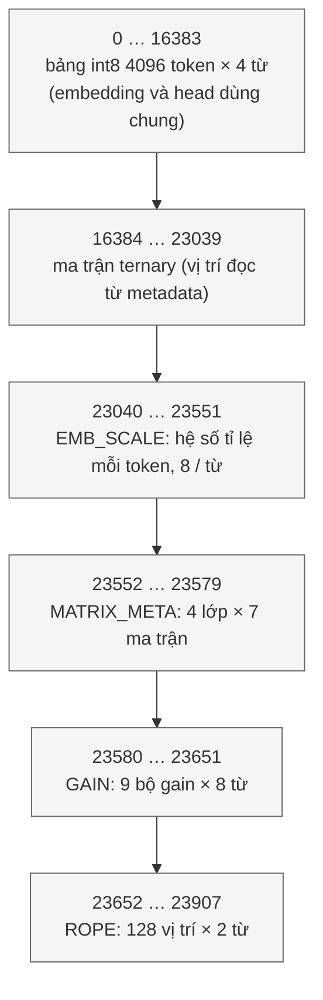

# `llm_pkg` — Hằng số và hàm tiện ích của NanoFable `llm_soc`

| Mục | Giá trị |
|---|---|
| File | `llm_pkg.sv` (cuối file `include` `llm_exp_lut.svh`, `llm_gumbel_lut.svh`) |
| Loại | Package SystemVerilog (hằng + hàm tổ hợp thuần) |
| Nhóm | Hạ tầng — dùng chung |
| Con | — (kéo theo module `llm_exp_sample`, `llm_gumbel_sample`) |
| Được dùng bởi | `llm_soc`, `llm_attention_normalize` (`import llm_pkg::*`) |

## 0. Kiến thức cần biết trước

**Package.** Trong SystemVerilog, `package` chứa hằng số, kiểu và hàm dùng chung. Module nào cần thì `import`. Nhờ vậy địa chỉ bộ nhớ hay quy tắc bão hòa chỉ định nghĩa **một lần**.

**Hàm `function automatic`.** Một hàm thuần tổ hợp: nhận đầu vào, trả đầu ra, không giữ trạng thái. Khi tổng hợp, mỗi lần gọi tạo ra một khối logic.

**Bão hòa (saturation).** Khi kết quả vượt khoảng của định dạng đích, thay vì để tràn (quay vòng sang số âm), kẹp về giá trị lớn/nhỏ nhất. S24: −8 388 608 … 8 388 607.

**xorshift32.** Bộ sinh số giả ngẫu nhiên rất rẻ: chỉ dịch và XOR. Từ một giá trị khác 0 nó sinh ra dãy 2³² − 1 số khác 0 trước khi lặp lại.

Xem thêm [../00_kien_thuc_nen.md](../00_kien_thuc_nen.md) (mục 3.5 bão hòa, 5.6 sampling).

## 1. Hằng số

| Hằng | Giá trị | Ý nghĩa |
|---|---|---|
| `CONTEXT` | 128 | Số vị trí tối đa (prompt + token sinh ra) |
| `PARAM_ROWS` | 24576 | Số từ 256 bit của bộ nhớ tham số |
| `EMB_SCALE_BASE` | 23040 | Đầu vùng hệ số tỉ lệ embedding / head (8 hệ số mỗi từ) |
| `MATRIX_META_BASE` | 23552 | Đầu vùng metadata ma trận (vị trí, số chunk, số hàng, hệ số) |
| `GAIN_BASE` | 23580 | Đầu vùng gain của RMSNorm |
| `ROPE_BASE` | 23652 | Đầu vùng bảng cos/sin của RoPE |



Cách `llm_soc` tính địa chỉ trong từng vùng:

- Bảng int8: `{0, token[11:0], chunk[1:0]}` = `4·token + chunk`. Cả bước embedding (`E_DATA`) lẫn head đọc cùng bảng này.
- `EMB_SCALE_BASE + token / 8`: hệ số tỉ lệ của token (8 hệ số 32 bit trong một từ 256 bit).
- `MATRIX_META_BASE + 7·layer + matrix_id` với `matrix_id` 0…6 = Q, K, V, O, gate, up, down.
- `GAIN_BASE + 16·layer + (8 nếu norm trước MLP) + 2·row`; norm cuối (`G_FNORM`) ở `GAIN_BASE + 64 + 2·row`. Một bộ gain 128 × 16 bit = 8 từ.
- `ROPE_BASE + 2·position`: 2 từ cos/sin cho mỗi vị trí.

Vùng ternary không có hằng riêng: địa chỉ đầu mỗi ma trận nằm trong metadata (do host nạp). Kích thước 16384 … 23039 là suy ra: nếu Q, K, V, O là 128 hàng × 4 chunk (1 từ/hàng), gate và up là 384 hàng × 4 chunk, down là 128 hàng × 12 chunk (3 từ/hàng), thì mỗi lớp cần 4·128 + 3·384 = 1664 từ, 4 lớp = 6656 = 23040 − 16384 — khớp đúng chỗ trống giữa bảng int8 và `EMB_SCALE_BASE`. Từ 23908 đến 24575 không được RTL tham chiếu.

## 2. Hàm

### `llm_sat24(x: S64) → S24`

`x > 8 388 607` → `0x7FFFFF`; `x < −8 388 608` → `0x800000`; ngược lại lấy 24 bit thấp. Ví dụ: 9 000 000 → 8 388 607 (≈ 127,99998 ở Q16).

### `llm_extend56(x: S56) → S64`

Mở rộng dấu: lặp bit 55 thêm 8 lần ở đầu. Dùng để đưa tích của `llm_math` vào các thanh ghi 64 bit.

### `llm_random_next(x: U32) → U32`

```
x ^= x << 13
x ^= x >> 17
x ^= x << 5
```

Ví dụ từ 1: `1 ^ (1<<13) = 8193` → `8193 ^ (8193>>17) = 8193` → `8193 ^ (8193<<5) = 8193 ^ 262176 = 270369`. Seed 0 không hợp lệ (dãy sẽ mãi bằng 0), nên `llm_soc` đổi seed 0 của host thành 1.

## 3. Bảng tra kéo theo

- [`llm_exp_sample`](llm_exp_sample.md): e^(−i/16), 257 mẫu, cho softmax.
- [`llm_gumbel_sample`](llm_gumbel_sample.md): nhiễu Gumbel, 256 mẫu, cho lấy mẫu token.
