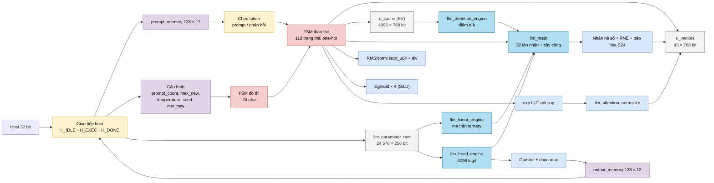
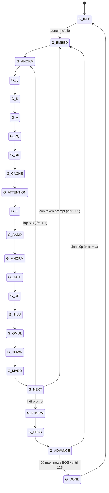
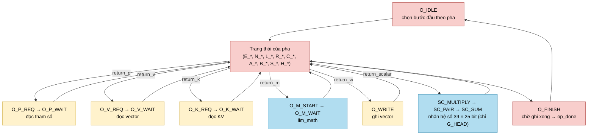

# `llm_soc` — NPU suy luận mô hình ngôn ngữ NanoFable tự chủ

| Mục | Giá trị |
|---|---|
| File | `llm_soc.sv` (1431 dòng) |
| Loại | Top chính: giao tiếp host + FSM đồ thị 24 trạng thái + FSM thao tác one-hot 112 trạng thái |
| Nhóm | Top / điều khiển — NPU chính |
| Con | `reset_release`, `llm_parameter_ram` (`u_parameters`), `llm_bank_ram` × 2 (`u_vectors`, `u_cache`), `llm_math` (`u_math`), `llm_linear_engine`, `llm_head_engine`, `llm_attention_engine`, `llm_attention_normalize`, `isqrt_u64` (`u_root`), `div` (`u_div`), `sigmoid` × `SIGMOID_LANES`, `logic_mul` × 5, `llm_exp_sample` × 2, `llm_gumbel_sample` |
| Package | `llm_pkg` (hằng số, `llm_sat24`, `llm_random_next`), `npu_pkg` (`rne_shift64`, `sat_s16`, `sat_s32`) |
| Được dùng bởi | Top của thiết kế (FPGA: `quartus/llm_soc`) |

## 0. Kiến thức cần biết trước

**Mô hình ngôn ngữ sinh văn bản thế nào?** Văn bản được cắt thành các **token** (mảnh từ), mỗi token là một số 0…4095. Mô hình nhận chuỗi token đã có và tính "điểm" (logit) cho cả 4096 token có thể đứng tiếp theo. Chọn một token, nối vào chuỗi, lặp lại. Ví dụ prompt "Ngày xửa" → mô hình chọn "ngày" → chuỗi "Ngày xửa ngày" → chọn "xưa" → …

**Transformer decoder, một lớp gồm những gì?** Mỗi token được biểu diễn bằng vector 128 số (kênh). Một lớp (layer) làm:

```
h  = RMSNorm(x)
q, k, v = Wq·h, Wk·h, Wv·h           (3 phép nhân ma trận)
q, k = RoPE(q, k, vị trí)            (xoay để mã hóa vị trí)
a  = Attention(q, k, v của mọi token trước)  (4 đầu, mỗi đầu 32 kênh)
x  = x + Wo·a                        (cộng dư — residual)
h  = RMSNorm(x)
x  = x + Wdown·( SiLU(Wgate·h) ⊙ (Wup·h) )   (khối FFN, 384 kênh ẩn)
```

NanoFable có 4 lớp như vậy. Sau lớp cuối: `RMSNorm` → nhân với ma trận embedding (dùng chung với đầu vào) → 4096 logit → chọn token.

**Prefill và decode.** *Prefill*: đẩy lần lượt từng token của prompt qua 4 lớp để điền bộ nhớ đệm K/V, chưa cần chọn token (trừ token cuối). *Decode*: mỗi bước sinh một token mới, đưa token đó vào làm đầu vào bước kế tiếp.

**KV cache.** Attention của token ở vị trí p cần k, v của mọi vị trí 0…p. Thay vì tính lại, mỗi bước lưu k, v của vị trí hiện tại vào bộ nhớ đệm (`u_cache`), các bước sau chỉ đọc lại.

**Lấy mẫu (sampling).** `temperature = 0` → chọn logit lớn nhất (greedy). `temperature > 0` → cộng nhiễu Gumbel tỉ lệ với temperature vào mỗi logit rồi chọn lớn nhất (Gumbel-max), tương đương lấy mẫu ngẫu nhiên theo softmax. Temperature càng cao, văn bản càng "ngẫu nhiên".

**FSM kiểu "gọi hàm".** Rất nhiều bước cần cùng một việc: đọc bộ nhớ tham số, đọc bộ nhớ vector, chạy `llm_math`, ghi vector. `llm_soc` viết mỗi việc đó **một lần** thành vài trạng thái (`O_P_REQ/O_P_WAIT`, `O_V_REQ/O_V_WAIT`, …). Trước khi nhảy vào, trạng thái gọi ghi "địa chỉ trả về" vào thanh ghi `return_p`/`return_v`/`return_k`/`return_m`/`return_w`/`return_scalar`; xong việc, FSM nhảy về trạng thái được ghi. Giống `call`/`return` trong phần mềm.

Xem thêm [../00_kien_thuc_nen.md](../00_kien_thuc_nen.md) (fixed-point, RMSNorm, softmax, attention), [llm_pkg.md](llm_pkg.md) (hằng số, bản đồ tham số).

## 1. Tổng quan

### 1.1 Thông số mô hình (cố định trong RTL)

| Thông số | Giá trị |
|---|---|
| Số lớp | 4 |
| Số kênh (d_model) | 128, lưu dạng S24 Q16 (32 kênh / hàng 768 bit) |
| Đầu attention | 4 × 32 kênh |
| Kênh ẩn FFN | 384 |
| Từ vựng | 4096 token; token 0, 2 không bao giờ được chọn; token 1 = kết thúc (EOS) |
| Ngữ cảnh tối đa | 128 vị trí (prompt + token sinh ≤ 128) |
| Trọng số | Ternary (−1/0/+1) cho 7 ma trận mỗi lớp; int8 cho embedding |

### 1.2 Bản đồ địa chỉ host

| Vùng | Địa chỉ byte | Nội dung |
|---|---|---|
| Tham số | 0x000000 – 0x0BFFFC | `llm_parameter_ram`, mỗi 32 bit một lần (24 576 hàng 256 bit) |
| Prompt | 0x100000 + 4·i | Token prompt thứ i (12 bit), i = 0…127 |
| Kết quả | 0x200000 + 4·i | Token sinh ra thứ i (chỉ đọc khi không chạy) |
| Trạng thái | 0x400000 (đọc) | `{generated[7:0], overflow, error, ready, running}` |
| Cấu hình | 0x400000 + 4·k (ghi) | k = 1 `prompt_count`, 2 `max_new` (mặc định 96), 3 bit 0 = **launch**, 4 `temperature` (166), 5 `seed` (1; ghi 0 → 1), 6 `min_new` (64) |

Giao dịch host: giữ `host_en`, địa chỉ, dữ liệu đến khi `host_ready = 1`, rồi hạ `host_en` ít nhất một chu kỳ. Ghi chỉ có hiệu lực khi lõi không chạy.

### 1.3 Bản đồ bộ nhớ vector `u_vectors` (96 hàng × 768 bit)

Mỗi "khe" gồm 12 hàng; hàng = 32 làn × S24. Vector 128 kênh dùng 4 hàng, vector 384 kênh dùng 12 hàng. Địa chỉ = `khe · 12 + hàng`.

| Khe | Hàng | Nội dung |
|---|---|---|
| 0 | 0–3 | x — dòng dư (residual) |
| 1 | 12–15 | Đầu ra RMSNorm / đầu ra Wo, Wdown (trước khi cộng) |
| 2 | 24–27 | q (hàng 24 + đầu h) |
| 3 | 36–39 | k |
| 4 | 48–51 | v |
| 5 | 60–63 | Kết quả attention (hàng 60 + đầu h) |
| 6 | 72–83 | gate → SiLU(gate) → SiLU(gate) ⊙ up |
| 7 | 84–95 | up |

### 1.4 KV cache `u_cache` (4096 hàng × 768 bit)

Địa chỉ 12 bit = `{lớp[1:0], vị_trí[6:0], K/V, đầu[1:0]}`. Mỗi hàng chứa 32 kênh của một đầu. Mỗi bước ghi 8 hàng (4 đầu k + 4 đầu v).

## 2. Cổng và tham số

| Tham số | Mặc định | Ý nghĩa |
|---|---|---|
| `USE_QUARTUS_MEMORY` | 1 | Dùng `quartus_word_ram` cho các bộ nhớ lớn (0 = mảng thanh ghi di động) |
| `PERF_COUNTERS` | 0 | Thêm bộ đếm hiệu năng (chu kỳ mỗi pha, số lần đọc/ghi) |
| `ENABLE_DEBUG_INDEX` | 0 | Mã hóa trạng thái one-hot thành số 7 bit cho `instr_debug` |
| `ATTN_DIV_LANES` | 4 | Số phép chia song song khi chuẩn hóa attention |
| `SIGMOID_LANES` | 4 | Số khối `sigmoid` song song cho SiLU |

| Cổng | Hướng | Rộng | Ý nghĩa |
|---|---|---|---|
| `host_en`, `host_we`, `host_addr`, `host_wdata` | in | 1/1/32/32 | Giao dịch host |
| `host_rdata`, `host_ready` | out | 32/1 | Kết quả / hoàn tất |
| `running`, `ready` | out | 1 | Đang suy luận / rảnh |
| `error`, `overflow_out` | out | 1 | Lỗi / có kết quả nhân ma trận ternary bị kẹp S24 (chỉ đường linear bật cờ này, xem §4.6) |
| `pc_debug` | out | 9 | Vị trí token hiện tại |
| `instr_debug` | out | 13 | `{0, pha đồ thị[4:0], chỉ số trạng thái op[6:0]}` |

## 3. Sơ đồ khối

### 3.1 Kiến trúc tổng quát



### 3.2 FSM đồ thị: thứ tự các pha



Bất kỳ pha nào gặp lỗi (`op_fault_q`) → `G_DONE` với `error = 1`.

### 3.3 FSM thao tác: chương trình con dùng chung



Trong thực tế chỉ `G_HEAD` gọi chuỗi `SC_MULTIPLY → SC_PAIR → SC_SUM` (từ `H_COEFF`). Kết quả của `llm_linear_engine` không đi qua các trạng thái này: chúng chạy trên đường ống riêng điều khiển bởi `linear_pipe_valid_q[0..8]`, dùng chung ba bộ nhân `u_scalar_lo/mid/hi`. Xem §4.6.

## 4. Hoạt động chi tiết

### 4.1 Khởi động

Host ghi `launch` (0x40000C, bit 0 = 1). Nếu `prompt_count = 0`, `max_new = 0` hoặc `prompt_count + max_new > 128` → `error = 1`, không chạy. Ngược lại: xóa `error`, `overflow`, đặt `layer = 0`, `position = 0`, `generated = 0`, `random = seed`, vào `G_EMBED`. Token đầu tiên được đọc từ `prompt_memory[0]` qua một đường ống 2 nhịp (`token_read_valid_q` → `token_commit_valid_q` → `token_valid_q`); `G_EMBED` chờ `token_valid_q`.

### 4.2 Từng pha

| Pha | Đọc | Làm | Ghi |
|---|---|---|---|
| `G_EMBED` | Tham số hàng `token·4 + r` (int8), hệ số `EMB_SCALE[token]` | Giải lượng tử: int8 × hệ số → S24 (qua `llm_math`, RNE, kẹp) | Khe 0 |
| `G_ANORM`, `G_MNORM`, `G_FNORM` | Khe 0, gain | Σx² (4 hàng) → `(Σ >> 7) + 42 950` → `isqrt` → `2³² / rms` (`div`, RNE) → x · (1/rms) · gain | Khe 1 |
| `G_Q`, `G_K`, `G_V` | Meta ma trận, khe 1 | `llm_linear_engine`: y = W · h, rồi × hệ số, `>> 24` RNE, bão hòa S24 | Khe 2 / 3 / 4 |
| `G_RQ`, `G_RK` | Bảng cos/sin `ROPE_BASE + 2·vị_trí` | RoPE: hai lần `llm_math` (phần cos, phần sin) | Tại chỗ khe 2 / 3 |
| `G_CACHE` | Khe 3, 4 | Sao chép 4 hàng k + 4 hàng v | KV cache |
| `G_ATTENTION` | Khe 2, KV cache | Mỗi đầu: điểm q·k cho t = 0…vị_trí, max, `exp(score − max)` bằng LUT nội suy, Σ p·v, chia cho Σ p | Khe 5 |
| `G_O` | Khe 5 | Wo · a | Khe 1 |
| `G_AADD`, `G_MADD` | Khe 0, 1 | x = x + khe 1 (bão hòa) | Khe 0 |
| `G_GATE`, `G_UP` | Khe 1 | Wgate · h, Wup · h (384 hàng) | Khe 6 / 7 |
| `G_SILU` | Khe 6 | `g · sigmoid(g)` với 4 khối `sigmoid` song song (Q12) | Khe 6 |
| `G_GMUL` | Khe 6, 7 | Nhân theo phần tử | Khe 6 |
| `G_DOWN` | Khe 6 (384 kênh) | Wdown · u (128 hàng) | Khe 1 |
| `G_HEAD` | Khe 1, embedding int8, hệ số | 4096 logit, mỗi logit = (embedding[t] · h) × hệ số; cộng nhiễu Gumbel; chọn max | `best_token_q` |

`G_K`, `G_V` và `G_UP` dùng lại vector đầu vào đã nạp sẵn trong `input_cache_q` (cùng nguồn với `G_Q` / `G_GATE`), không đọc lại `u_vectors`.

### 4.3 Kiểm tra metadata ma trận

Trước mỗi phép nhân ma trận, hàng meta `MATRIX_META_BASE + lớp·7 + chỉ_số` được đọc và kiểm tra:

- Số cột K = 128 (hoặc 384 với `Wdown`); số hàng = 384 với `Wgate`, `Wup`, còn lại 128.
- Hệ số ≠ 0; các bit dư phải bằng 0.
- Hàng trọng số đầu tiên ≥ 16 384 (vùng ternary) và kết thúc ≤ 23 040 (trước `EMB_SCALE_BASE`).

Sai → `op_fault_q`, dừng với lỗi. Cơ chế này chặn trường hợp host nạp tham số sai định dạng.

### 4.4 Chọn token (G_HEAD → G_ADVANCE)

- Logit đã nhân hệ số: `s = RNE(acc · coeff >> 24)`.
- `temperature = 0`: điểm = s.
- `temperature > 0`: điểm = s + RNE(gumbel · temperature >> 8), với gumbel tra bảng `llm_gumbel_sample` bằng 8 bit cao của bộ sinh ngẫu nhiên xorshift (`llm_random_next`).
- Bỏ qua token 0 và 2; token 1 (EOS) chỉ được chọn khi `generated ≥ min_new`. Khi bằng nhau, giữ token có số nhỏ hơn.
- `G_ADVANCE` ghi token vào `output_memory[generated]`, tăng `generated`. Dừng khi đủ `max_new`, chọn EOS, hoặc vị trí = 127. Nếu không, token vừa chọn thành đầu vào của vị trí kế tiếp.

### 4.5 Ví dụ phiên làm việc của host

Prompt 3 token [17, 250, 9], sinh tối đa 5 token, greedy:

1. Ghi toàn bộ tham số vào 0x000000… (24 576 × 8 lần ghi 32 bit).
2. Ghi 17, 250, 9 vào 0x100000, 0x100004, 0x100008.
3. Ghi 3 → 0x400004, 5 → 0x400008, 0 → 0x400010 (temperature), 0 → 0x400018 (min_new).
4. Ghi 1 → 0x40000C (launch).
5. Đọc 0x400000 đến khi bit `ready = 1`. Số token sinh = bit 11…4.
6. Đọc token tại 0x200000, 0x200004, …

Thứ tự tính toán: vị trí 0 (token 17) qua 4 lớp → vị trí 1 (250) qua 4 lớp → vị trí 2 (9) qua 4 lớp → FNORM, HEAD → token mới ở vị trí 3 → 4 lớp → HEAD → … tối đa 5 lần HEAD.

### 4.6 Đường ống kết quả linear và cờ `overflow_out`

Mỗi tổng hàng `llm_linear_engine` trả ra (`linear_feed`) đi qua 9 tầng, đánh dấu bằng `linear_pipe_valid_q[0..8]`, số hàng đi kèm trong `linear_pipe_row_q`:

| Tầng | Việc |
|---|---|
| 0 | Ba tích riêng `acc × coeff[7:0]`, `[15:8]`, `[24:16]` (`u_scalar_lo/mid/hi`) |
| 1–2 | Cộng các tích riêng → `scalar_product_q` |
| 3 | `rne_shift64(·, 24)` → `scalar_round_q` |
| 4–5 | Tách cờ vượt trên / dưới S24, chuyển qua cụm (`scalar_packet_*`, `scalar_cluster_*`) |
| 6 | Kẹp S24 vào `scalar_group_q`; **bị kẹp → `overflow_out = 1`** |
| 7 | Đưa vào đúng làn của `write_vector_q` |
| 8 | Đủ 32 hàng (hoặc hàng cuối) → ghi `u_vectors` |

`overflow_out` chỉ được bật ở tầng 6 này. Các phép kẹp khác (EMBED, RMSNorm, RoPE, cộng dư, SiLU, GMUL, chuẩn hóa attention, logit HEAD) **không** bật cờ. Cờ được xóa khi `launch` hợp lệ ở `G_IDLE`.

## 5. Trạng thái không bao giờ được vào (phân tích tĩnh)

`op_t` khai báo 112 trạng thái one-hot, nhưng đi theo mọi đường chuyển trạng thái và mọi nhãn `return_*` thực sự được gán, chỉ **87** trạng thái đến được từ `O_IDLE`. 25 trạng thái còn lại là phần sót lại từ phiên bản trước khi có các engine streaming:

| Nhóm | Trạng thái không đến được |
|---|---|
| Linear cũ | `L_WEIGHT`, `L_INPUT`, `L_MAC`, `L_COEFF`, `L_ROUND`, `L_FLAGS`, `L_SAT`, `L_STORE`, `L_DECODE`, `L_DOT_WAIT` |
| Attention cũ | `A_KEY`, `A_DOT`, `A_SCALE`, `A_SCORE`, `A_NEXT_SCORE`, `A_VALUE`, `A_DIV`, `A_DIV_WAIT`, `A_FLAGS`, `A_SAT`, `A_PACK` |
| Head cũ | `H_WEIGHT`, `H_INPUT`, `H_MAC` |
| Định tuyến scalar | `SC_ROUTE` |

Các nhãn trở về tương ứng không bao giờ được gán: `RET_P_L_WEIGHT`, `RET_P_H_WEIGHT`, `RET_M_L_MAC`, `RET_M_H_MAC`, `RET_M_A_DOT`, `RET_K_A_KEY`, `RET_SCALAR_L_ROUND`, `RET_SCALAR_A_SCORE`, `RET_SCALAR_O_IDLE`.

Đây là kết quả đọc mã nguồn, không phải kết quả mô phỏng hay tổng hợp. Mã của các trạng thái này vẫn nằm trong RTL; tài liệu chỉ ghi nhận chúng.
