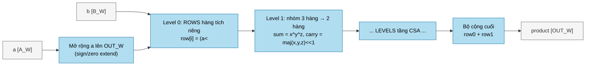
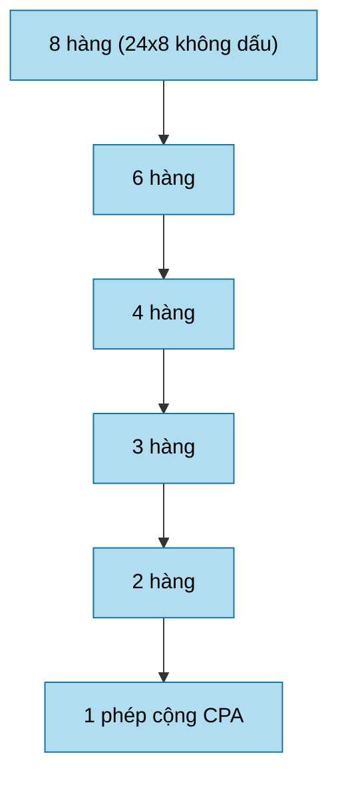

# `logic_mul` — Bộ nhân tổ hợp bằng cây nén bit-product

| Mục | Giá trị |
|---|---|
| File | `logic_mul.sv` |
| Loại | Tổ hợp thuần (không clock, không reset) |
| Nhóm | Số học dùng chung (MAC) |
| Được dùng bởi | `llm_soc` (5 instance), `llm_math`, `llm_attention_engine`, `norm`, `rowwise_op`, `sigmoid`, `scale_compose`, `ternary_mul`, `mul`, `postscale` |

## 0. Kiến thức cần biết trước

**Nhân nhị phân bằng tay.** Nhân hai số nhị phân giống nhân số thập phân, chỉ khác là mỗi "chữ số" của số nhân chỉ là 0 hoặc 1. Ví dụ 5 × 3 = `101 × 011`:

```
      101      (a = 5)
    × 011      (b = 3)
    -----
      101      bit 0 của b = 1 → chép a
     1010      bit 1 của b = 1 → chép a, dịch trái 1
    00000      bit 2 của b = 0 → 0
    -----
     1111  = 15
```

Mỗi dòng trước dấu cộng là một **tích riêng phần** (partial product). Một phép nhân n bit có n tích riêng phần cần cộng lại.

**Số có dấu.** Với số bù hai, bit cao nhất của b mang trọng số **âm** (−2ⁿ⁻¹ thay vì +2ⁿ⁻¹). Vì vậy tích riêng phần của bit đó phải **trừ** đi thay vì cộng vào.

**Bộ cộng nhớ lưu (CSA, 3:2).** Cộng nhiều số liên tiếp bằng bộ cộng thường rất chậm, vì mỗi phép cộng phải chờ số nhớ lan từ bit thấp lên bit cao. CSA nhận **3 số** và trả **2 số** (một dãy "tổng không nhớ" và một dãy "nhớ") có cùng tổng. Mỗi bit được xử lý độc lập, nên không có lan truyền nhớ. Lặp lại CSA theo dạng cây thì n hàng giảm còn 2 hàng sau khoảng log₁.₅(n) tầng. Cuối cùng chỉ cần **một** bộ cộng thường.

**Tại sao không dùng `*`?** Dùng `*` sẽ để công cụ tự chọn khối nhân DSP của FPGA. Viết tường minh giúp mạch giống hệt nhau trên FPGA và ASIC, và kiểm soát được độ rộng bit.

Các khái niệm chung (thanh ghi, cạnh clock, pipeline, valid, fixed-point, RNE…) được giải thích trong [../00_kien_thuc_nen.md](../00_kien_thuc_nen.md).

## 1. Tổng quan

Toàn bộ NPU **không dùng toán tử `*`** trong datapath và **không dùng IP nhân của FPGA**. Mọi phép nhân đều quy về `logic_mul`. Module này xây phép nhân theo đúng cách nhân tay nhị phân:

1. Tạo **các hàng tích riêng phần** (partial product): mỗi bit của `b` chọn một bản sao `a` đã dịch trái.
2. Nén các hàng bằng **bộ cộng nhớ lưu 3:2** (carry-save adder, CSA) qua nhiều tầng, đến khi còn tối đa 2 hàng.
3. Cộng 2 hàng cuối bằng **một bộ cộng truyền nhớ** để ra tích.

Kết quả là `OUT_W` bit thấp của tích **chính xác**, có dấu hoặc không dấu tùy tham số. Module thuần tổ hợp, nên module gọi tự quyết định đặt thanh ghi trước/sau để chia pipeline.

## 2. Tham số và cổng

| Tên | Kiểu | Mặc định | Ý nghĩa |
|---|---|---|---|
| `A_W` | param | 24 | Độ rộng toán hạng `a` |
| `B_W` | param | 8 | Độ rộng toán hạng `b` (quyết định số hàng tích riêng) |
| `OUT_W` | param | `A_W+B_W` | Độ rộng kết quả; lấy `OUT_W` bit thấp |
| `SIGNED_A` | param | 1 | `a` là số bù 2 → mở rộng dấu lên `OUT_W` |
| `SIGNED_B` | param | 0 | `b` là số bù 2 → hàng MSB mang trọng số âm |
| `a` | in `[A_W-1:0]` | | Thừa số 1 |
| `b` | in `[B_W-1:0]` | | Thừa số 2 |
| `product` | out `[OUT_W-1:0]` | | Tích |

## 3. Sơ đồ khối



## 4. Hoạt động chi tiết

### 4.1 Tạo hàng tích riêng (level 0)

- Số hàng là `ROWS = B_W + (SIGNED_B ? 1 : 0)`.
- Với bit `i` thường: `row[i] = (extended_a << i) & {OUT_W{b[i]}}`.
- Nếu `SIGNED_B = 1`, bit MSB của `b` có trọng số `-2^(B_W-1)`. Có thể viết `-x = ~x + 1`, nên module tách thành hai phần:
  - `row[B_W-1] = b[MSB] ? ~(extended_a << (B_W-1)) : 0`, tức phần đảo bit;
  - `row[B_W] = b[MSB]`, tức phần "+1" thêm vào bit 0.

### 4.2 Cây nén 3:2

Mỗi tầng nhóm các hàng thành bộ ba `(x, y, z)` và thay mỗi bộ ba bằng hai hàng:

| Đầu ra | Công thức | Ý nghĩa |
|---|---|---|
| `sum` | `x ^ y ^ z` | Tổng từng bit, chưa truyền nhớ |
| `carry` | `((x&y)|(x&z)|(y&z)) << 1` | Bit nhớ, dịch lên trọng số kế |

Các hàng dư (không đủ bộ ba) được chuyển thẳng xuống tầng sau (`g_tail`). Số hàng sau mỗi tầng là `count - count/3`. Hàm elaboration `rows_at()` và `tree_depth()` tính hình học cây lúc tổng hợp; các vòng lặp đều có biên tĩnh `ROWS`.



### 4.3 Độ sâu cây cho các instance thực tế

Tính bằng đúng công thức `count -= count/3` của RTL:

| Instance (nơi dùng) | A_W×B_W | Dấu B | Chuỗi số hàng | Số tầng CSA |
|---|---|---|---|---|
| `llm_math.u_mul` (slice 0..2), `llm_soc.u_noise_mul` | 24×8 | không | 8→6→4→3→2 | 4 |
| `llm_math.u_mul` (slice 3) | 24×8 | có | 9→6→4→3→2 | 4 |
| `llm_soc.u_scalar_lo/mid` | 39×8 | không | 8→6→4→3→2 | 4 |
| `llm_soc.u_scalar_hi` | 39×9 | có | 10→7→5→4→3→2 | 5 |
| `llm_soc.u_exp_mul` | 25×12 | không | 12→8→6→4→3→2 | 5 |
| `llm_attention_engine.u_scale` | 39×14 | không | 14→10→7→5→4→3→2 | 6 |
| `sigmoid.u_bit_mul` | 24×10 | không | 10→7→5→4→3→2 | 5 |
| `rowwise_op.u_mul` | 16×16 | không | 16→…→2 | 6 |
| `mul.u_bit_mul` | 16×17 | có | 18→…→2 | 6 |
| `postscale`/`ternary_mul.u_bit_mul` | 18×24 | không | 24→…→2 | 7 |
| `scale_compose.u_bit_mul` | 24×24 | không | 24→…→2 | 7 |
| `norm.u_mul` | 25×25 | có | 26→…→2 | 7 |

## 5. Ghi chú thiết kế

- Không có thanh ghi bên trong. Độ trễ tổ hợp tăng theo số tầng CSA cộng thêm một bộ cộng `OUT_W` bit, nên các khối dùng nó thường cắt phép nhân lớn thành nhiều lát (ví dụ `llm_math` cắt S32 thành 4 lát 8 bit, `llm_soc` cắt hệ số 24 bit thành 8/8/9 bit).
- Kết quả là tích bị cắt về `OUT_W` bit (modulo `2^OUT_W`). Nơi gọi chọn `OUT_W` đủ rộng để không mất thông tin.
- Đây là điểm duy nhất hiện thực phép nhân, nên số học của NPU độc lập công nghệ (không phụ thuộc DSP block).
