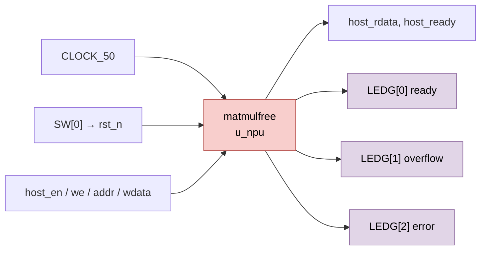

# `matmul_wrap` — Vỏ bọc board FPGA cho NPU legacy `matmulfree`

| Mục | Giá trị |
|---|---|
| File | `matmul_wrap.sv` |
| Loại | Cấu trúc thuần (chỉ nối dây) |
| Nhóm | Top — tích hợp board |
| Con | `matmulfree` (`u_npu`) |
| Được dùng bởi | — (top của bản dựng FPGA legacy) |

## 0. Kiến thức cần biết trước

**Wrapper (vỏ bọc).** Một module chỉ có nhiệm vụ nối module lõi với chân vật lý của board: clock của board, công tắc, đèn LED. Nó không chứa logic tính toán. Nhờ vậy lõi `matmulfree` không phụ thuộc vào board cụ thể.

**Tên chân kiểu board Altera/Intel.** `CLOCK_50` là dao động 50 MHz; `SW` là công tắc gạt; `LEDG` là LED xanh. Đây là quy ước tên chân thường gặp trên các board DE của Terasic.

Xem thêm [../00_kien_thuc_nen.md](../00_kien_thuc_nen.md) (mục 1 phần cứng số, reset) và [matmulfree.md](matmulfree.md).

## 1. Tổng quan

| Chân board | Nối tới `matmulfree` | Ý nghĩa |
|---|---|---|
| `CLOCK_50` | `clk` | Clock 50 MHz |
| `SW[0]` | `rst_n` | Gạt xuống = reset (mức thấp) |
| `LEDG[0]` | `ready` | NPU sẵn sàng |
| `LEDG[1]` | `overflow_out` | Có bão hòa |
| `LEDG[2]` | `error` | Có lỗi |
| `host_*` | `host_*` | Giao tiếp host 32 bit (đi thẳng) |

`running`, `pc_debug`, `instr_debug` được nối vào dây nội bộ nhưng không đưa ra chân.

Chú thích trong file nhắc: host phải nạp SRAM, descriptor và một chương trình kết thúc bằng lệnh `HALT` trước khi ra lệnh start.

## 2. Sơ đồ khối

