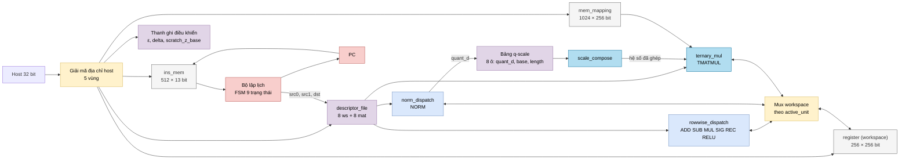
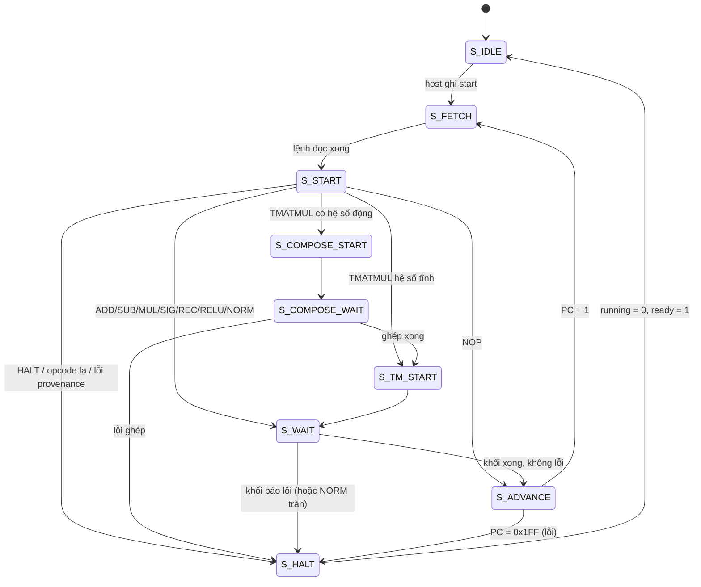

# `matmulfree` — NPU legacy chạy chương trình lệnh 13 bit

| Mục | Giá trị |
|---|---|
| File | `matmulfree.sv` |
| Loại | Top của NPU legacy: giải mã host + bộ lập lịch FSM 9 trạng thái |
| Nhóm | Top / điều khiển — NPU legacy |
| Con | `PC` (`u_pc`), `ins_mem` (`u_imem`), `descriptor_file` (`u_desc`), `register` (`u_ws`), `mem_mapping` (`u_param`), `rowwise_dispatch` (`u_row`), `norm_dispatch` (`u_norm`), `ternary_mul` (`u_tm`), `scale_compose` (`u_compose`) |
| Được dùng bởi | `matmul_wrap` |

## 0. Kiến thức cần biết trước

**NPU "chạy chương trình" là gì?** Khác `llm_soc` (luồng cố định cho một mô hình), `matmulfree` giống một CPU rất nhỏ chuyên cho vector: host nạp **chương trình** (danh sách lệnh) vào bộ nhớ lệnh, nạp dữ liệu, rồi bấm `start`. NPU đọc từng lệnh, giao cho khối tính toán phù hợp, chờ xong rồi sang lệnh kế tiếp, đến khi gặp `HALT`.

**Bộ đếm chương trình (PC).** Thanh ghi chứa địa chỉ lệnh sắp chạy. Mỗi lệnh xong, PC tăng 1. Bộ nhớ lệnh có 512 ô nên PC rộng 9 bit (0…0x1FF).

**Descriptor thay cho địa chỉ trong lệnh.** Một lệnh chỉ dài 13 bit, không đủ chỗ ghi địa chỉ, độ dài, định dạng. Vì vậy lệnh chỉ ghi **số hiệu** (0…7) của descriptor. Descriptor được host nạp trước, mô tả vector nằm ở đâu, dài bao nhiêu, định dạng gì (S8/S16/U16/S32), bao nhiêu bit phân số. Ví dụ "ws desc 2 = vector S16 dài 40 phần tử, bắt đầu ở từ 10, Q8".

**Workspace và bộ nhớ tham số.** Workspace (`register`, 256 từ × 256 bit) chứa mọi vector trung gian; khối tính toán đọc và ghi vào đây. Bộ nhớ tham số (`mem_mapping`, 1024 từ) chứa trọng số ternary; NPU chỉ đọc.

**Ma trận "không phép nhân" (matmul-free).** Trọng số chỉ nhận −1, 0, +1 nên `W · x` chỉ cần cộng/trừ (xem [ternary_mul.md](ternary_mul.md)). Tên module lấy từ ý tưởng này.

Xem thêm [../00_kien_thuc_nen.md](../00_kien_thuc_nen.md), [npu_pkg.md](npu_pkg.md) (kiểu descriptor), [descriptor_file.md](descriptor_file.md).

## 1. Tổng quan

### 1.1 Tập lệnh

Lệnh 13 bit:

```
 12      9 8     6 5     3 2     0
+---------+-------+-------+-------+
|  opcode |  dst  | src1  | src0  |
+---------+-------+-------+-------+
```

`src0`, `src1`, `dst` là số hiệu ws descriptor (0…7). Với `TMATMUL`, trường `src1` là số hiệu **mat descriptor**.

| Opcode | Tên | Khối thực thi | Ý nghĩa |
|---|---|---|---|
| 0x0 | NOP | — | Bỏ qua, sang lệnh kế |
| 0x1 | ADD | `u_row` | dst = src0 + src1 |
| 0x2 | SUB | `u_row` | dst = src0 − src1 |
| 0x3 | MUL | `u_row` | dst = src0 · src1 |
| 0x6 | SIG | `u_row` | dst = sigmoid(src0) |
| 0x7 | NORM | `u_norm` | dst (S8) = lượng tử hóa(RMSNorm(src0)) |
| 0x8 | TMATMUL | `u_compose` + `u_tm` | dst = W[src1] · src0 · hệ số |
| 0xB | REC | `u_row` | dst = cổng hồi quy(src0, g = src1, dst cũ) |
| 0xC | RELU | `u_row` | dst = max(src0, 0) |
| 0xF | HALT | — | Dừng bình thường |
| 0x4, 0x5, 0x9, 0xA | DIV, EXP, LDV, STV | — | **Có tên nhưng chưa hiện thực** → lỗi + dừng |
| khác | — | — | Lỗi + dừng |

### 1.2 Bản đồ địa chỉ host (byte, 32 bit/lần)

| Vùng | Địa chỉ | Nội dung |
|---|---|---|
| Tham số | 0x0000_0000 – 0x0000_7FFC | 8192 từ 32 bit = 1024 từ 256 bit của `mem_mapping` |
| Workspace | 0x0001_0000 – 0x0001_1FFC | 256 từ 256 bit; `addr[12:5]` = từ, `addr[4:2]` = mảnh 32 bit |
| ws descriptor i | 0x0002_0000 + 16·i | 1 từ 32 bit, i = 0…7 |
| mat descriptor i | 0x0002_0100 + 16·i + 4·w | 3 từ 32 bit (w = 0…2), i = 0…7 |
| Bộ nhớ lệnh | 0x0003_0000 – 0x0003_07FC | 512 lệnh 13 bit (`host_addr[31:11] = 0x60`) |
| Điều khiển | 0x0004_0000 + 4·k | Thanh ghi k, bảng dưới |

| k | Tên | R/W | Ý nghĩa (giá trị reset) |
|---|---|---|---|
| 0 | status | R / W | Đọc `{error, overflow, ready, running}`; ghi bit 0 = 1 → start |
| 1 | pc | R | PC hiện tại |
| 4 | scratch_z_base | R/W | Từ bắt đầu vùng nháp z của NORM (0x80) |
| 5, 6 | epsilon lo, hi | R/W | ε 64 bit cho NORM (0) |
| 7 | delta | R/W | Sàn lượng tử hóa (1) |
| 8 | quant | R | `{quant_r, quant_m}` của NORM gần nhất |
| 9 | norm | R | `{norm_r, norm_m}` |
| 10 | quant_d | R | `quant_d` của NORM gần nhất |

Ghi chỉ được chấp nhận khi NPU **không chạy**; `host_ready` lên ngay trong chu kỳ ghi. Đọc đi qua một thanh ghi yêu cầu và một thanh ghi trả lời có gắn địa chỉ: host giữ nguyên yêu cầu đến khi `host_ready`. Khi đang chạy chỉ đọc được vùng điều khiển (để theo dõi `status`, `pc`).

## 2. Cổng

| Cổng | Hướng | Rộng | Ý nghĩa |
|---|---|---|---|
| `host_en`, `host_we` | in | 1 | Yêu cầu host / ghi |
| `host_addr`, `host_wdata` | in | 32 | Địa chỉ / dữ liệu ghi |
| `host_rdata` | out | 32 | Dữ liệu đọc |
| `host_ready` | out | 1 | Hoàn tất giao dịch |
| `running`, `ready` | out | 1 | Đang chạy / rảnh |
| `error`, `overflow_out` | out | 1 | Có lỗi / có bão hòa trong lần chạy |
| `pc_debug`, `instr_debug` | out | 9, 13 | Gỡ lỗi |

## 3. Sơ đồ khối





## 4. Hoạt động chi tiết

### 4.1 Một vòng lệnh

1. `S_FETCH`: đọc `ins_mem[PC]` (bộ nhớ có độ trễ đọc nên chờ `instr_fetch_valid`), chốt vào `instr_q`.
2. `S_START`: `descriptor_file` đã tra sẵn `d_src0 = ws[instr[2:0]]`, `d_src1 = ws[instr[5:3]]`, `d_dst = ws[instr[8:6]]`, `d_mat = mat[instr[5:3]]`. Bộ lập lịch đặt `active_unit` (1 = row, 2 = norm, 3 = tm) và phát `start` cho khối tương ứng.
3. `S_WAIT`: chờ `done` của khối đang chạy. `overflow` và `error` được cộng dồn vào thanh ghi trạng thái.
4. `S_ADVANCE`: PC + 1, quay lại `S_FETCH`.

Chỉ có **một** khối tính toán chạy tại một thời điểm. Ba khối dùng chung một cổng workspace qua bộ mux chọn theo `active_unit`, nên không có tranh chấp.

### 4.2 Điều kiện dừng

| Nguyên nhân | `error` |
|---|---|
| Lệnh `HALT` | 0 |
| Opcode chưa hiện thực / không hợp lệ | 1 |
| Khối báo `format_error` | 1 |
| NORM báo `overflow` (kể cả khi không có `format_error`) | 0 hoặc 1, nhưng **vẫn dừng** |
| Lỗi provenance của TMATMUL (§4.3) hoặc `scale_compose` lỗi | 1 |
| Chạy tới lệnh cuối (PC = 0x1FF) mà chưa gặp `HALT` | 1 |

Với `rowwise_dispatch` và `ternary_mul`, `overflow` (bão hòa) chỉ được ghi nhận, chương trình vẫn chạy tiếp.

### 4.3 Bảng q-scale: theo dõi nguồn gốc hệ số

Sau `NORM`, vector q (int8) chỉ có nghĩa khi đi kèm `quant_d` (xem [norm.md](norm.md)). Nếu `TMATMUL` dùng q mà quên nhân hệ số này, kết quả sai lệch theo một tỉ lệ ngẫu nhiên phụ thuộc dữ liệu. `matmulfree` chặn lỗi này bằng một bảng 8 ô:

- **Ghi:** NORM xong **không lỗi, không tràn** → ô số `dst` (= `instr[8:6]`) lưu `quant_d`, `base_word`, `length` của vector q và bật `q_valid`.
- **Xóa một ô:** bất kỳ lần ghi workspace nào (của NPU hoặc host) rơi vào vùng q của ô đó → `q_valid = 0` (dữ liệu đã bị thay, hệ số không còn đúng).
- **Xóa tất cả:** host ghi một descriptor bất kỳ.

Khi gặp `TMATMUL`:

| Mat descriptor `reserved[0]` | Điều kiện | Kết quả |
|---|---|---|
| 1 (dùng hệ số động) | ô `src0` hợp lệ và base, length khớp `d_src0` | `scale_compose` ghép `quant_d` với hệ số ma trận → `ternary_mul` |
| 1 | không thỏa | lỗi, dừng |
| 0 (hệ số tĩnh) | `d_src0` không chồng vùng q hợp lệ nào | `ternary_mul` dùng nguyên hệ số ma trận |
| 0 | `d_src0` chồng một vùng q hợp lệ | lỗi, dừng (q động bắt buộc phải ghép hệ số) |

Hệ quả cho người viết chương trình: `NORM` và `TMATMUL` đi sau nó phải dùng **cùng số hiệu** ws descriptor (NORM ghi vào ô `dst`, TMATMUL tra ô `src0`).

### 4.4 Ví dụ chương trình

Tính `y = W · RMSNorm(x)` rồi `ReLU`, với ws desc 0 = x (S16), 1 = q (S8), 2 = y (S16), mat desc 3 = W (`reserved[0] = 1`):

| PC | Lệnh | Mã | Diễn giải |
|---|---|---|---|
| 0 | NORM src0 = 0, dst = 1 | `0x7` `001` `000` `000` = 0x0E40 | q = quant(RMSNorm(x)), lưu quant_d vào ô 1 |
| 1 | TMATMUL src0 = 1, mat = 3, dst = 2 | `0x8` `010` `011` `001` = 0x1099 | Ô 1 hợp lệ → ghép hệ số → y = W · q |
| 2 | RELU src0 = 2, dst = 2 | `0xC` `010` `000` `010` = 0x1882 | y = max(y, 0), tại chỗ |
| 3 | HALT | 0x1E00 | Dừng |

Mã = `opcode << 9 | dst << 6 | src1 << 3 | src0`. Ví dụ dòng 1: 8·512 + 2·64 + 3·8 + 1 = 4249 = 0x1099.

Trình tự host: ghi tham số W → ghi x vào workspace → ghi descriptor → ghi 4 lệnh vào 0x30000… → ghi `1` vào 0x40000 → đọc 0x40000 đến khi `ready = 1` → kiểm tra `error` → đọc y từ workspace.
