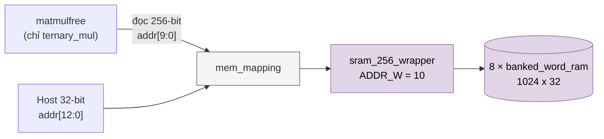

# `mem_mapping` — SRAM tham số của NPU legacy (1024 × 256 bit = 32 KiB)

| Mục | Giá trị |
|---|---|
| File | `mem_mapping.sv` |
| Loại | Wrapper cấu trúc |
| Nhóm | Bộ nhớ trọng số (Weights) |
| Con | `sram_256_wrapper #(.ADDR_W(10))` |
| Được dùng bởi | `matmulfree` (bộ nhớ tham số: trọng số ternary và bias; chỉ `ternary_mul` đọc) |

## 0. Kiến thức cần biết trước

**Bộ nhớ tham số của NPU legacy.** Chứa trọng số ternary, bias… mà host nạp vào trước khi chạy chương trình. Một hàng 256 bit chứa 128 trọng số 2 bit, hoặc 8 bias 32 bit.

**Wrapper.** Module này không có logic riêng. Nó chỉ cố định kích thước (1024 hàng) cho module chung `sram_256_wrapper`, để `matmulfree` có một tên rõ nghĩa ("bộ nhớ tham số") khi kết nối.

Các khái niệm chung (thanh ghi, cạnh clock, pipeline, valid, fixed-point, RNE…) được giải thích trong [../00_kien_thuc_nen.md](../00_kien_thuc_nen.md).

## 1. Tổng quan

`mem_mapping` cố định kích thước của `sram_256_wrapper` cho bộ nhớ tham số:

- **Phía compute:** 1024 hàng × 256 bit, địa chỉ 10 bit.
- **Phía host:** 8192 word 32 bit, địa chỉ 13 bit = `{hàng[9:0], làn[2:0]}`.

Hằng `npu_pkg::PARAM_AW = 10` và `PARAM_DEPTH = 1024` mô tả đúng kích thước này.

## 2. Sơ đồ

## 3. Hoạt động

Mọi tín hiệu được nối thẳng xuống `sram_256_wrapper`. Trong `matmulfree`, cổng ghi phía compute bị nối cứng `wr_en = 0`: chỉ host ghi được bộ nhớ này, còn lõi chỉ đọc (qua `ternary_mul`). Hành vi chi tiết (ghi có mask làn, đọc 2 cạnh, điều kiện `host_rvalid`) xem [sram_256_wrapper.md](sram_256_wrapper.md).

Bố cục dữ liệu trong RAM do descriptor ma trận quy định (`weight_base`, `bias_base`; xem [npu_pkg.md](npu_pkg.md)):

- mỗi hàng trọng số bắt đầu ở biên word 256 bit và chiếm `ceil(K/128)` word (128 trọng số 2 bit/word);
- bias là S32, 8 giá trị/word.
