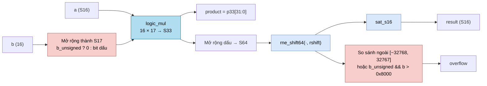

# `mul` — Bộ nhân S16 × S16/U16 có làm tròn và bão hòa (tế bào tham chiếu)

| Mục | Giá trị |
|---|---|
| File | `mul.sv` (cùng file với `addsub`) |
| Loại | Tổ hợp thuần |
| Nhóm | Số học dùng chung — tế bào tham chiếu |
| Con | `logic_mul` (16 × 17 → 33 bit) |
| Được dùng bởi | Không module RTL nào khởi tạo; dành cho kiểm thử số học |

## 0. Kiến thức cần biết trước

**Nhân số fixed-point rồi dịch phải.** Khi nhân hai số có phần phân số, số bit phân số **cộng lại**. Ví dụ `a` có 8 bit phân số, `b` có 8 bit phân số → tích có 16 bit phân số. Muốn đưa kết quả về lại 8 bit phân số thì phải **dịch phải 8 bit**. Cổng `rshift` chính là số bit cần dịch này.

**Làm tròn khi dịch.** Dịch phải là chia cho 2ⁿ và bỏ phần lẻ. Nếu chỉ cắt bỏ, sai số luôn lệch về một phía. Ở đây dùng **RNE** (làm tròn tới gần nhất, hòa thì về số chẵn), ví dụ 2,5 → 2 và 3,5 → 4.

**Bão hòa.** Kết quả S16 chỉ chứa được −32768…32767. Nếu kết quả thật lớn hơn, thay vì để tràn (quay vòng thành số âm), mạch **kẹp** về giá trị lớn nhất, và bật cờ `overflow`.

**Mở rộng U16 thành S17.** `logic_mul` ở đây được cấu hình "có dấu × có dấu". Một số không dấu 16 bit (0…65535) được biến thành số có dấu 17 bit bằng cách thêm bit `0` ở đầu; một số có dấu thì lặp lại bit dấu.

Các khái niệm chung được giải thích trong [../00_kien_thuc_nen.md](../00_kien_thuc_nen.md).

## 1. Tổng quan

`mul` là một tế bào số học nhỏ còn giữ lại sau khi gom các file trợ giúp cũ. Nó tính:

```
result = sat_s16( RNE( a × b, rshift ) )
```

với `a` luôn có dấu, còn `b` có dấu hoặc không dấu tùy `b_unsigned`. Không có module RTL nào trong cây thiết kế khởi tạo `mul`; datapath thật của NPU legacy dùng `ternary_mul` và `rowwise_op`. Module tồn tại để làm mạch tham chiếu cho hồi quy số học.

## 2. Cổng

| Cổng | Hướng | Rộng | Ý nghĩa |
|---|---|---|---|
| `a` | in | S16 | Thừa số thứ nhất |
| `b` | in | 16 | Thừa số thứ hai |
| `b_unsigned` | in | 1 | 1: hiểu `b` là U16; 0: hiểu `b` là S16 |
| `rshift` | in | 6 | Số bit dịch phải (0…63) |
| `product` | out | S32 | 32 bit thấp của tích chính xác |
| `result` | out | S16 | Tích đã làm tròn và bão hòa |
| `overflow` | out | 1 | Báo kết quả bị kẹp hoặc `b` không dấu vượt 0x8000 |

## 3. Sơ đồ khối



## 4. Hoạt động chi tiết

1. `b_s17 = b_unsigned ? {0, b} : {b[15], b}`.
2. `logic_mul` cho tích chính xác `p33` (S33). Tích 16 × 17 bit cần đúng 33 bit nên không mất thông tin.
3. `product` lấy 32 bit thấp của `p33`. Cách này luôn chính xác: độ lớn lớn nhất của tích là 32 768 × 65 535 = 2 147 450 880 < 2³¹, nên mọi tích S16 × (S16 hoặc U16) đều vừa S32. Ví dụ `a = −32768`, `b = 65535` (U16) cho −2 147 450 880, vẫn nằm trong S32. `p33` rộng 33 bit chỉ vì đó là độ rộng tự nhiên của `logic_mul` 16 × 17.
4. `p33` được mở rộng dấu lên 64 bit, rồi `rne_shift64` dịch phải `rshift` bit có làm tròn RNE.
5. `result = sat_s16(rounded)`.
6. `overflow` bật khi `rounded` nằm ngoài khoảng S16, **hoặc** khi `b_unsigned = 1` và `b > 0x8000`. Điều kiện thứ hai là một quy ước của kiểm thử: hệ số không dấu chỉ được phép tới 1,0 (0x8000 trong Q15).

Ví dụ: `a = 300`, `b = 0x4000` (0,5 trong Q15, không dấu), `rshift = 15` → tích 4 915 200 → dịch 15 bit = 150 → `result = 150`, `overflow = 0`.
