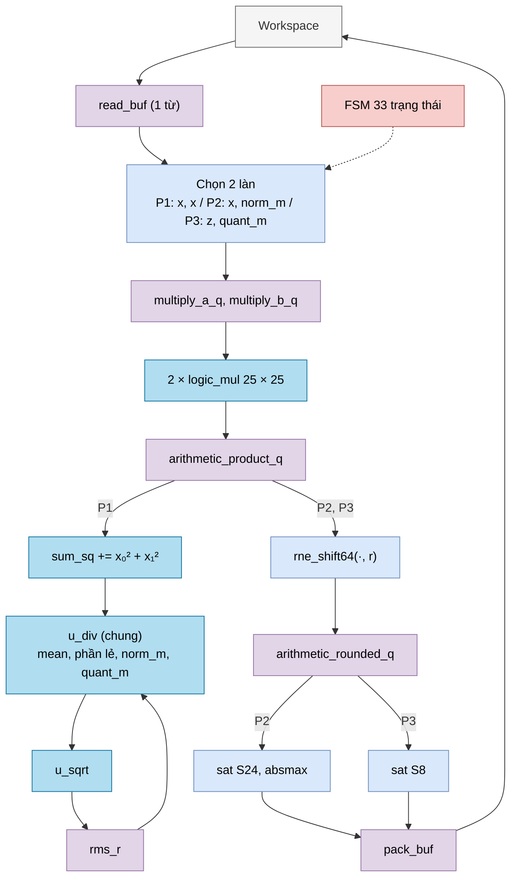
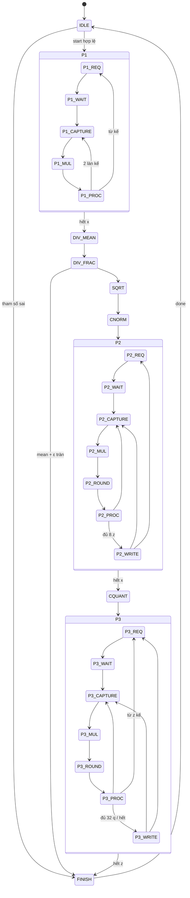

# `norm` — RMSNorm số nguyên + lượng tử hóa activation sang int8

| Mục | Giá trị |
|---|---|
| File | `norm.sv` |
| Loại | Tuần tự, FSM 33 trạng thái, 3 lượt đọc workspace |
| Nhóm | Chuẩn hóa — NPU legacy |
| Con | `div` (`u_div`, 55/32, dùng chung cho 4 phép chia), `isqrt_u64` (`u_sqrt`), `logic_mul` × 2 (25 × 25 → 48, dùng chung cho 3 lượt) |
| Được dùng bởi | `norm_dispatch` (`u_norm`) |

## 0. Kiến thức cần biết trước

**RMSNorm.** Chuẩn hóa một vector x (K phần tử) để nó có "độ lớn trung bình" bằng 1:

```
rms = √( (x₀² + x₁² + … + x_{K−1}²) / K + ε )
zᵢ = xᵢ / rms
```

ε (epsilon) là số rất nhỏ để tránh chia cho 0. Ví dụ x = [3, 4, 0, 0]: tổng bình phương 25, trung bình 6,25, rms = 2,5 → z = [1,2; 1,6; 0; 0].

**Lượng tử hóa absmax sang int8.** Phép nhân ma trận ternary nhận đầu vào int8 (−128…127). Ta tìm `d = max |zᵢ|` rồi tính `qᵢ = round(127 · zᵢ / d)`. Phần tử lớn nhất thành ±127, còn lại tỉ lệ theo. Muốn khôi phục: `zᵢ ≈ qᵢ · d / 127`, nên `d` (`quant_d`) phải được giữ lại để ghép vào hệ số của phép nhân sau (xem [scale_compose.md](scale_compose.md)).

**Không cần bộ chia cho từng phần tử.** Chia K phần tử cho rms tốn K phép chia. Thay vào đó module tính **một lần** hệ số `1/rms ≈ norm_m · 2^(−norm_r)`, sau đó mỗi phần tử chỉ cần một phép nhân và một phép dịch. Tương tự cho `127/d`.

**Thang đo của x bị triệt tiêu.** Nếu x thật = x_raw · s, thì z = x/rms không phụ thuộc s. Vì vậy x vào ở dạng S16 nguyên, không cần biết s (chỉ ε phải tính theo cùng thang).

Xem thêm [../00_kien_thuc_nen.md](../00_kien_thuc_nen.md) (mục 3 fixed-point/RNE/bão hòa, mục 5 RMSNorm), [div.md](div.md), [isqrt_u64.md](isqrt_u64.md).

## 1. Tổng quan

Ba lượt quét workspace:

| Lượt | Đọc | Tính | Ghi |
|---|---|---|---|
| P1 | x (S16, 16/từ) | Σ x² | — |
| (giữa) | — | mean = Σ/K (2 phép chia), rms = √(mean + ε), `norm_m/r` | — |
| P2 | x | `z = RNE(x · norm_m >> norm_r)`, bão hòa S24, tìm `absmax` | z (S24 trong ô S32, 8/từ) vào vùng nháp |
| (giữa) | — | `quant_d = max(absmax, delta)`, `quant_m/r` | — |
| P3 | z | `q = sat8(RNE(z · quant_m >> quant_r))` | q (S8, 32/từ) |

Kết quả phụ (`quant_d`, `norm_m/r`, `quant_m/r`) được giữ ở cổng ra để `matmulfree` lưu và host đọc.

## 2. Cổng

| Cổng | Hướng | Rộng | Ý nghĩa |
|---|---|---|---|
| `start` | in | 1 | Bắt đầu |
| `x_base`, `z_base`, `q_base` | in | 8 | Từ bắt đầu của x, vùng nháp z, đầu ra q |
| `k_len` | in | 10 | K = 1…512 |
| `epsilon_raw32` | in | 64 | ε ở định dạng Q32 theo đơn vị x_raw² |
| `delta_raw` | in | 24 | Sàn của mẫu số lượng tử hóa (≠ 0) |
| `ws_rd_*`, `ws_wr_*` | — | — | Cổng workspace |
| `busy`, `done` | out | 1 | Bận / xung xong |
| `overflow` | out | 1 | z bị bão hòa, hoặc mean + ε tràn 64 bit |
| `format_error` | out | 1 | Tham số sai / tràn |
| `quant_d` | out | 24 | max(\|z\|, delta) — Q16 |
| `norm_m`, `norm_r` | out | 24, 6 | 1/rms ≈ norm_m · 2^(−16−norm_r) |
| `quant_m`, `quant_r` | out | 24, 6 | 127/d ≈ quant_m · 2^(−quant_r) |

## 3. Sơ đồ khối





(`DIV_MEAN`, `DIV_FRAC`, `SQRT`, `CNORM`, `CQUANT` mỗi khối gồm cặp `_START`/`_WAIT`, riêng `CNORM`, `CQUANT` có thêm `_PREP`.)

## 4. Hoạt động chi tiết

### 4.1 Kiểm tra khi `start`

`format_error` và nhảy `FINISH` nếu: K = 0 hoặc > 512; `delta_raw = 0`; vùng x (⌈K/16⌉ từ), z (⌈K/8⌉ từ) hoặc q (⌈K/32⌉ từ) vượt quá 256 từ; x chồng z; q chồng z.

### 4.2 Lượt 1 — tổng bình phương

Mỗi từ có 16 giá trị S16. Mỗi bước xử lý 2 làn (`lane` = 0, 2, …, 14) qua 3 cạnh: chốt toán hạng → nhân → cộng vào `sum_sq` (U40). Làn có chỉ số ≥ K được bỏ qua.

### 4.3 Trung bình, căn và hệ số chuẩn hóa

Trung bình được tính ở dạng Q32 bằng **hai** phép chia số nguyên để giữ phần lẻ:

```
mean, rem = sum_sq ÷ K
frac      = (rem << 32) ÷ K
v_raw     = (mean << 32) + frac + epsilon_raw32       // mean(x²) + ε ở Q32
rms_r     = isqrt(v_raw)                               // rms ở Q16
```

Bit 64 của `v_raw` bằng 1 → tràn → `overflow` và `format_error`.

**Chọn `norm_r`.** Gọi b là vị trí bit 1 cao nhất của `rms_r`. `norm_r = b − 9` (hoặc 0 nếu b ≤ 9). Khi đó

```
norm_m = RNE(2^(32 + norm_r) / rms_r) ≈ 2^23
```

luôn vừa 24 bit và có khoảng 23 bit có nghĩa. Nếu `sum_sq = 0` (vector toàn 0) thì bỏ qua phép chia, `norm_m = 0`.

### 4.4 Lượt 2 — tính z

`z = RNE(x · norm_m >> norm_r)`. Vì `norm_m / 2^norm_r = 2^32 / rms_r = 2^16 / rms`, ta có `z = x / rms` ở Q16. z được bão hòa về S24 (nếu bị kẹp → `overflow`), mở rộng dấu lên 32 bit và gom 8 giá trị/từ vào vùng nháp. Đồng thời `absmax` giữ |z| lớn nhất.

### 4.5 Hệ số lượng tử hóa

- `quant_d = max(absmax, delta_raw)` — delta là sàn để tránh khuếch đại nhiễu khi vector gần 0.
- Gọi b là bit cao nhất của `quant_d`. `quant_r = b + 17 + boost`, với `boost = 1` khi `quant_d > 127 · 2^(b−6)` (d rất gần 2^(b+1)).
- `quant_m = RNE(127 · 2^quant_r / quant_d)` ≈ 127 · 2¹⁷ — vừa U24 và có độ chính xác cao nhất.

### 4.6 Lượt 3 — tính q

Đọc lại z (8 giá trị/từ), `q = sat8(RNE(z · quant_m >> quant_r)) = round(127 · z / d)`. Gom 32 giá trị q/từ rồi ghi vào `q_base`.

### 4.7 Ví dụ đầy đủ (K = 4, ε = 0, delta = 1)

| Bước | Giá trị |
|---|---|
| x | [3, 4, 0, 0] |
| `sum_sq` | 25 |
| mean, rem | 6, 1 → frac = 2³²/4 = 1 073 741 824 |
| `v_raw` | 6,25 · 2³² = 26 843 545 600 |
| `rms_r` | √ = 163 840 (= 2,5 · 2¹⁶, bit cao nhất b = 17) |
| `norm_r`, `norm_m` | 8, RNE(2⁴⁰ / 163 840) = 6 710 886 |
| z | [78 643, 104 858, 0, 0] ≈ [1,19999; 1,60001; 0; 0] |
| `quant_d` | 104 858 (b = 16, boost = 0) |
| `quant_r`, `quant_m` | 33, 10 403 800 |
| q | [95, 127, 0, 0] (127 · 1,2 / 1,6 = 95,25 → 95) |
