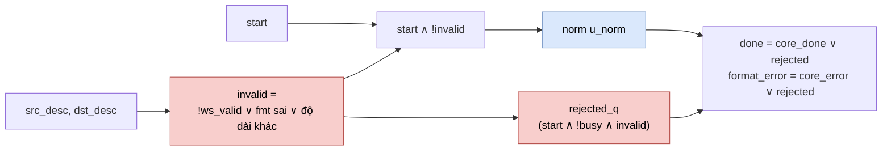

# `norm_dispatch` — Kiểm tra descriptor rồi chuyển lệnh NORM cho `norm`

| Mục | Giá trị |
|---|---|
| File | `norm_dispatch.sv` |
| Loại | Vỏ bọc mỏng: một phép kiểm tra tổ hợp + một thanh ghi |
| Nhóm | Chuẩn hóa — NPU legacy |
| Con | `norm` (`u_norm`) |
| Được dùng bởi | `matmulfree` (`u_norm`) |

## 0. Kiến thức cần biết trước

**Dispatch (điều phối).** Lệnh của `matmulfree` chỉ chứa **số hiệu** descriptor. Module dispatch nhận các descriptor đã tra, kiểm tra chúng có hợp lệ với lệnh không, rồi mới khởi động lõi tính toán với các tham số đã tách sẵn (địa chỉ, độ dài). Lõi `norm` không cần biết khái niệm descriptor.

**Descriptor workspace** (`ws_desc_t`): `base_word`, `length`, `fmt`, `frac_bits` — xem [npu_pkg.md](npu_pkg.md).

Xem thêm [norm.md](norm.md).

## 1. Tổng quan

Lệnh `NORM` hợp lệ khi:
- `src_desc` và `dst_desc` đều qua `ws_valid` (độ dài 1…512, `frac_bits` ≤ 24, nằm trong 256 từ workspace).
- Nguồn là **S16**, đích là **S8**.
- Hai vector cùng độ dài.

Hợp lệ → `u_norm.start = start`. Không hợp lệ → `norm` không chạy; chu kỳ kế tiếp `rejected = 1`, làm `done` và `format_error` cùng lên 1 trong một chu kỳ, `overflow` bị chặn về 0.

## 2. Cổng

Giống `norm` (xem [norm.md](norm.md) §2), chỉ khác đầu vào:

| Cổng | Hướng | Rộng | Ý nghĩa |
|---|---|---|---|
| `src_desc`, `dst_desc` | in | 32 | Descriptor vector vào (S16) / ra (S8) |
| `scratch_z_base` | in | 8 | Từ bắt đầu của vùng nháp z |
| `epsilon_raw32`, `delta_raw` | in | 64, 24 | Tham số số học, chuyển thẳng cho `norm` |

## 3. Sơ đồ khối

Ánh xạ tham số: `x_base = src.base_word`, `q_base = dst.base_word`, `k_len = src.length`, `z_base = scratch_z_base`.
