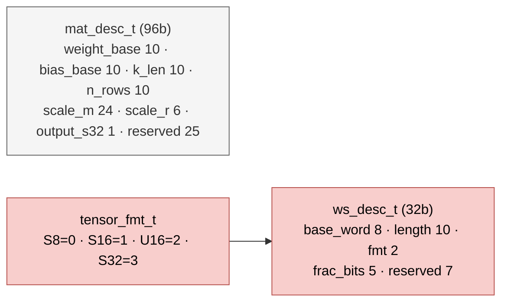

# `npu_pkg` — Package hằng số, kiểu và hàm của NPU legacy

| Mục | Giá trị |
|---|---|
| File | `npu_pkg.sv` |
| Loại | `package` (không phải phần cứng độc lập) |
| Nhóm | Hạ tầng |
| Được dùng bởi | `matmulfree`, `descriptor_file`, các dispatcher, `norm`, `rowwise_op`, `ternary_mul`, `scale_compose`, `postscale` … |

## 0. Kiến thức cần biết trước

**Package.** Trong SystemVerilog, `package` là nơi gom các hằng số, kiểu dữ liệu và hàm dùng chung, tương tự file header trong C. Module dùng nó bằng `import npu_pkg::*;`.

**Hàm trong phần cứng.** Một `function` trong RTL không phải chương trình con được "gọi" lúc chạy. Mỗi chỗ dùng hàm sinh ra **một bản mạch riêng**. Vì vậy các hàm ở đây đều nhỏ và thuần tổ hợp.

**`struct packed`.** Một nhóm trường bit ghép liền nhau thành một vector bit dài. Ví dụ `ws_desc_t` dài đúng 32 bit, nên host ghi được bằng một word.

Các khái niệm bão hòa, RNE, scale dạng m × 2⁻ʳ được giải thích ở tài liệu kiến thức nền, mục 3.

Các khái niệm chung (thanh ghi, cạnh clock, pipeline, valid, fixed-point, RNE…) được giải thích trong [../00_kien_thuc_nen.md](../00_kien_thuc_nen.md).

## 1. Tổng quan

`npu_pkg` gom mọi quy ước dùng chung của NPU `matmulfree`: kích thước bộ nhớ, độ rộng dữ liệu, định dạng tensor, cấu trúc descriptor, và các hàm làm tròn/bão hòa. Các hàm này là **hàm thuần tổ hợp**: mỗi chỗ gọi sinh ra một khối logic riêng.

## 2. Hằng số

| Hằng | Giá trị | Ý nghĩa |
|---|---|---|
| `SRAM_W` | 256 | Bit / hàng SRAM |
| `PARAM_AW`, `PARAM_DEPTH` | 10, 1024 | SRAM tham số 32 KiB (`mem_mapping`) |
| `WORK_AW`, `WORK_DEPTH` | 8, 256 | Workspace 8 KiB (`register`) |
| `ACT_W` | 8 | Activation S8 |
| `STATE_W` | 16 | Trạng thái S16 |
| `WEIGHT_W` | 2 | Trọng số ternary 2 bit |
| `DOT_LANES` | 32 | Số làn tích vô hướng |
| `VEC_LANES` | 2 | Số làn vector |
| `ACC_W` | 18 | Bộ tích lũy |
| `K_MAX` | 512 | Độ dài tối đa của vector/K |
| `M_W`, `SHIFT_W` | 24, 6 | Mantissa và số bit dịch của scale |

## 3. Kiểu

Chi tiết từng trường xem [descriptor_file.md](descriptor_file.md).

## 4. Hàm

| Hàm | Chức năng |
|---|---|
| `sat_s16(x)` / `sat_s32(x)` | Bão hòa số S64 về S16 / S32 |
| `rne_shift64(x, shift)` | Dịch phải số học, làm tròn tới chẵn gần nhất (RNE), shift 0..63 |
| `rne_shift42(x, shift)` | RNE cho tích S42 của postscale; `shift ≥ 42` trả 0 |
| `scale_shift64(x, shift)` | `shift ≥ 0`: `rne_shift64`; `shift < 0`: dịch trái |
| `ws_words(d)` | Số word 256 bit mà tensor chiếm: S8 `ceil(n/32)`, S16/U16 `ceil(n/16)`, S32 `ceil(n/8)` |
| `ws_valid(d)` | `0 < length ≤ 512`, `frac_bits ≤ 24`, `base_word + ws_words ≤ 256` |
| `ranges_overlap(a, an, b, bn)` | Hai vùng `[a, a+an)` và `[b, b+bn)` có giao nhau không |

### 4.1 Làm tròn RNE không cần phủ định

`rne_shift64` không tính giá trị tuyệt đối. Nó dùng tính chất của dịch số học:

1. `q = x >>> shift` cho `floor(x / 2^shift)`.
2. Các bit bị bỏ được dồn lên MSB: `discarded = x << (64 − shift)`. Biểu thức dịch dùng 7 bit, nên khi `shift = 0` lượng dịch là 64 và mọi bit bị đẩy ra; không có bit nào bị bỏ.
3. `guard = discarded[63]` (bit nửa), `sticky = |discarded[62:0]`.
4. `inc = guard && (sticky || q[0])`, và kết quả là `q + inc`.

Vì `floor` đúng cho cả số âm, phần dư luôn dương, nên một quy tắc duy nhất làm tròn đúng cả hai dấu, kể cả trường hợp hòa: chọn số chẵn.
