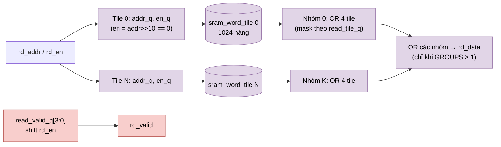

# `pipelined_word_ram` — Bộ chuyển đổi SRAM có pipeline (thay được công nghệ)

| Mục | Giá trị |
|---|---|
| File | `pipelined_word_ram.sv` |
| Loại | Tuần tự, throughput 1 đọc + 1 ghi mỗi chu kỳ |
| Nhóm | Hạ tầng / bộ nhớ |
| Con | `quartus_word_ram` (nhánh IP) hoặc `sram_word_tile` (nhánh mô hình) |
| Được dùng bởi | `llm_bank_ram` (mỗi làn một instance), `llm_parameter_ram` (8 làn × 32 bit) |

## 0. Kiến thức cần biết trước

**Vấn đề của RAM sâu.** RAM tham số có 24 576 hàng. Nếu làm một khối khổng lồ, tín hiệu địa chỉ phải tỏa đến rất nhiều ô nhớ (**fanout** lớn), và dữ liệu ra phải qua một mux 24 576 đầu vào. Cả hai đều chậm.

**Giải pháp: chia tile + thêm tầng thanh ghi.**
1. Cắt RAM thành **tile** 1024 hàng. Mỗi tile có bản sao địa chỉ riêng, nên fanout mỗi bản sao nhỏ.
2. Chỉ tile chứa địa chỉ cần đọc mới được bật đọc.
3. Dữ liệu ra của các tile được gom bằng **cây OR**: các tile không được đọc xuất 0, nên OR tất cả lại chính là dữ liệu của tile được đọc. Mỗi tầng OR có thanh ghi.

Đổi lại, độ trễ đọc tăng từ 1 lên 3–4 cạnh. Bù lại clock chạy nhanh hơn, và vẫn đọc được 1 hàng mỗi chu kỳ (throughput giữ nguyên).

**"Bộ chuyển đổi" (adapter).** Module này là lớp đệm giữa logic NPU và RAM vật lý. Logic NPU chỉ biết `rd_en/rd_addr → rd_data/rd_valid`; bên dưới có thể là RAM mô hình, M10K, hay SRAM ASIC.

Các khái niệm chung (thanh ghi, cạnh clock, pipeline, valid, fixed-point, RNE…) được giải thích trong [../00_kien_thuc_nen.md](../00_kien_thuc_nen.md).

## 1. Tổng quan

Đây là **ranh giới SRAM** của `llm_soc`. Phía trên là giao diện word đơn giản (`rd_en/rd_addr → rd_data/rd_valid`). Phía dưới, bộ nhớ được chia **tile 1024 hàng**, gom **4 tile thành một nhóm**, rồi gom phản hồi qua cây OR có thanh ghi. Nhờ vậy fanout địa chỉ và mux dữ liệu không trở thành đường găng khi bộ nhớ sâu (đến 24576 hàng ở RAM tham số).

`generate` chọn một trong ba hiện thực:

| Nhánh | Điều kiện | Lá | Độ trễ đọc |
|---|---|---|---|
| `g_ip_tiled` | `USE_QUARTUS_MEMORY && ROWS > 4096` | `quartus_word_ram` mỗi tile 1024 hàng | 4 cạnh |
| `g_ip` | `USE_QUARTUS_MEMORY && ROWS ≤ 4096` | một `quartus_word_ram` nguyên khối | 3 cạnh (1 nhóm) / 4 cạnh |
| `g_model` | `USE_QUARTUS_MEMORY = 0` | `sram_word_tile` mỗi tile | 3 cạnh (≤ 4 tile) / 4 cạnh |

## 2. Tham số và cổng

| Tên | Mặc định | Ý nghĩa |
|---|---|---|
| `WIDTH` | 32 | Độ rộng word |
| `ROWS` | 4096 | Số word |
| `USE_QUARTUS_MEMORY` | 0 | Chọn lá IP hay lá mô hình |
| `rd_en, rd_addr` | in | Yêu cầu đọc |
| `wr_en, wr_addr, wr_data` | in | Yêu cầu ghi |
| `rd_data` | out | Dữ liệu đọc |
| `rd_valid` | out | Dữ liệu đọc hợp lệ (pipeline valid) |
| `wr_valid` | out | Xác nhận ghi đã tới lá (2 cạnh sau yêu cầu) |

Hằng nội bộ: `TILES = ceil(ROWS/1024)`, `GROUPS = ceil(TILES/4)`.

## 3. Sơ đồ khối (nhánh `g_model`, tổng quát)



## 4. Hoạt động chi tiết

### 4.1 Pipeline đọc (`g_model`)

| Cạnh | Việc xảy ra |
|---|---|
| 1 | Mỗi tile chốt `read_address_q`; `read_enable_q = rd_en && (rd_addr>>10 == tile)` |
| 2 | Tile đọc (`sram_word_tile` có thanh ghi ra); `read_tile_q[tile]` ghi nhớ tile nào được đọc |
| 3 | Mỗi nhóm OR 4 tile (đã AND với `read_tile_q`) vào `group_data_q`. Nếu `GROUPS == 1` thì đây là `rd_data`, `rd_valid = read_valid_q[2]` |
| 4 | (Chỉ khi `GROUPS > 1`) OR các nhóm vào `rd_data`, `rd_valid = read_valid_q[3]` |

Bộ chọn dùng **AND-OR** thay cho mux nhị phân theo địa chỉ: chỉ tile được đọc mới có dữ liệu khác 0, nên phép OR cho đúng kết quả mà không cần giải mã địa chỉ ở tầng phản hồi.

### 4.2 Nhánh IP

- `g_ip` (≤ 4096 hàng): thanh ghi địa chỉ/dữ liệu/enable (cạnh 1), `altsyncram` chốt địa chỉ (cạnh 2), `response_q` (cạnh 3). Nếu `GROUPS > 1` thêm một thanh ghi (cạnh 4).
- `g_ip_tiled` (> 4096 hàng, ví dụ RAM tham số 24576 hàng = 24 tile = 6 nhóm): mỗi tile có địa chỉ/enable cục bộ; payload ghi chốt một lần cho mỗi nhóm 4 tile; phản hồi nhóm (cạnh 3) đi qua **cây OR nhị phân đệm lũy thừa 2** rồi vào `rd_data` (cạnh 4).

### 4.3 Ghi

`wr_en/wr_addr/wr_data` được chốt ở cạnh 1 và ghi vào lá ở cạnh 2. `wr_valid` = `write_pending_q` trễ 1 cạnh, tức báo sau 2 cạnh. Đọc và ghi cùng địa chỉ trong cùng chu kỳ được chấp nhận trả **dữ liệu cũ**.

```
cạnh:      0        1           2            3             4
rd_en ─────┐
           └ addr_q ┬ tile read ┬ group OR   ┬ (final OR)
rd_valid   ................................↑(GROUPS=1)   ↑(GROUPS>1)
```

### 4.4 Reset

Reset chỉ xóa các bit **valid/enable** (`read_valid_q`, `read_enable_q`, `write_enable_q`, `read_tile_q`), không xóa nội dung hay payload. Enable của lá được AND thêm `rst_n`, nên yêu cầu đang bay bị hủy khi reset.
