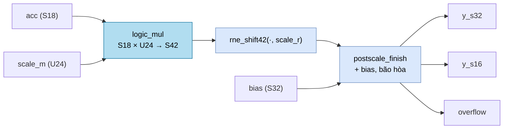

# `postscale` — Scale tích lũy, cộng bias, bão hòa (mạch tham chiếu tổ hợp)

| Mục | Giá trị |
|---|---|
| File | `postscale.sv` |
| Loại | Tổ hợp thuần |
| Nhóm | Số học — hậu xử lý đầu ra ma trận (NPU legacy) |
| Con | `logic_mul` (18 × 24 → 42 bit), `postscale_finish` |
| Được dùng bởi | Không module RTL nào khởi tạo; `ternary_mul` dùng lại `postscale_finish` với phiên bản có thanh ghi |

## 0. Kiến thức cần biết trước

**Tại sao cần "scale" sau phép nhân ma trận?** Trọng số ternary chỉ là −1/0/+1, nên tích vô hướng `acc = Σ wᵢ·xᵢ` chỉ là tổng các activation. Mô hình thật cần `y = α · acc + bias`, trong đó α là một số thực nhỏ (ví dụ 0,0123) học được cho mỗi ma trận. Phần cứng không có số thực, nên α được biểu diễn dạng **mantissa × 2⁻ʳ**:

```
α ≈ scale_m / 2^scale_r
```

Ví dụ α = 0,0123 với `scale_r = 30` → `scale_m = round(0,0123 × 2³⁰) = 13 207 024`, vừa 24 bit. Nhân `acc × scale_m` rồi dịch phải 30 bit (có làm tròn) cho ra `α · acc`.

**Bias.** Một hằng số cộng thêm vào mỗi đầu ra. Bias đã được lưu sẵn ở **thang của đầu ra**, nên cộng thẳng sau khi scale.

**Hai dạng đầu ra.** Ma trận có thể ghi kết quả dạng S16 (lưu gọn) hoặc S32 (giữ chính xác cho bước sau), chọn bằng cờ `output_s32` của descriptor.

Các khái niệm chung (RNE, bão hòa) được giải thích trong [../00_kien_thuc_nen.md](../00_kien_thuc_nen.md), mục 3.

## 1. Tổng quan

`postscale` thực hiện toàn bộ hậu xử lý cho một đầu ra của ma trận ternary, trong **một khối tổ hợp**:

```
y = sat( rne_shift42(acc × scale_m, scale_r) + bias )
```

Mạch thật trong `ternary_mul` chia chuỗi này thành nhiều tầng thanh ghi (`SCALE_PRODUCT`, `SCALE_ROUND`, `SCALE`) để đạt tần số cao, nhưng phần cuối (cộng bias + bão hòa) dùng chung module con `postscale_finish`. `postscale` vì vậy là mô hình tham chiếu một-chu-kỳ của cùng phép tính.

## 2. Cổng

| Cổng | Hướng | Rộng | Ý nghĩa |
|---|---|---|---|
| `acc` | in | S18 | Tích vô hướng ternary |
| `scale_m` | in | U24 | Mantissa của hệ số scale |
| `scale_r` | in | 6 | Số bit dịch phải |
| `bias` | in | S32 | Bias ở thang đầu ra |
| `output_s32` | in | 1 | Chọn kiểu kiểm tra tràn |
| `y_s32`, `y_s16` | out | S32, S16 | Kết quả bão hòa về hai độ rộng |
| `overflow` | out | 1 | Kết quả bị kẹp ở độ rộng đã chọn |

## 3. Sơ đồ khối



## 4. Hoạt động chi tiết

1. **Nhân.** S18 × U24 cần tối đa 18 + 24 = 42 bit, nên `product` S42 là chính xác.
2. **Dịch có làm tròn.** `rne_shift42` dịch phải số học `scale_r` bit, làm tròn RNE. Nếu `scale_r ≥ 42` thì mọi giá trị S42 đều làm tròn về 0, nên hàm trả 0 trực tiếp.
3. **Hoàn tất.** Giao cho `postscale_finish` (xem [postscale_finish.md](postscale_finish.md)).

Ví dụ: `acc = 1000`, `scale_m = 0x400000` (= 2²²), `scale_r = 24` → α = 0,25 → `rounded = 250`; `bias = −10` → `y = 240`.
