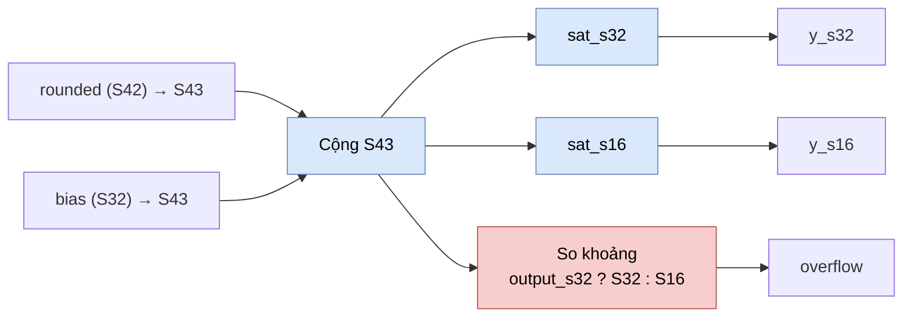

# `postscale_finish` — Cộng bias và bão hòa S16/S32

| Mục | Giá trị |
|---|---|
| File | `postscale.sv` |
| Loại | Tổ hợp thuần |
| Nhóm | Số học — hậu xử lý đầu ra ma trận (NPU legacy) |
| Con | — |
| Được dùng bởi | `ternary_mul` (instance `u_scale`), `postscale` |

## 0. Kiến thức cần biết trước

**Chọn độ rộng đủ để không tràn.** Cộng một số S42 với một số S32 có thể cần tối đa 43 bit (lấy độ rộng lớn hơn rồi thêm 1). Mạch tính tổng ở **S43**, nên tổng luôn chính xác; chỉ sau đó mới bão hòa xuống S32 hoặc S16.

**Bão hòa đồng thời hai độ rộng.** Mạch xuất cả `y_s32` và `y_s16`. Bên dùng (`ternary_mul`) chọn một trong hai tùy định dạng đầu ra. Cờ `overflow` chỉ xét độ rộng đã chọn bằng `output_s32`.

Các khái niệm chung được giải thích trong [../00_kien_thuc_nen.md](../00_kien_thuc_nen.md).

## 1. Tổng quan

Đây là bước cuối của hậu xử lý ma trận: lấy tích đã scale và làm tròn (`rounded`, S42), cộng `bias` (S32), rồi bão hòa. Tách thành module riêng để cả mạch tham chiếu tổ hợp (`postscale`) và datapath có thanh ghi (`ternary_mul`) dùng **cùng một** mạch, đảm bảo kết quả số giống hệt nhau.

## 2. Cổng

| Cổng | Hướng | Rộng | Ý nghĩa |
|---|---|---|---|
| `rounded` | in | S42 | Tích đã dịch và làm tròn |
| `bias` | in | S32 | Bias |
| `output_s32` | in | 1 | 1: kiểm tra tràn theo S32; 0: theo S16 |
| `y_s32` | out | S32 | `sat_s32(rounded + bias)` |
| `y_s16` | out | S16 | `sat_s16(rounded + bias)` |
| `overflow` | out | 1 | Tổng nằm ngoài khoảng của độ rộng đã chọn |

## 3. Sơ đồ khối

## 4. Hoạt động chi tiết

1. `biased = {rounded[41], rounded} + sign_extend(bias)` ở 43 bit.
2. `y_s32 = sat_s32(biased)`, `y_s16 = sat_s16(biased)` (hai hàm của `npu_pkg`, nhận đầu vào 64 bit).
3. `overflow`:
   - `output_s32 = 1`: `biased > 2 147 483 647` hoặc `< −2 147 483 648`.
   - `output_s32 = 0`: `biased > 32 767` hoặc `< −32 768`.

Ví dụ: `rounded = 40 000`, `bias = −5 000` → `biased = 35 000`. Với `output_s32 = 0`: `y_s16 = 32 767`, `overflow = 1`. Với `output_s32 = 1`: `y_s32 = 35 000`, `overflow = 0`.
