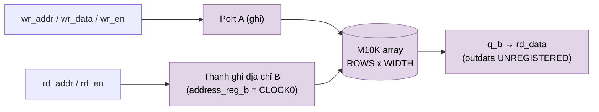

# `quartus_word_ram` — Lá bộ nhớ FPGA (altsyncram M10K)

| Mục | Giá trị |
|---|---|
| File | `quartus_word_ram.sv` |
| Loại | Lá công nghệ (technology leaf), IP Altera duy nhất của thiết kế |
| Nhóm | Hạ tầng / bộ nhớ |
| Được dùng bởi | `pipelined_word_ram` (nhánh `g_ip` và `g_ip_tiled`) khi `USE_QUARTUS_MEMORY = 1` |

## 0. Kiến thức cần biết trước

**RAM trên FPGA.** Chip FPGA Intel Cyclone V có sẵn các khối RAM cứng tên **M10K**, mỗi khối 10 240 bit. Dùng chúng tiết kiệm hơn nhiều so với làm RAM bằng flip-flop. Để gọi M10K, RTL khởi tạo một **IP** (khối dựng sẵn của hãng) tên `altsyncram`.

**Dual-port.** RAM có 2 cổng: cổng A chỉ ghi, cổng B chỉ đọc. Hai cổng hoạt động độc lập trong cùng chu kỳ.

**Lá công nghệ (technology leaf).** Đây là module **duy nhất** gắn với FPGA. Khi làm chip ASIC, chỉ cần thay lá này bằng SRAM macro của nhà máy, phần còn lại của thiết kế không đổi. Đó là lý do module được giữ nhỏ và tách riêng.

Các khái niệm chung (thanh ghi, cạnh clock, pipeline, valid, fixed-point, RNE…) được giải thích trong [../00_kien_thuc_nen.md](../00_kien_thuc_nen.md).

## 1. Tổng quan

Đây là **điểm gắn công nghệ FPGA duy nhất** trong datapath bộ nhớ. Module bọc `altsyncram` của Intel/Altera ở chế độ `DUAL_PORT`: port A chỉ ghi, port B chỉ đọc, chung một clock. Mọi logic compute/control của NPU không thấy IP này. Khi chuyển sang ASIC chỉ cần thay lá này (hoặc chọn nhánh mô hình `sram_word_tile`) phía sau `pipelined_word_ram`.

## 2. Tham số và cổng

| Tên | Mặc định | Ý nghĩa |
|---|---|---|
| `WIDTH` | 32 | Độ rộng word |
| `ROWS` | 4096 | Số word |
| `ADDR_W` | `clog2(ROWS)` | Độ rộng địa chỉ |
| `rd_en`, `rd_addr` | in | Yêu cầu đọc (port B) |
| `wr_en`, `wr_addr`, `wr_data` | in | Yêu cầu ghi (port A) |
| `rd_data` | out | Dữ liệu đọc, không có thanh ghi ra |

## 3. Sơ đồ

## 4. Hành vi

| Thuộc tính | Giá trị trong RTL |
|---|---|
| Họ thiết bị | Cyclone V, khối `M10K` |
| Độ trễ đọc thô | 1 cạnh: địa chỉ được chốt ở cạnh clock, dữ liệu ra không có thanh ghi |
| Đọc và ghi cùng địa chỉ cùng chu kỳ | `OLD_DATA`: trả dữ liệu cũ |
| Reset | Không reset nội dung, không xóa ngõ ra (`outdata_aclr_b = NONE`) |
| Khởi tạo | `power_up_uninitialized = TRUE` |
| Clock enable | Bypass toàn bộ |

Các tầng thanh ghi địa chỉ/enable và thanh ghi ngõ ra do `pipelined_word_ram` cung cấp, nên lá này được giữ tối giản.
