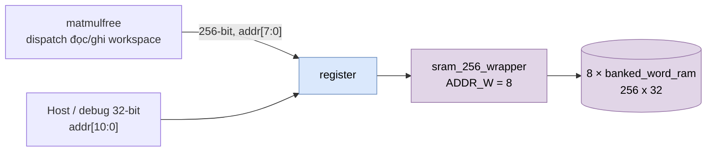

# `register` — SRAM workspace của NPU legacy (256 × 256 bit = 8 KiB)

| Mục | Giá trị |
|---|---|
| File | `regfile.sv` (tên module là `register`, khác tên file) |
| Loại | Wrapper cấu trúc |
| Nhóm | Bộ nhớ activation (workspace) |
| Con | `sram_256_wrapper #(.ADDR_W(8))` |
| Được dùng bởi | `matmulfree` (vector đầu vào/đầu ra của mọi lệnh) |

## 0. Kiến thức cần biết trước

**Workspace là gì?** Khi NPU chạy một chương trình gồm nhiều lệnh, kết quả của lệnh này là đầu vào của lệnh sau. Các vector trung gian đó (activation) nằm trong **workspace**, một vùng nhớ nháp. Mỗi lệnh chỉ ra vector nguồn/đích bằng **workspace descriptor**: bắt đầu ở hàng nào, dài bao nhiêu phần tử, định dạng gì.

**Đóng gói nhiều số vào một hàng.** Một hàng 256 bit chứa 32 số 8 bit, hoặc 16 số 16 bit, hoặc 8 số 32 bit, tùy định dạng.

**Lưu ý tên.** Module tên `register` nhưng không phải "thanh ghi" theo nghĩa flip-flop; nó là một SRAM. File chứa nó tên `regfile.sv`.

Các khái niệm chung (thanh ghi, cạnh clock, pipeline, valid, fixed-point, RNE…) được giải thích trong [../00_kien_thuc_nen.md](../00_kien_thuc_nen.md).

## 1. Tổng quan

`register` là **workspace**, nơi chứa các tensor activation mà lệnh của NPU legacy đọc và ghi.

- **Phía compute:** 256 hàng × 256 bit.
- **Phía host/debug:** 2048 word 32 bit, `host_addr[10:0] = {hàng[7:0], làn[2:0]}`.

Hằng `npu_pkg::WORK_AW = 8` và `WORK_DEPTH = 256` khớp với cấu hình này. Workspace descriptor (`ws_desc_t.base_word`, 8 bit) trỏ vào hàng của RAM này.

## 2. Sơ đồ

## 3. Hoạt động

Module chỉ nối dây xuống `sram_256_wrapper`; xem [sram_256_wrapper.md](sram_256_wrapper.md) để biết hợp đồng đọc 2 cạnh và cách ghi theo làn.

Mật độ đóng gói một hàng 256 bit phụ thuộc định dạng tensor (`npu_pkg::ws_words`):

| Định dạng | Phần tử / hàng |
|---|---|
| `FMT_S8` | 32 |
| `FMT_S16`, `FMT_U16` | 16 |
| `FMT_S32` | 8 |
