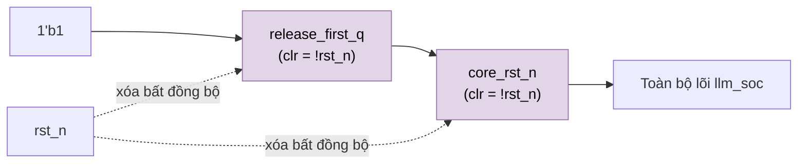

# `reset_release` — Đồng bộ nhả reset (async assert, sync release)

| Mục | Giá trị |
|---|---|
| File | `reset_release.sv` |
| Loại | Tuần tự, 2 flip-flop |
| Nhóm | Hạ tầng |
| Được dùng bởi | `llm_soc.u_reset` |

## 0. Kiến thức cần biết trước

**Tại sao cần đồng bộ hóa reset?** Nút reset ngoài có thể nhả ra (`rst_n` lên 1) vào **bất kỳ thời điểm nào**, kể cả sát cạnh clock. Nếu hàng nghìn flip-flop thấy reset nhả ở những thời điểm hơi khác nhau, một số FF thoát reset ở chu kỳ này, số khác ở chu kỳ sau, và mạch có thể khởi động sai.

**Giải pháp kinh điển: "assert bất đồng bộ, release đồng bộ".**
- Vào reset: ngay lập tức, không chờ clock. An toàn, vì mọi thứ đều bị xóa.
- Ra khỏi reset: tín hiệu được đưa qua **2 flip-flop nối tiếp** chạy bằng clock. FF thứ nhất có thể bị **metastable** (lơ lửng giữa 0 và 1) nếu `rst_n` đổi đúng lúc cạnh clock; FF thứ hai cho nó một chu kỳ để ổn định. Đầu ra là một tín hiệu đổi **đúng tại cạnh clock**, nên toàn bộ lõi rời reset cùng lúc.

Các khái niệm chung (thanh ghi, cạnh clock, pipeline, valid, fixed-point, RNE…) được giải thích trong [../00_kien_thuc_nen.md](../00_kien_thuc_nen.md).

## 1. Tổng quan

Biến reset ngoài `rst_n` (bất đồng bộ) thành `core_rst_n` cho toàn bộ lõi `llm_soc`:

- **Assert tức thì:** khi `rst_n` xuống 0, cả hai FF bị xóa ngay, nên `core_rst_n = 0` không chờ clock.
- **Release đồng bộ:** khi `rst_n` lên 1, `core_rst_n` chỉ lên 1 sau **2 cạnh lên** clock. Nhờ vậy mọi FF của lõi thoát reset cùng một cạnh và đường reset vẫn được STA phân tích bình thường, không cần ngoại lệ timing.

## 2. Cổng

| Cổng | Hướng | Ý nghĩa |
|---|---|---|
| `clk` | in | Clock lõi |
| `rst_n` | in | Reset ngoài, tích cực mức thấp |
| `core_rst_n` | out | Reset đã đồng bộ cho lõi |

## 3. Sơ đồ



## 4. Giản đồ thời gian

```
clk         _/‾\_/‾\_/‾\_/‾\_/‾\_
rst_n       ‾‾\_______/‾‾‾‾‾‾‾‾‾‾
release_1st ‾‾\_________/‾‾‾‾‾‾‾‾   (cạnh 1 sau khi nhả)
core_rst_n  ‾‾\_____________/‾‾‾‾   (cạnh 2 sau khi nhả)
```
