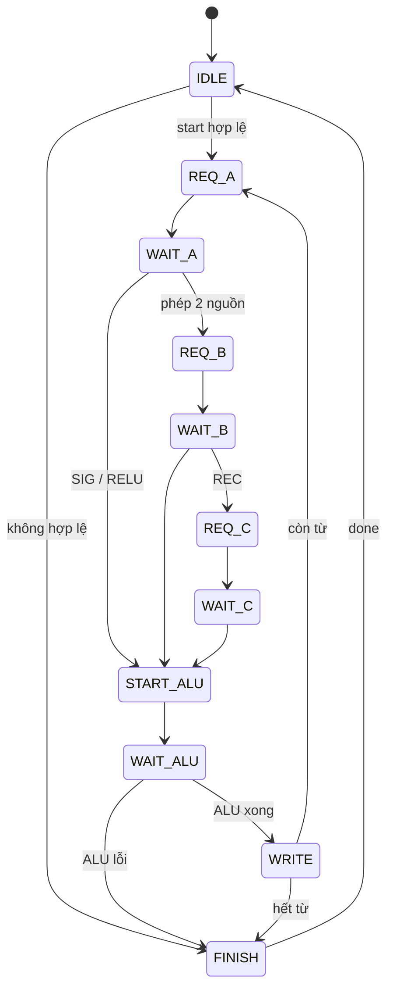
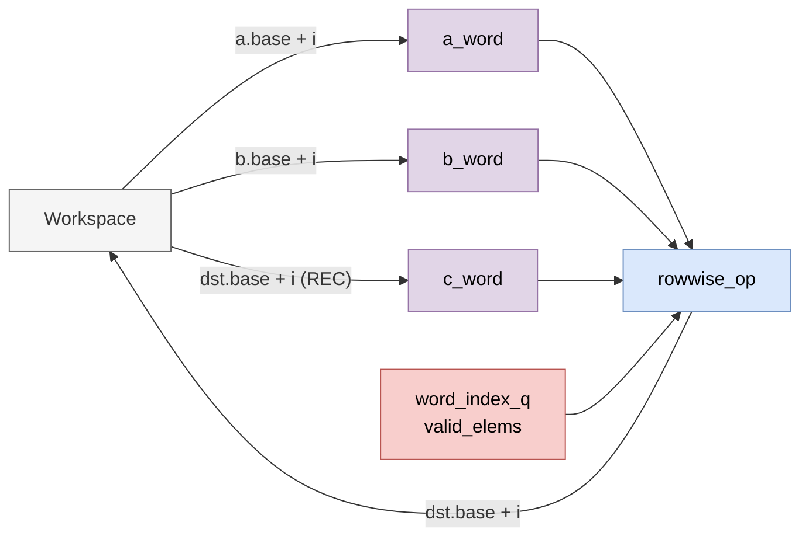

# `rowwise_dispatch` — Chạy phép theo phần tử trên cả vector, từng từ một

| Mục | Giá trị |
|---|---|
| File | `rowwise_dispatch.sv` |
| Loại | Tuần tự, FSM 11 trạng thái |
| Nhóm | Activation / vector — NPU legacy |
| Con | `rowwise_op` (`u_alu`) |
| Được dùng bởi | `matmulfree` (`u_row`) |

## 0. Kiến thức cần biết trước

**Vector dài hơn một từ.** Một vector S16 dài K phần tử chiếm `⌈K/16⌉` từ 256 bit. [rowwise_op](rowwise_op.md) chỉ xử lý **một** từ. Module này lặp: đọc từ thứ i của a (và b, c), giao cho ALU, ghi kết quả vào từ thứ i của đích, rồi sang i + 1. Từ cuối có thể chỉ chứa một phần các phần tử hợp lệ.

Ví dụ K = 40: 3 từ, phần tử hợp lệ lần lượt 16, 16, 8.

**Kiểm tra trước, chạy sau.** Mọi điều kiện định dạng được kiểm tra một lần lúc `start`. Sai → bỏ qua toàn bộ, báo `format_error`.

Xem thêm [rowwise_op.md](rowwise_op.md), [npu_pkg.md](npu_pkg.md) (`ws_valid`, `ranges_overlap`).

## 1. Tổng quan

| `op` | Nguồn đọc | Điều kiện định dạng |
|---|---|---|
| 1 ADD, 2 SUB | a, b | a, b, đích cùng định dạng (S16 hoặc U16), a, b cùng `frac_bits` |
| 3 MUL | a, b | a, đích S16; b S16 hoặc U16 |
| 6 SIG | a | a S16; đích U16 Q15 |
| 11 REC | a, b, **đích cũ** | a, đích S16 cùng `frac_bits`; b U16 Q15; b không chồng đích |
| 12 RELU | a | a, đích S16 |

Điều kiện chung: mọi descriptor dùng đến qua `ws_valid` và cùng độ dài; U16 luôn phải có `frac_bits = 15`; nguồn **được phép trùng hoàn toàn** với đích (tính tại chỗ) nhưng không được chồng lệch một phần.

## 2. Cổng

| Cổng | Hướng | Rộng | Ý nghĩa |
|---|---|---|---|
| `start` | in | 1 | Bắt đầu |
| `op` | in | 4 | Mã phép (`instr[12:9]`) |
| `a_desc`, `b_desc`, `dst_desc` | in | 32 | Descriptor |
| `ws_rd_*`, `ws_wr_*` | — | — | Cổng workspace |
| `busy`, `done`, `overflow`, `format_error` | out | 1 | Trạng thái |

## 3. Sơ đồ khối

## 4. Hoạt động chi tiết

- `word_count = ⌈length/16⌉`; `valid_elems = min(16, length − 16·i)`.
- Ba lần đọc dùng chung một cổng workspace nên đi tuần tự: a, rồi b, rồi c.
- `overflow` và `format_error` của ALU được cộng dồn (OR) qua mọi từ. ALU báo lỗi → dừng ngay, không ghi từ đó.
- REC đọc từ đích **trước khi** ghi đè, vì vậy trạng thái h được cập nhật tại chỗ.

Ví dụ: `ADD` K = 40 → 3 vòng; mỗi vòng `REQ_A → WAIT_A → REQ_B → WAIT_B → START_ALU → WAIT_ALU → WRITE`.
