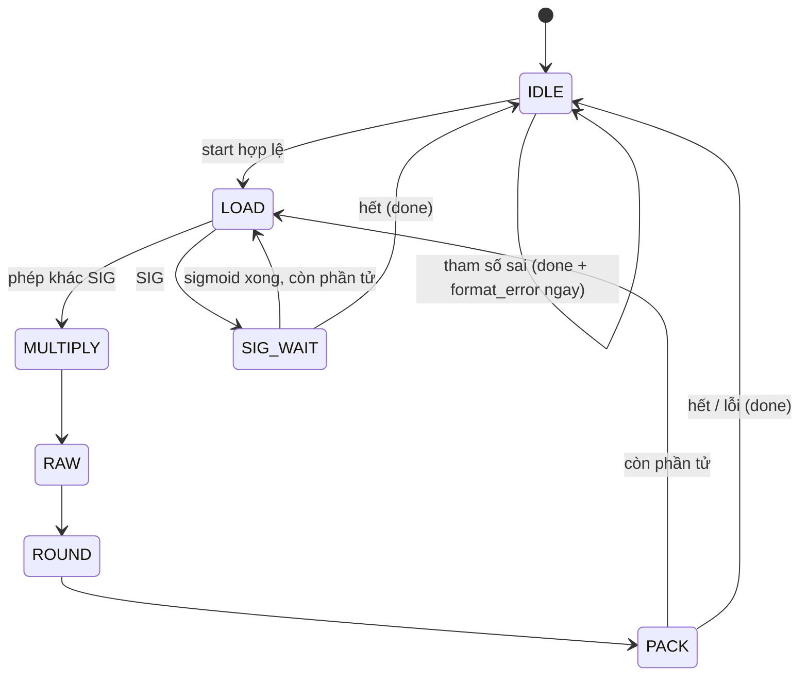

# `rowwise_op` — ALU theo phần tử cho một từ 16 × 16 bit

| Mục | Giá trị |
|---|---|
| File | `rowwise_op.sv` |
| Loại | Tuần tự, FSM 7 trạng thái, xử lý 2 phần tử mỗi lượt |
| Nhóm | Activation / vector — NPU legacy |
| Con | `logic_mul` × 2 (16 × 16 → 32 không dấu), `sigmoid` (`u_sig`) |
| Được dùng bởi | `rowwise_dispatch` (`u_alu`) |

## 0. Kiến thức cần biết trước

**Phép toán theo phần tử (element-wise).** Hai vector cùng độ dài a, b → c với `cᵢ = f(aᵢ, bᵢ)`. Ví dụ cộng: [1, 2] + [10, 20] = [11, 22].

**S16 và U16 (Q15).** S16 là số có dấu 16 bit với `frac_bits` bit phân số do descriptor chỉ định. U16 trong module này **luôn** là Q15 không dấu trong khoảng [0; 1,0]: 0x8000 = 32 768 = 1,0. Giá trị > 0x8000 bị coi là lỗi định dạng.

**Căn chỉnh dấu phẩy khi nhân.** Nhân hai số Q(fa) và Q(fb) cho tích Q(fa + fb). Muốn đưa về Q(fd) phải dịch phải `fa + fb − fd` bit (dịch trái nếu âm). Ví dụ 1,5 (Q8 = 384) × 2,0 (Q8 = 512) = 196 608 ở Q16 → muốn Q8 → dịch phải 8 → 768 = 3,0 ✓.

**Cổng hồi quy (recurrent gate).** Phép `REC` tính `h_mới = g · h_cũ + (1 − g) · ứng_viên` với g ∈ [0, 1]. Đây là phép cập nhật trạng thái kiểu "trộn" thường gặp trong mạng hồi quy không dùng attention: g gần 1 giữ trạng thái cũ, g gần 0 lấy giá trị mới.

Xem thêm [../00_kien_thuc_nen.md](../00_kien_thuc_nen.md) (mục 3 fixed-point/RNE/bão hòa), [sigmoid.md](sigmoid.md), [logic_mul.md](logic_mul.md).

## 1. Tổng quan

Nhận 3 từ 256 bit (`a_word`, `b_word`, `c_word`, mỗi từ 16 phần tử 16 bit) và số phần tử hợp lệ `valid_elems` (1…16). Xử lý từng cặp phần tử và trả về `result_word`.

| `select` | Tên | Công thức | Dịch phải |
|---|---|---|---|
| 1 | ADD | a + b | fa − fd |
| 2 | SUB | a − b | fa − fd |
| 3 | MUL | a · b | fa + fb − fd |
| 6 | SIG | sigmoid(a) → U16 Q15 | (qua `sigmoid`, mỗi lần 1 phần tử) |
| 11 (0xB) | REC | c · g + a · (0x8000 − g), g = b | 15 (mỗi lần 1 phần tử) |
| 12 (0xC) | RELU | max(a, 0) | fa − fd |

Kết quả được làm tròn (`scale_shift64`, RNE khi dịch phải) rồi bão hòa: đích S16 → [−32 768; 32 767]; đích U16 → [0; 0x8000]. Bị kẹp → `overflow`.

## 2. Cổng

| Cổng | Hướng | Rộng | Ý nghĩa |
|---|---|---|---|
| `start` | in | 1 | Bắt đầu (khi không bận) |
| `select` | in | 4 | Mã phép toán |
| `a_word`, `b_word`, `c_word` | in | 256 | Nguồn a, b và trạng thái cũ (chỉ REC dùng c) |
| `a/b/dst_frac_bits` | in | 5 | Số bit phân số |
| `valid_elems` | in | 5 | Số phần tử hợp lệ trong từ |
| `a/b/dst_unsigned` | in | 1 | Định dạng U16 |
| `result_word` | out | 256 | Kết quả |
| `busy`, `done`, `overflow`, `format_error` | out | 1 | Trạng thái |

## 3. Sơ đồ khối

```mermaid
flowchart LR
    classDef ctrl fill:#f8cecc,stroke:#b85450,color:#000
    classDef mac fill:#b1ddf0,stroke:#10739e,color:#000
    classDef act fill:#dae8fc,stroke:#6c8ebf,color:#000
    classDef reg fill:#e1d5e7,stroke:#9673a6,color:#000
    IN["a, b, c (chốt khi start)"]:::reg --> LD["LOAD: chọn 2 làn<br/>|a|, |b|, dấu tích"]:::act
    LD --> MQ["magnitude_a_q, magnitude_b_q"]:::reg
    MQ --> MUL["2 × logic_mul 16 × 16"]:::mac
    MUL --> PQ["magnitude_product_q<br/>gắn lại dấu"]:::reg
    LD --> RAW["RAW: add / sub / relu /<br/>tích / tổng 2 tích (REC)"]:::act
    PQ --> RAW
    RAW --> SC["ROUND: scale_shift64(·, shift)"]:::act
    SC --> SAT["PACK: bão hòa S16 / U16"]:::act
    SAT --> RB["result_buffer_q"]:::reg
    LD -->|"SIG"| SIG["sigmoid"]:::act
    SIG --> RB
    RB --> OUT["result_word"]
    FSM["FSM"]:::ctrl -.-> LD
```

## 4. Hoạt động chi tiết

### 4.1 Nhân có dấu bằng bộ nhân không dấu

Hai `logic_mul` là bộ nhân **không dấu**. Ở `LOAD`, module lấy trị tuyệt đối của hai toán hạng và nhớ `dấu = dấu_a XOR dấu_b`. Sau khi nhân, tích được đổi dấu lại nếu cần. Ví dụ (−3) · 5: |−3| · |5| = 15, dấu âm → −15.

### 4.2 Chu trình 5 cạnh cho 2 phần tử

`LOAD` (chọn làn, kiểm tra U16 > 0x8000) → `MULTIPLY` (chốt tích) → `RAW` (chọn kết quả thô 33 bit) → `ROUND` (dịch + RNE) → `PACK` (bão hòa, ghi vào bộ đệm). Mỗi bước một thanh ghi riêng để đường tổ hợp ngắn.

### 4.3 REC dùng cả hai bộ nhân cho một phần tử

- Bộ nhân 0: `h_cũ` (từ `c_word`) × `g`.
- Bộ nhân 1: `ứng_viên` (từ `a_word`) × `(0x8000 − g)`.
- `RAW`: cộng hai tích; `ROUND`: dịch phải 15 (vì g là Q15).

Ví dụ g = 0x6000 (0,75), h_cũ = 400, ứng viên = 800: 400 · 24 576 + 800 · 8 192 = 16 384 000 → >> 15 = 500 = 0,75 · 400 + 0,25 · 800 ✓.

### 4.4 SIG

Mỗi phần tử: chốt `sig_x_q` ở `LOAD`, khởi động `sigmoid` với `frac_bits = a_frac_bits`, chờ `sig_done`, ghi `y_raw` (U16 Q15) thẳng vào bộ đệm, không qua làm tròn.

### 4.5 Lỗi

Khi `start`: `valid_elems` = 0 hoặc > 16, `frac_bits` > 24, hoặc `select` không thuộc 6 mã trên → `done` và `format_error` ngay, không chạy. Trong lúc chạy: toán hạng U16 > 0x8000 (trừ RELU), hoặc g > 0x8000 ở REC → `format_error`, dừng sớm.

### 4.6 Ví dụ ADD

a = [1,5; −0,25] ở Q8 = [384, −64], b = [0,75; 0,5] ở Q8 = [192, 128], đích Q4. Shift = 8 − 4 = 4. Tổng = [576, 64] → >> 4 = [36, 4] = [2,25; 0,25] ở Q4 ✓.
