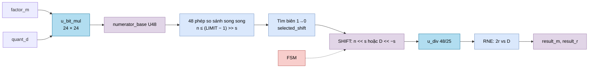
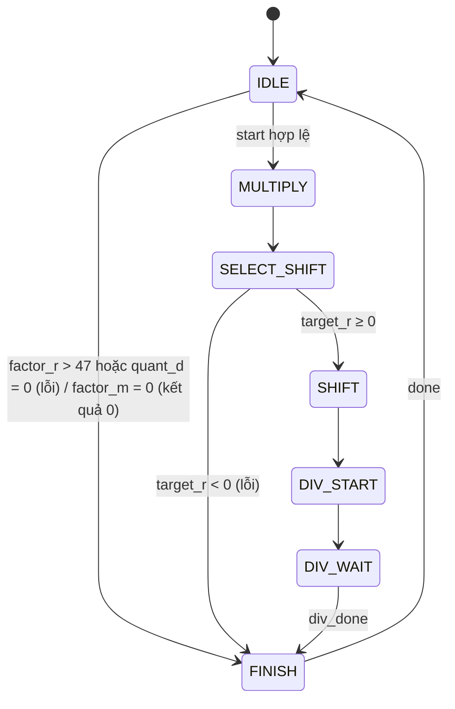

# `scale_compose` — Ghép hệ số tỉ lệ của ma trận với hệ số lượng tử hóa lúc chạy

| Mục | Giá trị |
|---|---|
| File | `scale_compose.sv` |
| Loại | Tuần tự, FSM 7 trạng thái |
| Nhóm | Điều khiển số học — NPU legacy |
| Con | `logic_mul` (`u_bit_mul`, 24 × 24 → 48 không dấu), `div` (`u_div`, 48/25) |
| Được dùng bởi | `matmulfree` (`u_compose`) |

## 0. Kiến thức cần biết trước

**Vì sao cần ghép hệ số?** Lệnh `NORM` (xem [norm.md](norm.md)) biến vector z thành int8 q bằng công thức `q ≈ 127 · z / d`, trong đó `d = quant_d` là giá trị tuyệt đối lớn nhất của z (ở Q16). Muốn lấy lại giá trị thật phải nhân ngược: `z ≈ q · d / (127 · 2¹⁶)`. Hệ số này chỉ biết **lúc chạy** (phụ thuộc dữ liệu).

Ma trận có sẵn hệ số `factor = m · 2⁻ʳ` (nạp từ host). Kết quả `W · q` cần nhân với **tích hai hệ số**:

```
C = factor_m · quant_d / (127 · 65536 · 2^factor_r)
```

Module này tính C và biểu diễn lại dưới dạng `result_m · 2^(−result_r)` để [ternary_mul](ternary_mul.md) dùng như hệ số bình thường.

**Chọn r để giữ độ chính xác.** Cùng một số thực có nhiều cách viết m · 2⁻ʳ. Ví dụ 0,75 = 3/4 = 12/16 = 12 582 912/2²⁴. m càng lớn (nhưng vẫn vừa 24 bit) thì sai số làm tròn càng nhỏ. Module chọn **r lớn nhất (≤ 47) mà m sau khi làm tròn vẫn vừa U24**.

Xem thêm [../00_kien_thuc_nen.md](../00_kien_thuc_nen.md) (mục 3 fixed-point, RNE), [div.md](div.md), [logic_mul.md](logic_mul.md).

## 1. Tổng quan

```
n = factor_m · quant_d              (U48)
chọn s lớn nhất để RNE(n · 2^s / D) < 2^24,  D = 127 · 65536 = 0x7F0000
result_r = factor_r + s   (kẹp ≤ 47)
result_m = RNE(n · 2^s / D)
```

Nếu s âm (n quá lớn) thì thay vì dịch n sang phải, mẫu D được dịch sang trái.

## 2. Cổng

| Cổng | Hướng | Rộng | Ý nghĩa |
|---|---|---|---|
| `start` | in | 1 | Bắt đầu |
| `factor_m`, `factor_r` | in | 24, 6 | Hệ số của ma trận |
| `quant_d` | in | 24 | Hệ số lượng tử hóa từ NORM |
| `busy`, `done` | out | 1 | Bận / xung xong |
| `format_error` | out | 1 | Không biểu diễn được |
| `result_m`, `result_r` | out | 24, 6 | Hệ số đã ghép |

## 3. Sơ đồ khối





## 4. Hoạt động chi tiết

### 4.1 Tìm số dịch không cần vòng lặp

`RNE(n / D)` vừa U24 khi `n < (2²⁴ − ½) · D`. Hằng `COEFFICIENT_LIMIT = 0x7EFF_FFC0_8000` chính là `(2²⁴ − ½) · 0x7F0000`.

Với mỗi s = 0…47, một bộ so sánh kiểm tra `n ≤ (LIMIT − 1) >> s` (tương đương `n · 2^s < LIMIT`). Vì n · 2^s tăng theo s, vector kết quả có dạng `111…1000…0`. Vị trí bit 1 cuối cùng là s lớn nhất. Logic `fit_encoded` tìm biên này bằng một chuỗi OR, không có vòng lặp chạy theo thời gian.

Nếu ngay cả s = 0 cũng không vừa: thử s = −1 (`n < 2 · LIMIT`), nếu không được nữa thì s = −2. Trường hợp s âm: chia cho `D << |s|` thay vì dịch n.

### 4.2 Kẹp r và kiểm tra

- `target_r = factor_r + s`. Âm → `format_error` (hệ số quá lớn, không biểu diễn được).
- `target_r > 47` → dùng r = 47 và `s = 47 − factor_r` (m sẽ nhỏ hơn mức tối đa, mất chút độ chính xác).
- Sau khi chia: thương làm tròn bằng 0, chia cho 0 hoặc vượt `0xFFFFFF` → `format_error`.

### 4.3 Ví dụ

`factor = 1,0` (m = 1, r = 0), `quant_d = 104 858` (≈ 1,6 ở Q16, lấy từ ví dụ trong [norm.md](norm.md)).

- C thật = 104 858 / 8 323 072 ≈ 0,0125984733.
- n = 104 858. s lớn nhất thỏa điều kiện là **30**.
- `result_m = RNE(104 858 · 2³⁰ / 8 323 072) = 13 527 508` (< 2²⁴ = 16 777 216 ✓), `result_r = 30`.
- Kiểm tra: 13 527 508 / 2³⁰ ≈ 0,0125984736 — sai lệch ở chữ số thứ 10.
