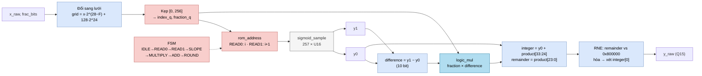
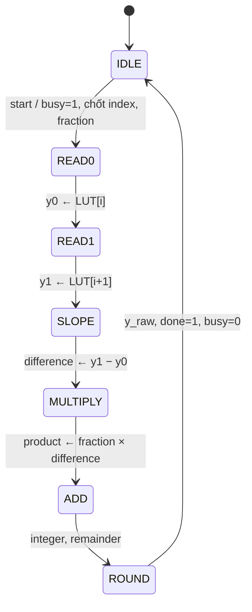

# `sigmoid` — Hàm sigmoid bằng bảng 257 điểm và nội suy tuyến tính

| Mục | Giá trị |
|---|---|
| File | `sigmoid.sv` (kèm `sigmoid_lut.svh`, `sigmoid_257.mem`) |
| Loại | Tuần tự, FSM 7 trạng thái |
| Nhóm | Hàm kích hoạt (Activation) |
| Con | `sigmoid_sample` (bảng tra), `logic_mul` (24 × 10 → 34 bit) |
| Được dùng bởi | `llm_soc` (`SIGMOID_LANES` instance trong `g_sigmoid`, mặc định 4), `rowwise_op` (NPU legacy) |

## 0. Kiến thức cần biết trước

**Hàm sigmoid.** σ(x) = 1 / (1 + e⁻ˣ). Hàm biến mọi số thực thành một số trong khoảng (0, 1): σ(0) = 0,5; x rất âm → gần 0; x rất dương → gần 1.

```
σ(x)
1.0 |                    ________
    |                 _/
0.5 |---------------*
    |           _/
0.0 |________/
    +----------------------------- x
   -8           0           +8
```

**Dùng ở đâu?** Trong `llm_soc`, khối MLP dùng **SiLU**: SiLU(x) = x · σ(x). Vì vậy cần σ(x) cho từng phần tử của vector "gate". NPU legacy có lệnh sigmoid riêng trong `rowwise_op`.

**Tại sao dùng bảng?** Tính e⁻ˣ và phép chia chính xác rất tốn phần cứng. Thay vào đó, σ được lấy mẫu sẵn tại 257 điểm cách đều trên đoạn [−8, 8] (bước 1/16), lưu trong bảng hằng. Giá trị giữa hai điểm được **nội suy tuyến tính**. Ngoài đoạn [−8, 8], σ đã gần như bằng 0 hoặc 1, nên kẹp về điểm đầu/cuối.

**Định dạng.**
- Đầu vào `x_raw` là S16 có `frac_bits` bit phân số (ví dụ `frac_bits = 12` → 1,0 = 4096).
- Đầu ra `y_raw` là U16 ở **Q15**: 1,0 = 32768. Ví dụ σ(0) = 0,5 → `0x4000`.

Các khái niệm chung (FSM, start/busy/done, fixed-point, RNE) được giải thích trong [../00_kien_thuc_nen.md](../00_kien_thuc_nen.md).

## 1. Tổng quan

Mỗi lần nhận `start`, module tính một giá trị σ(x) và trả kết quả sau 7 cạnh clock:

1. Đổi x sang **tọa độ lưới**: `chỉ số` (9 bit, 0…256) + `phần lẻ` (24 bit).
2. Đọc hai mẫu kề nhau `y0 = LUT[i]` và `y1 = LUT[i+1]` từ **một** bảng tra, ở hai chu kỳ liên tiếp.
3. Tính `y = y0 + phần_lẻ × (y1 − y0)`, làm tròn RNE theo **toàn bộ** giá trị nội suy.

## 2. Cổng

| Cổng | Hướng | Rộng | Ý nghĩa |
|---|---|---|---|
| `clk`, `rst_n` | in | 1 | Clock, reset bất đồng bộ mức thấp |
| `start` | in | 1 | Bắt đầu (chỉ nhận khi ở `IDLE`) |
| `x_raw` | in | S16 | Đầu vào fixed-point |
| `frac_bits` | in | 5 | Số bit phân số của `x_raw` (0…24) |
| `busy` | out | 1 | Đang tính |
| `done` | out | 1 | Xung 1 chu kỳ khi `y_raw` hợp lệ |
| `y_raw` | out | U16 | σ(x) ở Q15 |

`llm_soc` luôn dùng `frac_bits = 12`.

## 3. Sơ đồ khối



### FSM



## 4. Hoạt động chi tiết

### 4.1 Đổi sang tọa độ lưới

Giá trị thực của x là `x_raw / 2^F`. Lưới có bước 1/16 và điểm 128 ứng với x = 0:

```
grid / 2^24 = 16 · x + 128
```

RTL tính bằng dịch trái thay vì nhân: `grid = (x_raw <<< (28 − F)) + (128 << 24)`. Dịch `28 − F` bit cho `x_raw · 2^(28−F) = x · 2^28 = 16 · x · 2^24`. Biến `grid` rộng 45 bit, đủ cho mọi `F` từ 0 đến 24 mà không mất bit phân số nào.

- `grid ≤ 0` (x ≤ −8): `index = 0`, `fraction = 0`.
- `grid ≥ 256 · 2^24` (x ≥ 8): `index = 256`, `fraction = 0`.
- Còn lại: `index = grid[32:24]`, `fraction = grid[23:0]` (24 bit phân số).

Ví dụ với `F = 12`: x = 1,5 → `x_raw = 6144` → grid/2²⁴ = 16 × 1,5 + 128 = 152 → `index = 152`, `fraction = 0`.

### 4.2 Đọc bảng

Chỉ có **một** bảng tra (`u_lookup`). Địa chỉ được đổi theo trạng thái:

- `READ0`: địa chỉ `index_q` → chốt vào `y0`.
- `READ1`: địa chỉ `index_q + 1` (trừ khi `index_q = 256`, khi đó vẫn đọc 256) → chốt vào `y1`.

Bảng là một khối `case` hằng (`sigmoid_sample`), nên đọc là tổ hợp. Khi tổng hợp ASIC, nó trở thành logic hằng, không phải RAM có khởi tạo. File `sigmoid_257.mem` chứa cùng 257 giá trị, được sinh cùng lúc với bảng.

### 4.3 Nội suy và làm tròn

- `SLOPE`: `difference = y1 − y0`, cắt còn 10 bit không dấu. Hai mẫu kề nhau của bảng chênh nhau tối đa 512, nên 10 bit giữ chính xác độ dốc.
- `MULTIPLY`: `product = fraction × difference` (24 × 10 → 34 bit). `product` có 24 bit phân số.
- `ADD`: `integer = y0 + product[33:24]` (phần nguyên), `remainder = product[23:0]` (phần lẻ).
- `ROUND`: làm tròn RNE: cộng 1 nếu `remainder > 0x800000` (hơn một nửa), hoặc `remainder = 0x800000` và `integer` lẻ. Quy tắc hòa xét **toàn bộ** số nguyên đã nội suy, không chỉ phần cộng thêm.

Ví dụ: `y0 = 0x4000` (16384), `y1 = 0x4100` (16640), `fraction = 0x400000` (0,25) → `product = 64 · 2^24` → `y = 16384 + 64 = 16448` (≈ 0,502).

### 4.4 Thời gian và giao thức

- `start` ở chu kỳ t → `done = 1` ở cạnh thứ 7 sau đó; `busy` bằng 1 trong suốt thời gian này.
- `start` khi đang bận bị bỏ qua.
- Các thanh ghi dữ liệu (`fraction_q`, `y0`, `y1`, `difference_q`, `product_q`, `integer_q`, `remainder_q`) không có reset; chúng chỉ được dùng sau khi FSM đã ghi chúng.

### 4.5 Cách `llm_soc` dùng nhiều instance

`llm_soc` sinh `SIGMOID_LANES` bộ sigmoid. Ở trạng thái `SG_GROUP`, mỗi bộ chốt một phần tử khác nhau của vector 32 phần tử (`sigmoid_inputs_q[lane_q + sig_lane]`). Một xung `S_SIG` khởi động tất cả cùng lúc. Với 4 làn, 32 phần tử cần 8 lượt.
