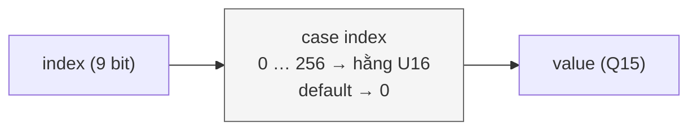

# `sigmoid_sample` — Bảng hằng 257 mẫu của σ(x)

| Mục | Giá trị |
|---|---|
| File | `sigmoid_lut.svh` (được `sigmoid.sv` `include`) |
| Loại | Tổ hợp thuần — bảng `case` hằng (ROM) |
| Nhóm | Hàm kích hoạt — bảng tra |
| Con | — |
| Được dùng bởi | `sigmoid` (instance `u_lookup`) |

## 0. Kiến thức cần biết trước

**ROM bằng `case`.** Một bảng giá trị cố định có thể viết thành câu lệnh `case`: mỗi địa chỉ trả một hằng. Công cụ tổng hợp biến nó thành mạch logic tổ hợp (hoặc ROM trên FPGA). Kết quả có **ngay trong chu kỳ**, không có độ trễ như SRAM.

**Q15.** Số không dấu 16 bit với 15 bit phân số: giá trị thực = số nguyên / 32768. Ví dụ `0x4000` = 16384 / 32768 = 0,5.

Xem thêm phần LUT và nội suy trong [../00_kien_thuc_nen.md](../00_kien_thuc_nen.md), mục 4.3, và cách dùng bảng trong [sigmoid.md](sigmoid.md).

## 1. Tổng quan

Bảng lưu σ(x) tại 257 điểm `x = (i − 128) / 16`, với `i = 0…256` (tức x từ −8 đến +8, bước 0,0625), ở định dạng U16 Q15.

| `index` | x | σ(x) | Giá trị trong bảng |
|---|---|---|---|
| 0 | −8 | ≈ 0,000335 | `0x000b` (11) |
| 128 | 0 | 0,5 | `0x4000` (16384) |
| 255 | 7,9375 | ≈ 0,99964 | `0x7ff4` |
| 256 | 8 | ≈ 0,99966 | `0x7ff5` |

Địa chỉ ngoài 0…256 trả `0`, nhưng `sigmoid` luôn kẹp địa chỉ trong khoảng hợp lệ.

## 2. Cổng

| Cổng | Hướng | Rộng | Ý nghĩa |
|---|---|---|---|
| `index` | in | 9 | Chỉ số mẫu 0…256 |
| `value` | out | U16 | σ ở Q15 |

## 3. Sơ đồ khối

## 4. Hoạt động chi tiết

- Khối `always_comb` chứa 257 nhánh `case` và một nhánh `default`.
- File được bảo vệ bằng `` `ifndef SIGMOID_SAMPLE_SVH `` để không bị định nghĩa hai lần khi nhiều file cùng `include`.
- `sigmoid_257.mem` chứa đúng 257 giá trị này dưới dạng hex, một dòng mỗi mẫu, sinh cùng lúc với bảng.
- Hai mẫu kề nhau chênh nhau tối đa 512 (độ dốc lớn nhất ở quanh x = 0). `sigmoid` dựa vào giới hạn này để chỉ dùng 10 bit cho hiệu `y1 − y0`.
