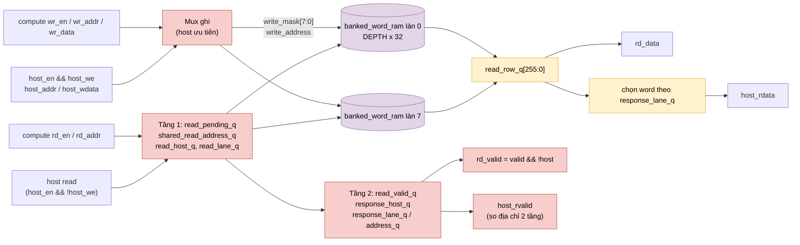
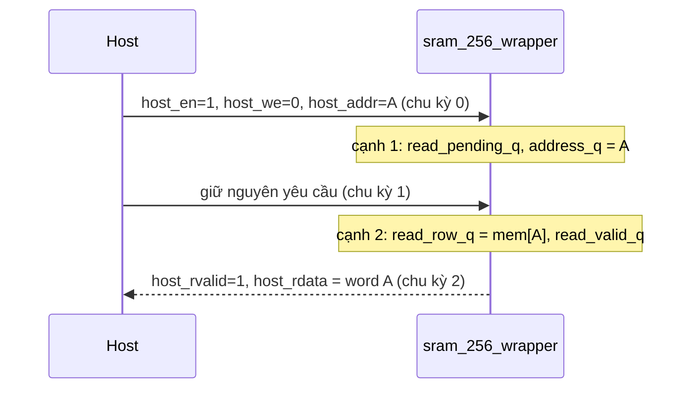

# `sram_256_wrapper` — SRAM 256-bit có cổng host 32-bit (NPU legacy)

| Mục | Giá trị |
|---|---|
| File | `sram_256_wrapper.sv` |
| Loại | Tuần tự, 1 port đọc dùng chung (compute/host), 1 port ghi có mask theo làn |
| Nhóm | Hạ tầng / bộ nhớ |
| Con | 8 × `banked_word_ram` (WIDTH 32, ROWS = DEPTH) |
| Được dùng bởi | `mem_mapping` (`ADDR_W = 10`), `register` (`ADDR_W = 8`) |

## 0. Kiến thức cần biết trước

**Hai "người dùng" chung một RAM.** RAM này phục vụ (1) lõi tính toán, đọc/ghi cả hàng 256 bit, và (2) host, đọc/ghi từng word 32 bit để nạp dữ liệu hoặc gỡ lỗi. RAM thật chỉ có 1 cổng đọc, nên cần đánh dấu mỗi yêu cầu đọc là của ai (bit "tag" `read_host_q`) để trả kết quả đúng người.

**Địa chỉ host = {hàng, làn}.** Hàng 256 bit có 8 word 32 bit. Host đánh địa chỉ theo word, nên địa chỉ host = hàng × 8 + làn: 3 bit thấp là làn, các bit còn lại là hàng.

**Giữ yêu cầu cho đến khi có phản hồi.** Host phải giữ nguyên yêu cầu đọc cho đến khi `host_rvalid = 1`. Mạch so địa chỉ ở mọi tầng; chỉ khi mọi tầng khớp với yêu cầu hiện tại thì mới báo hợp lệ. Nhờ vậy host không thể nhận nhầm dữ liệu của yêu cầu cũ.

Các khái niệm chung (thanh ghi, cạnh clock, pipeline, valid, fixed-point, RNE…) được giải thích trong [../00_kien_thuc_nen.md](../00_kien_thuc_nen.md).

## 1. Tổng quan

Đây là ranh giới SRAM của NPU legacy. Nếu thay bằng SRAM foundry thì chỉ phải thay module này.

- **Phía compute** thấy một RAM 256 bit/hàng.
- **Phía host** thấy các word 32 bit: `host_addr = {row, lane[2:0]}`.

Hàng 256 bit được tạo từ **8 bank 32 bit**. Nhờ vậy host ghi một word chỉ cần bật write-enable của đúng bank tương ứng.

Compute và host dùng chung một hợp đồng đọc: **yêu cầu ở chu kỳ n, dữ liệu hợp lệ sau 2 cạnh**. Bộ phân xử ở `matmulfree` bảo đảm hai phía không truy cập cùng lúc.

## 2. Tham số và cổng

| Tên | Hướng | Độ rộng | Ý nghĩa |
|---|---|---|---|
| `ADDR_W` / `DEPTH` | param | 8 / 256 | Số hàng 256 bit |
| `rd_en, rd_addr` | in | 1, `ADDR_W` | Đọc compute |
| `rd_data, rd_valid` | out | 256, 1 | Hàng đọc |
| `wr_en, wr_addr, wr_data` | in | 1, `ADDR_W`, 256 | Ghi cả hàng |
| `host_en, host_we` | in | 1 | Giao dịch host đang mở / là ghi |
| `host_addr` | in | `ADDR_W+3` | `{hàng, làn}` |
| `host_wdata` | in | 32 | Word ghi |
| `host_rdata, host_rvalid` | out | 32, 1 | Phản hồi host |

## 3. Sơ đồ khối

## 4. Hoạt động chi tiết

### 4.1 Đường ghi

Một port ghi duy nhất, chọn tổ hợp:

| Điều kiện | `write_address` | `write_data` | `write_mask` |
|---|---|---|---|
| Mặc định | `wr_addr` | `wr_data` | `{8{wr_en}}` (cả hàng) |
| `host_en && host_we` | `host_addr[ADDR_W+2:3]` | `{8{host_wdata}}` | `1 << host_addr[2:0]` (một làn) |

Write-enable của bank được AND với `rst_n`: trong lúc reset không ghi.

### 4.2 Đường đọc 2 cạnh

| Cạnh | Việc xảy ra |
|---|---|
| 1 | `read_pending_q <= rd_en \|\| host_read`. Chốt `shared_read_address_q`, `read_host_q` và `read_lane_q`; host được ưu tiên |
| 2 | 8 bank đọc `shared_read_address_q` vào `read_row_q`. `read_valid_q <= read_pending_q`. Thông tin chủ sở hữu (`response_host_q`, `response_lane_q`, `response_address_q`) dịch theo |

- `rd_valid = read_valid_q && !response_host_q`.
- `host_rdata = read_row_q[response_lane_q*32 +: 32]`.

### 4.3 Điều kiện `host_rvalid`

Host phải **giữ nguyên** yêu cầu đọc (`host_en`, `!host_we`, cùng `host_addr`) trong suốt hai tầng. `host_rvalid` chỉ bật khi:

- `read_valid_q && response_host_q`: tầng 2 là phản hồi host;
- `read_pending_q && read_host_q`: tầng 1 vẫn là yêu cầu host;
- `{shared_read_address_q, read_lane_q} == host_addr` và `{response_address_q, response_lane_q} == host_addr`.

Một chu kỳ ghi hoặc rỗi xen giữa sẽ làm mất hiệu lực phản hồi cũ, kể cả khi địa chỉ không đổi. Host vì vậy không bao giờ nhận dữ liệu trước một phép ghi của chính nó.

### 4.4 Reset

Reset bất đồng bộ chỉ xóa các thanh ghi điều khiển của pipeline đọc. Nội dung bank và `read_row_q` **không** bị reset.
