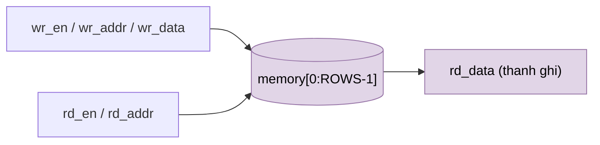

# `sram_word_tile` — Tile SRAM mô hình hóa (portable)

| Mục | Giá trị |
|---|---|
| File | `sram_word_tile.sv` |
| Loại | Tuần tự, mảng `logic` suy luận thành RAM |
| Nhóm | Hạ tầng / bộ nhớ |
| Được dùng bởi | `pipelined_word_ram.g_model` (llm_soc khi `USE_QUARTUS_MEMORY = 0`), `banked_word_ram` (NPU legacy) |

## 0. Kiến thức cần biết trước

**Mô hình RAM bằng mảng.** Trong SystemVerilog, khai báo `logic [W-1:0] memory [0:N-1]` là một mảng N word. Khi được đọc/ghi trong khối `always_ff`, công cụ tổng hợp tự **suy luận** (infer) thành RAM thật nếu có thể. Simulator thì xem nó như một mảng bình thường.

**Đọc đồng bộ.** `rd_data <= memory[rd_addr]` nằm trong `always_ff`, nên dữ liệu ra **sau 1 cạnh** clock, không ra ngay. Mọi RAM trong thiết kế đều hoạt động như vậy.

**"Tile".** Một tile là một khối RAM nhỏ (≤ 1024 word). RAM lớn được ghép từ nhiều tile; xem mục 2.2 của tài liệu kiến thức nền.

Các khái niệm chung (thanh ghi, cạnh clock, pipeline, valid, fixed-point, RNE…) được giải thích trong [../00_kien_thuc_nen.md](../00_kien_thuc_nen.md).

## 1. Tổng quan

Tile RAM tối đa 1024 word (địa chỉ 10 bit), viết bằng SystemVerilog thuần, nên chạy được trên mọi simulator/synth. Nó là "mô hình SRAM" tương đương chức năng với `quartus_word_ram`: 1 port đọc đồng bộ, 1 port ghi, cùng clock.

## 2. Tham số và cổng

| Tên | Mặc định | Ý nghĩa |
|---|---|---|
| `WIDTH` | 32 | Độ rộng word |
| `ROWS` | 1024 | Số word (≤ 1024 vì địa chỉ 10 bit) |
| `rd_en`, `rd_addr[9:0]` | in | Đọc |
| `wr_en`, `wr_addr[9:0]`, `wr_data` | in | Ghi |
| `rd_data` | out (reg) | Dữ liệu đọc |

## 3. Sơ đồ và hành vi

- Một khối `always_ff`: `if (wr_en) memory[wr_addr] <= wr_data; if (rd_en) rd_data <= memory[rd_addr];`.
- Đọc mất **1 cạnh**. Theo ngữ nghĩa non-blocking, đọc và ghi cùng địa chỉ cùng chu kỳ trả **dữ liệu cũ**, giống `OLD_DATA` của `quartus_word_ram`.
- `rd_data` giữ giá trị khi `rd_en = 0`. Không có reset.
