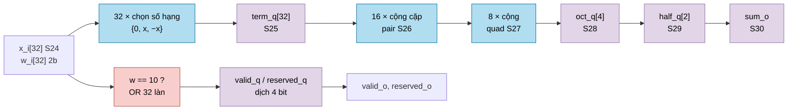
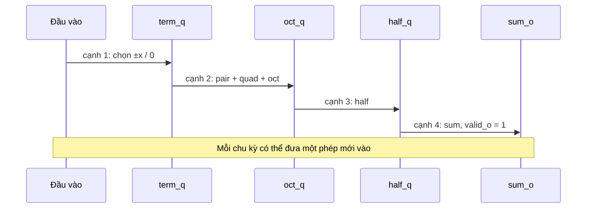

# `ternary_dot32` — Tích vô hướng 32 làn S24 × ternary, pipeline 4 tầng

| Mục | Giá trị |
|---|---|
| File | `ternary_dot32.sv` |
| Loại | Tuần tự, pipeline 4 tầng, throughput 1 phép/chu kỳ |
| Nhóm | MAC — tích vô hướng ternary (`llm_soc`) |
| Con | — |
| Được dùng bởi | `llm_linear_engine` (instance `u_dot`) |

## 0. Kiến thức cần biết trước

**Tích vô hướng (dot product).** Với hai vector x và w dài n: `x · w = x₀w₀ + x₁w₁ + … + xₙ₋₁wₙ₋₁`. Một phép nhân ma trận–vector chỉ là nhiều tích vô hướng: mỗi hàng của ma trận nhân với vector đầu vào.

**Trọng số ternary làm mất phép nhân.** Khi `wᵢ ∈ {−1, 0, +1}`: `xᵢ · wᵢ` chỉ là `xᵢ`, `−xᵢ` hoặc `0`. Bộ nhân được thay bằng một **mux 3 đầu vào** và một bộ đảo dấu.

| Mã 2 bit | Trọng số | Số hạng |
|---|---|---|
| `00` | 0 | 0 |
| `01` | +1 | x |
| `11` | −1 | −x |
| `10` | (dành riêng) | 0, **báo lỗi** |

**Pipeline.** Cộng 32 số theo cây cần 5 tầng cộng. Nếu làm hết trong một chu kỳ thì đường tín hiệu dài, clock phải chậm. Chèn thanh ghi giữa các tầng làm mỗi chu kỳ chỉ phải đi qua 1–2 tầng cộng. Kết quả ra muộn hơn (4 chu kỳ), nhưng mỗi chu kỳ vẫn **nhận một phép mới**.

**Độ rộng tăng theo cây.** S24 khi đổi dấu cần S25 (vì −(−2²³) = 2²³ không vừa S24). Mỗi tầng cộng thêm 1 bit: 25 → 26 → 27 → 28 → 29 → 30. Tổng 32 số S25 luôn vừa S30, nên **không bao giờ tràn**.

Xem thêm [../00_kien_thuc_nen.md](../00_kien_thuc_nen.md) (mục 1.4 pipeline, 4.4 ternary).

## 1. Tổng quan

Mỗi chu kỳ có `valid_i = 1`, module nhận 32 activation S24 (`x_i`) và 32 mã trọng số 2 bit (`w_i`), rồi 4 cạnh sau xuất tổng chính xác `sum_o` (S30) cùng `valid_o`. Nếu bất kỳ làn nào có mã `10`, `reserved_o` bật cùng lúc với `valid_o` để bộ điều khiển báo lỗi giao dịch. Mã dành riêng không bao giờ được âm thầm chấp nhận.

## 2. Cổng

| Cổng | Hướng | Rộng | Ý nghĩa |
|---|---|---|---|
| `clk`, `rst_n` | in | 1 | Clock, reset bất đồng bộ mức thấp |
| `valid_i` | in | 1 | Có dữ liệu vào ở chu kỳ này |
| `x_i[0:31]` | in | 32 × S24 | Activation |
| `w_i[0:31]` | in | 32 × 2 | Mã trọng số |
| `valid_o` | out | 1 | `sum_o` hợp lệ (trễ 4 cạnh so với `valid_i`) |
| `reserved_o` | out | 1 | Phép tương ứng có mã `10` |
| `sum_o` | out | S30 | Σ xᵢ·wᵢ chính xác |

## 3. Sơ đồ khối

### Thời gian

## 4. Hoạt động chi tiết

### 4.1 Tầng 1 — chọn số hạng (`term_q`)

Với mỗi làn, nếu `valid_i = 1`: `01` → `+x`, `11` → `−x`, `00` và `10` → `0`, mở rộng lên S25. Thanh ghi chỉ cập nhật khi `valid_i = 1` (clock enable), giảm công suất khi nghỉ.

### 4.2 Tầng 2 — cộng cặp, bốn, tám (`oct_q`)

`pair` (16 tổng S26) và `quad` (8 tổng S27) là **tổ hợp**; chỉ `oct_q` (4 tổng S28) có thanh ghi. Tầng này đi qua 3 bộ cộng nối tiếp, dài nhất trong pipeline.

### 4.3 Tầng 3 và 4

`half_q[0..1] = oct_q[0]+oct_q[1], oct_q[2]+oct_q[3]` (S29), rồi `sum_o = half_q[0] + half_q[1]` (S30). Các thanh ghi `oct_q`, `half_q`, `sum_o` cập nhật mọi chu kỳ (không có enable); dữ liệu chỉ có nghĩa khi `valid_o = 1`.

### 4.4 Cờ hợp lệ và lỗi

`valid_q` và `reserved_q` là hai thanh ghi dịch 4 bit có reset:

- `valid_q ← {valid_q[2:0], valid_i}`
- `reserved_q ← {reserved_q[2:0], valid_i && (bất kỳ làn nào có mã 10)}`

`valid_o = valid_q[3]`, `reserved_o = valid_q[3] && reserved_q[3]`. Cờ lỗi vì vậy đi cùng đúng phép tính đã gây ra nó.

### 4.5 Ví dụ

x = [1,0; 2,0; −0,5; 0; …] (Q16: 65536, 131072, −32768, …), w = [+1, −1, −1, 0, …]:

`sum = 65536 − 131072 + 32768 = −32768` → −0,5 ở Q16.
