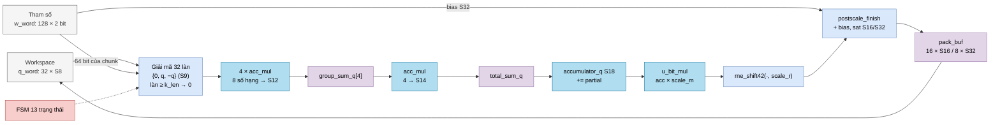

# `ternary_mul` — Lệnh nhân ma trận ternary × vector int8 của NPU legacy

| Mục | Giá trị |
|---|---|
| File | `ternary_mul.sv` |
| Loại | Tuần tự, FSM 13 trạng thái |
| Nhóm | MAC — NPU legacy `matmulfree` |
| Con | `acc_mul` × 5 (4 nhóm 8 số hạng + 1 tổng 4 nhóm), `logic_mul` (`u_bit_mul`, 18 × 24 → 42), `postscale_finish` (`u_scale`) |
| Được dùng bởi | `matmulfree` (đơn vị thực thi lệnh nhân ma trận) |

## 0. Kiến thức cần biết trước

**Descriptor (bộ mô tả).** Thay vì truyền mọi thông số qua lệnh, NPU legacy lưu chúng trong các **descriptor**:
- `ws_desc_t` (32 bit) mô tả một tensor trong bộ nhớ làm việc (workspace): từ bắt đầu `base_word`, số phần tử `length`, định dạng `fmt` (S8/S16/U16/S32), số bit phân số.
- `mat_desc_t` (96 bit) mô tả một ma trận: vị trí trọng số `weight_base`, vị trí bias `bias_base`, số cột `k_len`, số hàng `n_rows`, hệ số tỉ lệ `scale_m` (U24) và số bit dịch `scale_r`, cờ `output_s32`, các bit `reserved` (bit 1 = không có bias).

**Hệ số tỉ lệ dạng m · 2⁻ʳ.** Kết quả nguyên `acc` cần nhân một số thực s. Phần cứng biểu diễn `s ≈ m / 2ʳ` (m nguyên 24 bit) rồi tính `round(acc · m / 2ʳ)`. Ví dụ s = 0,75 → m = 3, r = 2: acc = 10 → 10·3 = 30 → 30/4 = 7,5 → RNE → 8.

**Hai bộ nhớ.** Workspace (`WORK_DEPTH` = 256 từ × 256 bit) chứa vector vào/ra; bộ nhớ tham số (`PARAM_DEPTH` = 1024 từ) chứa trọng số và bias.

Xem thêm [../00_kien_thuc_nen.md](../00_kien_thuc_nen.md) (mục 3 fixed-point, RNE, bão hòa; 4.4 ternary), [npu_pkg.md](npu_pkg.md), [acc_mul.md](acc_mul.md), [postscale_finish.md](postscale_finish.md).

## 1. Tổng quan

Khi `start`, module tính `y = sat(round(W · q · m / 2ʳ) + bias)` cho mọi hàng của ma trận:

- **Đầu vào** `q`: vector int8 (S8) dài `k_len` (1…512), 32 phần tử mỗi từ workspace.
- **Trọng số**: 2 bit mỗi phần tử, 128 phần tử mỗi từ tham số → mỗi hàng chiếm `⌈k_len / 128⌉` từ (1…4), hàng mới luôn bắt đầu ở đầu một từ.
- **Đầu ra**: S16 (16 giá trị/từ) hoặc S32 (8 giá trị/từ), gom đủ một từ rồi ghi.

Mỗi chunk 32 phần tử đi qua: đọc → giải mã ±q/0 → cộng 4 nhóm 8 → cộng 4 nhóm → cộng dồn. Hết hàng: đọc bias → nhân tỉ lệ → làm tròn → cộng bias, bão hòa → gom.

## 2. Cổng

| Cổng | Hướng | Rộng | Ý nghĩa |
|---|---|---|---|
| `start` | in | 1 | Bắt đầu |
| `q_desc`, `out_desc` | in | 32 | Descriptor vector vào / ra |
| `mat_desc` | in | 96 | Descriptor ma trận |
| `ws_rd_en/addr/data/valid` | — | 1/8/256/1 | Đọc workspace |
| `ws_wr_en/addr/data` | out | 1/8/256 | Ghi workspace |
| `param_rd_en/addr/data/valid` | — | 1/10/256/1 | Đọc bộ nhớ tham số |
| `busy`, `done` | out | 1 | Bận / xung xong |
| `overflow` | out | 1 | Có ít nhất một kết quả bị bão hòa |
| `format_error` | out | 1 | Descriptor sai hoặc gặp mã trọng số `10` |

## 3. Sơ đồ khối



### FSM

```mermaid
stateDiagram-v2
    [*] --> IDLE
    IDLE --> REQ_CHUNK : start, descriptor hợp lệ
    IDLE --> FINISH : descriptor sai / format_error
    REQ_CHUNK --> WAIT_CHUNK : đọc q (và w nếu chunk mod 4 = 0)
    WAIT_CHUNK --> REDUCE_GROUPS : có đủ q và w
    REDUCE_GROUPS --> REDUCE_TOTAL
    REDUCE_TOTAL --> ACCUM
    ACCUM --> REQ_CHUNK : còn chunk
    ACCUM --> REQ_BIAS : hết hàng, có bias
    ACCUM --> SCALE_PRODUCT : hết hàng, không bias
    ACCUM --> FINISH : mã 10
    REQ_BIAS --> WAIT_BIAS
    WAIT_BIAS --> SCALE_PRODUCT
    SCALE_PRODUCT --> SCALE_ROUND
    SCALE_ROUND --> SCALE
    SCALE --> REQ_CHUNK : hàng kế, từ chưa đầy
    SCALE --> WRITE : từ đầy hoặc hàng cuối
    WRITE --> REQ_CHUNK : còn hàng
    WRITE --> FINISH : hết hàng
    FINISH --> IDLE : done
```

## 4. Hoạt động chi tiết

### 4.1 Kiểm tra descriptor (trạng thái `IDLE`)

`format_error` và nhảy thẳng `FINISH` nếu bất kỳ điều kiện nào sai:
- `q_desc`, `out_desc` không hợp lệ (`ws_valid`: độ dài 1…512, ≤ 24 bit phân số, nằm trong workspace).
- `q_desc.fmt ≠ S8`, hoặc `out_desc.fmt` không khớp `output_s32` (S32 hay S16).
- `k_len` = 0 hoặc > 512; `n_rows` = 0; `q.length ≠ k_len`; `out.length ≠ n_rows`; `scale_r > 47`.
- Vùng trọng số hoặc vùng bias (nếu có) vượt 1024 từ.
- Vector vào và ra chồng lên nhau trong workspace.

**Tính kích thước không dùng nhân.** `weight_words_per_row = ⌈k_len/128⌉` (dịch phải 7). `weight_extent = n_rows × stride` được làm bằng dịch và cộng: ×2 = dịch 1, ×3 = dịch 1 + cộng, ×4 = dịch 2. Khi chuyển hàng, `weight_row_addr_q` cộng thêm stride thay vì nhân `row × stride`.

### 4.2 Đọc một chunk

- `REQ_CHUNK`: đọc workspace tại `q.base_word + chunk`. Chỉ đọc từ trọng số mới khi `chunk mod 4 = 0` (một từ trọng số đủ cho 4 chunk), tại `weight_row_addr + chunk/4`; các chunk khác dùng lại `w_word` (`got_w` đặt sẵn 1).
- `WAIT_CHUNK`: chờ cả hai bộ nhớ trả dữ liệu (có thể về khác chu kỳ).

### 4.3 Giải mã và cộng

Với làn `l`: giá trị `q_word[8l +: 8]` (S8), mã `w_word[64·(chunk mod 4) + 2l +: 2]`. Làn chỉ "hoạt động" khi `32·chunk + l < k_len` — phần thừa của chunk cuối bị bỏ qua. Mã `01` → `+q`, `11` → `−q`, còn lại → 0 (S9). Mã `10` ở làn hoạt động → `reserved_lane`.

- `REDUCE_GROUPS`: 4 cây `acc_mul` (8 số S9 → S12) được chốt vào `group_sum_q`, cùng cờ `reserved_weight_q`.
- `REDUCE_TOTAL`: `acc_mul` (4 số S12 → S14) → `total_sum_q`.
- `ACCUM`: `accumulator_q += total_sum` (S18). Nếu cờ lỗi bật → `format_error`, `FINISH`.

Ví dụ một chunk có 3 làn hoạt động: q = [5, −2, 7], w = [+1, −1, 0] → 5 + 2 + 0 = 7.

**Vì sao S18 là đủ?** Tối đa 512 số hạng, mỗi số |·| ≤ 128 → |acc| ≤ 65 536 → vừa S18.

### 4.4 Hậu xử lý một hàng

1. `REQ_BIAS` / `WAIT_BIAS` (nếu `reserved[1] = 0`): bias S32 ở `bias_base + row/8`, ô thứ `row mod 8`. Nếu không có bias: `bias = 0`.
2. `SCALE_PRODUCT`: `scale_product_q = acc × scale_m` (S42).
3. `SCALE_ROUND`: `scale_rounded_q = rne_shift42(product, scale_r)`.
4. `SCALE`: `postscale_finish` cộng bias, bão hòa về S32 hoặc S16, báo `overflow` (cộng dồn OR qua các hàng). Kết quả vào `pack_buf` ở vị trí `pack_count`.

### 4.5 Ghi ra

Khi `pack_buf` đầy (16 giá trị S16 hoặc 8 giá trị S32) hoặc là hàng cuối, `WRITE` ghi tại `out.base_word + out_word`, rồi xóa bộ đệm. Hết hàng → `FINISH` (`done = 1`, `busy = 0`).

### 4.6 Ví dụ trọn vẹn

`k_len = 40` (2 chunk, chunk 2 chỉ có 8 làn hoạt động), `n_rows = 3`, `scale_m = 3`, `scale_r = 2`, có bias = [1, 0, −1], ra S16.

Giả sử acc 3 hàng = [10, −6, 0] → × 3 = [30, −18, 0] → RNE / 4 = [8 (7,5 → 8), −4 (−4,5 → −4), 0] → + bias = [9, −4, −1]. Ba giá trị nằm trong một từ S16, được ghi ở `WRITE` sau hàng cuối.
