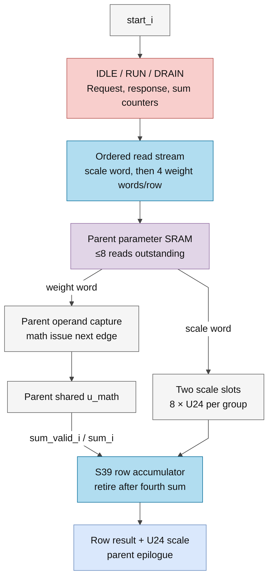

# llm_head_engine.sv

> **Category: GUIDE. Scope: CURRENT (may also have legacy callers).** RTL is authoritative; diagrams use the [shared visual style](../../diagrams/diagram_style.md).
[Documentation](../../README.md) → [Source guide](../full_graph.md) → [RTL index](README.md)

**Source:** [llm_head_engine.sv](<../../../Verilog%20Source%20code/llm_head_engine.sv>).

## At a glance

| Item | Description |
|---|---|
| Responsibility | Stream all 4,096 vocabulary rows in one pass. Each eight-row group reads its packed scale word, then four int8 weight words per row, with at most eight reads outstanding. Weight responses request parent operand capture and shared SIMD issue; four ordered sums form each S39 row result, which retires with its U24 scale. The parent owns RNE, noise, PRNG order and token selection. |
| Ordering | Responses and SIMD sums return in issue order. Two scale slots alternate by group; a group's scale response follows the previous group's 32 weight responses, so the slot it overwrites belongs to a group that has already retired. |
| Cancel / reset | `cancel_i` stops requests, captures and retirement, then `DRAIN` waits for every accepted read and SIMD sum before `busy_o` falls. Reset clears state and validity; scale and accumulator payloads are unreset. |

## Sơ đồ kiến trúc

